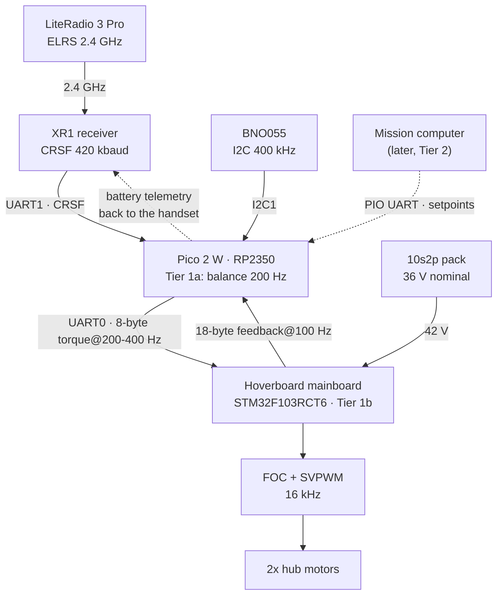
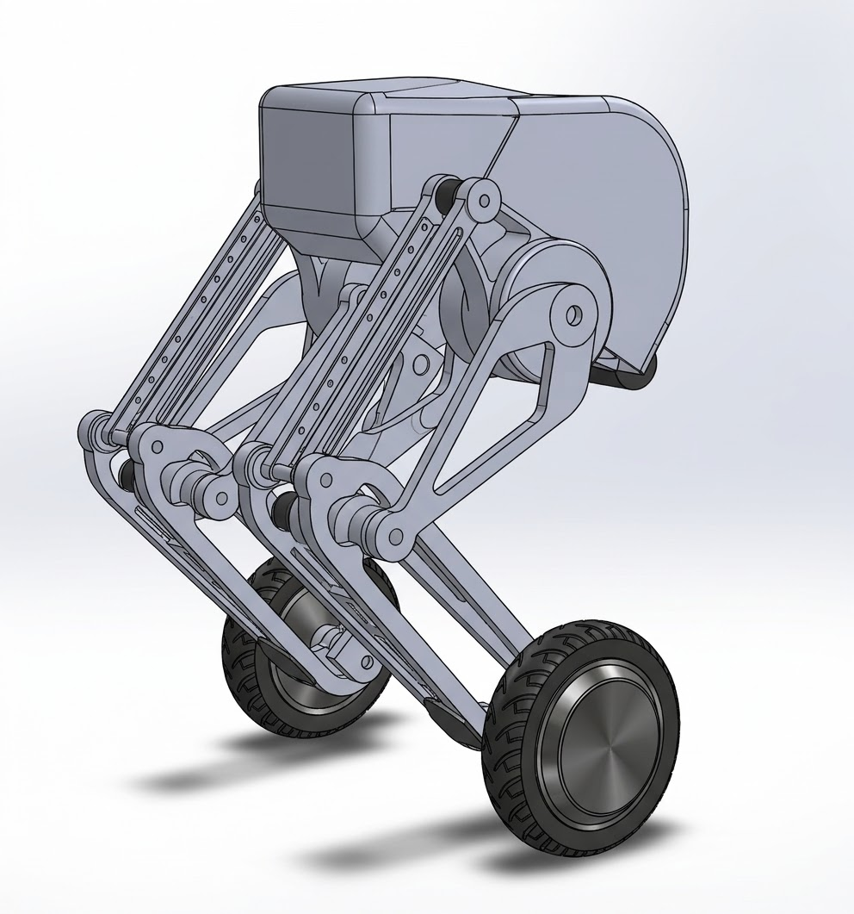

<div align="center">

# JBOT-Wheeled Biped

**A self-balancing wheeled robot built on a donor hoverboard, in Rust.**

Two stages: a two-wheel balancing platform first, then two hip actuators that let
the legs move the body independently.

[](https://www.rust-lang.org/)
[](docs/hardware.md)
[](docs/roadmap.md)
[](docs/)
[](docs/skills/rust_robotics_guidelines.md)

</div>

---

## Overview

**JBOT-Wheeled Biped** is a research-grade balancing robot. The wheeled platform
comes from a stock hoverboard: its mainboard, hub motors, battery, power button,
and charge port are reused as-is. The balancing controller is written from
scratch and runs on a **Raspberry Pi Pico 2 W**, while the hoverboard mainboard
keeps the power stage and the 16 kHz field-oriented current loop. Both boards are
real-time nodes, so the robot keeps standing even when the radio link or the
mission computer is lost.

The project is delivered in two stages.

| Stage | Hardware | Behaviour |
|---|---|---|
| **1. Two wheels** | Donor hoverboard mainboard, 2 hub motors, 10s battery, Pico 2 W, BNO055, XR1 receiver | Balance, drive forward and backward, turn, spin in place, variable speed, commanded from the radio |
| **2. Two hips** | Stage 1 plus two hip actuators and their drivers | The legs move the body independently: height, pitch offset, and roll via differential hip angle |

Stage 2 keeps the same wheel controller, the same radio link, and the same
balancing core. The long-term goal is a wheeled biped that stands and drives
itself and later accepts a mission computer for autonomous navigation.

---

## Hardware used from the hoverboard

| Donor part | Specification | Role |
|---|---|---|
| Mainboard | STM32F103RCT6, Cortex-M3 at 72 MHz, 256 KB flash, 48 KB RAM, 12 MOSFETs in two 3-phase bridges | FOC current loop, current limits, power latch, telemetry; torque actuator node |
| Hub motors | 2× direct-drive brushless, about 350 W each, 15 hall states, 6.5 in wheels (radius 0.0825 m) | Drive and speed feedback |
| Battery | 10s2p Li-ion, 36 V nominal, 42.0 V full, about 30 V cutoff, 4.4 A·h, ~158 W·h, integrated BMS | Energy |
| Power button | Soft latch held by the firmware (PA5) | Power on/off |
| Charge port | BMS charge input with a charge-detect line (PA12) | Charging and charge interlock |

Discarded: both sideboards (their own MCU, MPU6050-class IMU, battery LEDs, and
footpad sensors), the deck, and the plastic covers. The sideboards are UART
slaves that transmit on the same wires the Pico link and the hip link need.

Added to the robot:

| Part | Selection | Role |
|---|---|---|
| Real-time controller | **Raspberry Pi Pico 2 W** (RP2350, dual Cortex-M33 at 150 MHz, FPU, 520 KB SRAM, 4 MB flash) | Balance loop at 200 Hz, CRSF ingest, IMU, limits, state machine, telemetry, blackbox |
| Radio transmitter | **BetaFPV LiteRadio 3 Pro, ExpressLRS 2.4 GHz**, 8 channels | Operator command: arm, throttle, steering |
| Radio receiver | **RadioMaster XR1, ExpressLRS 2.4 GHz**, CRSF output, 420 kbaud | CRSF stream into the Pico's UART1 |
| IMU | **Bosch BNO055**, 9-DOF with onboard fusion, I2C | Tilt and tilt rate for the balance loop |
| DC-DC | 36–42 V to 5 V, 1.5 A, input rated for at least 60 V | Pico, receiver, and IMU supply |
| Protection | Main fuse and a hardware kill switch in the battery line | Real emergency stop |
| Stage 2 only | 2× hip actuators, model TBD, with drivers | Independent leg motion |

The receiver must be bound to the transmitter and both must run the same
ExpressLRS major version. The radio link is a command input, never a safety path.

---

## Control architecture



| Loop | Where | Rate |
|---|---|---|
| FOC current and SVPWM | Mainboard timer ISR | 16 kHz |
| Balance (pitch PD, speed, yaw) | Pico 2 W hardware timer | 200 Hz |
| Attitude | BNO055 fusion, gyro propagated on the Pico | 100 Hz / 200 Hz |
| Radio setpoints | CRSF over Pico UART1 | up to 250 Hz |
| Mission computer setpoints | Pico PIO UART frame | 50–100 Hz, optional |
| Torque command to the mainboard | Pico UART0, applied in the 5 ms FOC loop | 200–400 Hz |

The balance loop depends on neither external link. Losing the radio or the
mission computer means standing still, not falling. Only the radio can arm. The
mainboard zeroes torque on its own after 100 ms without a valid frame, so a Pico
hang does not leave a stale command applied.

Full details, pin maps, and the two-stage plan are in
[`docs/hardware.md`](docs/hardware.md) and
[`docs/architecture.md`](docs/architecture.md).

---

## Mechanical concept (stage 2)

Stage 1 is a plain two-wheel balancer: one hub motor per wheel, battery and
electronics low and centred between the wheels.

Stage 2 adds one hip actuator per leg. Each leg is a planar **1-DOF four-bar
linkage** — not a 2-DOF five-bar and not a serial two-link leg. The "knee" is a
rigid bend of the wheel fork, not an articulated joint. The **base is the
chassis link A–B**; the wheel is a single ground contact at **E**.

| Element | Type | Motor / function |
|---|---|---|
| A–B | Ground link | Base / chassis, fixed to the body |
| A | Revolute joint | Hip actuator, driven |
| B | Revolute pivot | Passive rocker |
| A–C | Upper crank | Driven by the hip actuator |
| B–D | Lower rocker | Passive |
| C–D–E | Wheel fork | One rigid coupler; E is the wheel axle |
| E | Wheel axle | Hub motor, driven |
| Spring / damper | Optional passive element | Between the base and the upper crank |

One hip angle moves the wheel along a fixed coupler curve; body height and
fore-aft offset are coupled and cannot be commanded independently. That is the
accepted trade for a stiff, simple, lightweight leg.

<p align="center">
  
</p>

> Concept sketch, not a dimensioned drawing. Link lengths and the actuator
> envelope come out of CAD after the stage 1 balance is proven.

---

## Key properties

- **Local balance loop** — the robot stands without the radio and without the
  mission computer. Loss of either link zeroes the setpoints, it does not cut
  motor torque.
- **Two MCU tiers** — the Pico 2 W owns behaviour, arming, and limits; the F103
  owns the current loop, the power stage, and a 100 ms command timeout that is
  independent of the Pico.
- **One commanding authority at a time** — the radio takes over as soon as a
  stick moves; the mission computer commands only inside a validity window.
- **Donor power stage** — the original MOSFET bridges, current shunts, hall
  inputs, and battery BMS are reused, with conservative limits until thermal
  behaviour is measured.
- **Staged risk** — the stock firmware is flashed first as a link and flashing
  test; the torque-node profile and the Pico controller replace it only after the
  hardware is proven.
- **Rust workspace with one-way dependencies** — shared types stay I/O-free;
  hardware, navigation, and the node compose them.

---

## Workspace layout

```text
jbot/
├── Cargo.toml                  # Host workspace definition and release profile
├── config/
│   └── robot.toml              # Typed robot configuration
├── crates/
│   ├── jbot_common/            # Shared messages, state types, configuration
│   ├── jbot_console/           # Native bench console for the Pico USB CDC link
│   ├── jbot_hardware/          # HAL: transports, sensors, actuators
│   ├── jbot_navigation/        # Costmaps, planners, navigation stack
│   └── jbot_node/              # High-level executable for the mission computer
├── firmware/
│   ├── README.md               # EFeru builds, flashing, Pico plan
│   ├── stm32f103/              # STM32F103 hoverboard mainboard firmware
│   │   ├── eferu/              # Upstream EFeru C (git-ignored)
│   │   ├── eferu-jbot.patch
│   │   ├── eferu-bench.patch
│   │   └── eferu-balance.patch
│   └── pico2w/                 # Pico 2 W Rust firmware (separate workspace)
└── docs/
    ├── specification.md        # System Requirements Specification (SRS-001)
    ├── architecture.md         # System architecture and safety concept
    ├── hardware.md             # Donor hardware, Pico pin map, interfaces
    ├── pico-bridge.md          # Pico 2 W firmware specification (FW-002)
    ├── bom.md                  # Component and assembly list
    ├── roadmap.md              # Phased delivery plan and gate criteria
    ├── system_requirements.md  # High-level requirements
    ├── agent_workflow.md       # Engineering workflow
    ├── tasks.md                # Task breakdown
    └── skills/                 # Rust robotics engineering guidelines
```

> **Dependency rule:** `jbot_common` stays free of I/O. Hardware and navigation
> crates may depend on it; the node wires the pieces together. Both embedded
> projects in `firmware/` are separate from the host workspace: the EFeru C tree
> builds with PlatformIO, and `pico-bridge` is its own Cargo workspace for
> `thumbv8m.main-none-eabihf`.

---

## Quick start

### Prerequisites

- [Rust toolchain](https://rustup.rs/) 1.75+ (edition 2021)
- A C linker (`cc` / `clang`) for the host build
- For the hoverboard: `pipx install platformio`, plus an ST-Link probe and a
  3.3 V USB-UART adapter
- For the Pico: `rustup target add thumbv8m.main-none-eabihf`, `probe-rs`, and
  either an SWD probe or the USB BOOTSEL path

### Build and test

```bash
git clone git@github.com:fobaty/jbot.git
cd jbot

cargo build --workspace
cargo run -p jbot_node
cargo test --workspace
```

### Hoverboard firmware

```bash
cd firmware/eferu
git apply ../eferu-bench.patch      # once, on the pinned upstream commit
pio run -e VARIANT_USART             # build
pio run -e VARIANT_USART -t upload   # flash, board powered from its battery

git apply ../eferu-balance.patch     # torque-node profile (TRQ_MODE, 100 ms)
pio run -e VARIANT_USART -t upload
```

Wiring, recovery from a read-protected chip, and the bench checklist are in
[`firmware/README.md`](firmware/README.md).

### Pico firmware

```bash
cd firmware/pico2w
cargo run --release                  # flash over SWD via probe-rs, RTT attached
```

The pin map, the task schedule, the link protocols, and the state machine are in
[`docs/pico-bridge.md`](docs/pico-bridge.md).

### Pico console

```bash
cargo run -p jbot_console -- --demo       # UI with synthetic telemetry
cargo run -p jbot_console                 # live BNO055 and telemetry
```

The native console shows the artificial horizon, compass, attitude, battery,
wheel, and control instruments, and drives the `speed`/`steer`/`trim`/`estop`
commands from one window. See
[`crates/jbot_console/README.md`](crates/jbot_console/README.md).

### Quality gates

Run before every merge:

```bash
cargo fmt --all -- --check
cargo check --workspace --all-targets
cargo test --workspace
cargo clippy --workspace --all-targets -- -D warnings
```

### Release build

```bash
cargo build --release -p jbot_node
```

The release profile enables LTO, a single codegen unit, and `panic = "abort"`
for predictable footprint and latency.

---

## Roadmap

| Stage | Focus | Gate |
|:-----:|-------|:----:|
| **1** | Hoverboard mainboard as a torque node, hub motors, battery, Pico 2 W, XR1 + LiteRadio, BNO055, two-wheel balancing | G1 |
| **2** | Two hip actuators and drivers, leg mechanism, independent body motion | G2 |
| **3** | Mission computer, telemetry, state estimation, HIL | G3 |
| **4** | SLAM, localization, navigation, autonomous runs | G4 |
| **5** | Camera/AI, manipulator, autonomous docking | G5 |

Detailed tasks, gate criteria, and the critical path live in
[`docs/roadmap.md`](docs/roadmap.md).

---

## Safety

This robot stores enough energy to injure people and damage property. The
hoverboard power stage has no hardware emergency stop and the power button is
only a firmware-held soft latch, so the safety concept is layered:

1. **Hardware plane** — fuse and a kill switch in the battery line. This is the
   only path that works when either firmware hangs.
2. **Real-time plane** — tilt cutoff, current limits, watchdog, and charge
   interlock enforced on the Pico within one balance period, with a 100 ms
   independent command timeout on the mainboard underneath it.
3. **Supervisor plane** — battery, temperature, latency, and fault monitoring on
   the mission computer, once it exists.

> Never disable a safety layer for convenience. Changes to firmware, transport,
> or control loops require a review against
> [`docs/skills/rust_robotics_guidelines.md`](docs/skills/rust_robotics_guidelines.md).

Two donor-specific hazards matter from day one:

- **Regenerative braking.** Leaning back charges the pack. A full pack can trip
  the BMS on overvoltage and spike the DC link; start runs at about 90 % charge.
- **Charge interlock.** The charge-detect line must inhibit arming and motor
  output while the charger is plugged in.

---

## Documentation

| Document | Contents |
|---|---|
| [`docs/specification.md`](docs/specification.md) | Requirements, priorities (P1/P2/P3), traceability |
| [`docs/architecture.md`](docs/architecture.md) | Compute tiers, interfaces, power, safety concept |
| [`docs/hardware.md`](docs/hardware.md) | Donor hardware, Pico pin map, radio link, IMU, interfaces |
| [`docs/pico-bridge.md`](docs/pico-bridge.md) | Pico firmware: pins, links, tasks, state machine, tests |
| [`docs/bom.md`](docs/bom.md) | Complete component and assembly list |
| [`docs/system_requirements.md`](docs/system_requirements.md) | Hardware and software requirements |
| [`docs/roadmap.md`](docs/roadmap.md) | Phases, gates, schedule, critical path |
| [`docs/tasks.md`](docs/tasks.md) | Granular task breakdown |
| [`docs/agent_workflow.md`](docs/agent_workflow.md) | Contribution and review workflow |
| [`crates/jbot_console/README.md`](crates/jbot_console/README.md) | Native Pico console: attitude, compass, drive controls |
| [`firmware/README.md`](firmware/README.md) | EFeru builds, flash, wiring, Pico plan |

---

## Contributing

1. Branch from `main` using a prefixed name: `feature/`, `fix/`, `refactor/`,
   `hotfix/`, or `chore/`.
2. Keep changes scoped and covered by tests.
3. Run the full quality gate suite above.
4. Write all code comments, commit messages, and documentation in **English**.
5. Open a pull request with context, test evidence, and safety impact.

---

## License

Released under the [MIT License](LICENSE). © 2026 Oleksii Shataliuk.

---

## Status

Stage 1 is in bench bring-up. The stock firmware builds and is ready to flash;
the torque-node profile and the Rust controller on the Pico 2 W follow once the
hardware chain is verified. Expect the API and the pin map to move until the G1
gate is passed.

---

<div align="center">
<sub>JBOT-Wheeled Biped · SRS-001 · Architecture v0.4 · Roadmap RB-001</sub>
</div>
