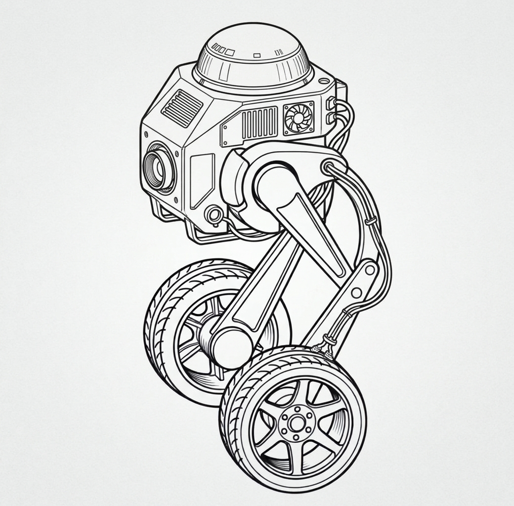
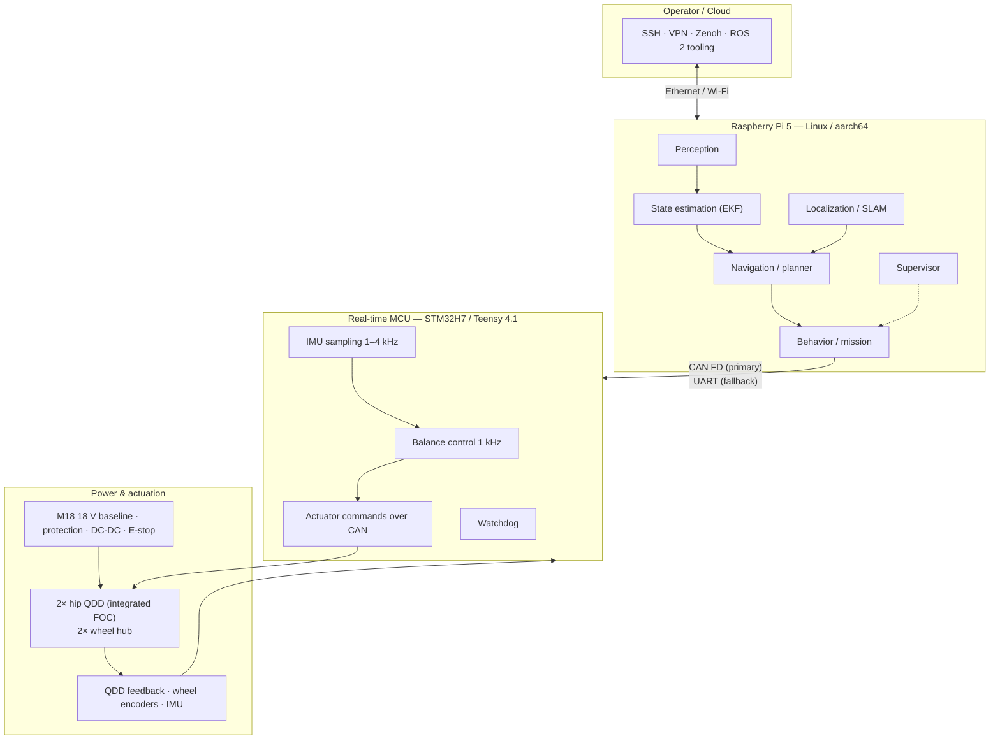

<div align="center">

# JBOT-WheeledBiped

**An autonomous wheeled-biped balancing robot built in Rust.**

Dynamically stable locomotion, real-time motor control, LiDAR SLAM, and autonomous navigation — from the first simulation model to a field-ready platform.

[](https://www.rust-lang.org/)
[](docs/architecture.md)
[](docs/roadmap.md)
[](docs/)
[](docs/skills/rust_robotics_guidelines.md)

</div>

---

## Overview

**JBOT-WheeledBiped** is a research-grade mobile robot that combines wheeled drive with two 1-DOF four-bar legs to balance dynamically on two wheels. The project covers the full engineering cycle: control theory and simulation, power electronics, embedded firmware, onboard autonomy, and system validation.

The design follows a strict split between a **hard real-time MCU** and a **Linux-class companion computer**. Balance and motor loops never depend on Linux scheduling; perception, mapping, planning, and networking live on the Raspberry Pi 5.

| | |
|---|---|
| **Balance loop** | 1 kHz on MCU, jitter < 50 µs |
| **Leg mechanism** | 1-DOF four-bar per leg, one wheel per leg |
| **Actuators** | 2× hip QDD + 2× wheel hub = 4 motors |
| **Hip actuator loop** | Integrated QDD FOC (vendor firmware) |
| **Command timeout → safe stop** | 100 ms |
| **State estimation** | 100–200 Hz EKF |
| **Autonomy** | LiDAR SLAM, costmaps, global/local planning |
| **Runtime** | 30–50 min on Milwaukee M18 XC5.0 |

---

## Mechanical Concept

The baseline is a two-wheeled balancing robot with **four motors**:

| Actuator | Qty | Location | Role |
|---|---:|---|---|
| Hip QDD | 2 | Body / chassis | Drives the upper crank of each four-bar leg |
| Wheel hub motor | 2 | Wheel axle | Drives one wheel per leg |
| **Total** | **4** | | |

Each leg is a planar **1-DOF four-bar linkage** — not a 2-DOF five-bar and not a serial two-link leg. The "knee" is a rigid bend of the wheel fork, not an articulated joint. The **base is the chassis link A–B**; the wheel is a single ground contact at **E**.

<p align="center">
  
</p>

*Mechanical concept: one 1-DOF four-bar leg and one hub-driven wheel per side.*

**Link and joint map**

| Element | Type | Motor / function |
|---|---|---|
| A–B | Ground link | **Base / chassis** — fixed to the body |
| A | Revolute joint | **Hip QDD** — driven |
| B | Revolute joint | Passive rocker pivot on the base |
| A–C | Upper crank | Driven by the hip QDD |
| B–D | Lower rocker | Passive |
| C–D–E | Wheel fork | One rigid coupler; E is the wheel axle |
| E | Wheel axle | **Hub motor** — driven |
| Spring / damper | Optional passive element | Between the base and the upper crank; compliance and impact relief |

**Base clarification:** the base is the chassis/ground link **A–B**. It connects the hip motor axis A and the passive rocker pivot B. The wheel fork **C–D–E** is the moving coupler and must not be confused with the base.

### Why this layout

- **Both hip motors sit in the body.** The leg carries no hip actuator; unsprung mass is limited to the wheel, fork, and links.
- **One wheel per leg.** Two ground contacts total, no dual-wheel scrub, and the 4-motor count stays fixed.
- **1 active leg DOF.** Height and fore-aft offset follow one coupler curve; the mechanism is stiff and simple, but those two quantities cannot be commanded independently.
- **3D balance allocation.** Pitch via wheel torque, yaw via differential wheel torque, height via the common hip angle, and roll via differential hip height.
- **Passive spring is optional.** It absorbs impacts and protects the QDD output bearing; the balance controller must include its compliance when fitted.

---

## Key Features

- **Deterministic real-time core** — 1 kHz balancing, integrated QDD actuator loops, hardware watchdog, and a fail-safe stop path enforced below the OS.
- **Four-bar legs with four motors** — two hip QDDs in the body and two wheel hub motors, one wheel per leg; a passive lower rocker and an optional spring keep the leg rigid and impact-tolerant.
- **Safety-first architecture** — dual-channel hardware E-stop, battery protection, precharge, and actuator-power contactor independent of software.
- **Rust workspace with one-way dependencies** — perception and control crates are pure computation with no I/O and are fully unit-testable.
- **Onboard autonomy** — LiDAR SLAM without external positioning infrastructure, waypoint missions, patrolling, and teleoperation.
- **Modular by construction** — camera, manipulator, AI accelerator, and docking station extend the platform without redesigning the control path.
- **Simulation before hardware** — every control loop is validated in a simulator before power reaches the motors.

---

## System Architecture



Full rationale, timing budgets, and the safety concept are in [`docs/architecture.md`](docs/architecture.md).

---

## Workspace Layout

```text
jbot/
├── Cargo.toml                  # Workspace definition and release profile
├── config/
│   └── robot.toml              # Typed baseline model configuration
├── crates/
│   ├── jbot_common/            # Shared messages, state types, kinematic models
│   ├── jbot_hardware/          # HAL: CAN/serial transport, sensors, actuators
│   ├── jbot_estimation/        # EKF / attitude estimation (no I/O)
│   ├── jbot_control/           # Balance control and trajectory generation (no I/O)
│   ├── jbot_navigation/        # Costmaps, planners, navigation stack
│   └── jbot_node/              # High-level executable for the Raspberry Pi 5
└── docs/
    ├── specification.md        # System Requirements Specification (SRS-001)
    ├── architecture.md         # System architecture and safety concept
    ├── kinematics.md           # Four-bar and differential-drive model
    ├── roadmap.md              # Phased delivery plan and gate criteria
    ├── system_requirements.md  # High-level requirements
    ├── agent_workflow.md       # Engineering workflow
    ├── tasks.md                # Task breakdown
    └── skills/                 # Rust robotics engineering guidelines
```

> **Dependency rule:** `jbot_estimation` and `jbot_control` stay free of I/O. Everything flows inward toward `jbot_common`; the node wires the pieces together.

---

## Quick Start

### Prerequisites

- [Rust toolchain](https://rustup.rs/) 1.75+ (edition 2021)
- A C linker (`cc` / `clang`) for the host build
- Optional for embedded work: `probe-rs`, `cargo-embed`, and the target toolchain

### Build and test

```bash
git clone git@github.com:fobaty/jbot.git
cd jbot

cargo build --workspace
cargo run -p jbot_node
cargo test --workspace
```

### Quality gates

Run before every merge:

```bash
cargo fmt --all -- --check
cargo check --workspace --all-targets
cargo test --workspace
cargo clippy --workspace --all-targets -- -D warnings
```

### Release build

```bash
cargo build --release -p jbot_node
```

The release profile enables LTO, single codegen unit, and `panic = "abort"` for predictable footprint and latency.

---

## Roadmap

| Phase | Focus | Gate |
|:-----:|-------|:----:|
| **1** | Four-bar kinematics, 2D/3D WIP model, LQR | G1 |
| **2** | Power subsystem, actuator test bench, MCU protocol | G2 |
| **3** | Raspberry Pi 5, LiDAR, telemetry, EKF, HIL | G3 |
| **4** | SLAM, localization, navigation, 100 autonomous runs | G4 |
| **5** | Camera/AI, manipulator, autonomous docking | G5 |

Detailed tasks, gate criteria, and the critical path live in [`docs/roadmap.md`](docs/roadmap.md).

---

## Safety

This robot stores enough energy to injure people and damage property. The safety concept is layered:

1. **Hardware plane** — fuses, precharge, contactor, and a dual-channel E-stop that cuts motor power without software involvement.
2. **Real-time plane** — watchdog and command timeouts force a damped, low-energy state within 100 ms of link loss.
3. **Supervisor plane** — monitors battery, temperature, latency, and fault flags; requests an orderly stop before limits are exceeded.

> Never disable a safety layer for convenience. Changes to firmware, transport, or control loops require a review against [`docs/skills/rust_robotics_guidelines.md`](docs/skills/rust_robotics_guidelines.md).

---

## Documentation

| Document | Contents |
|---|---|
| [`docs/specification.md`](docs/specification.md) | Requirements, priorities (P1/P2/P3), traceability |
| [`docs/architecture.md`](docs/architecture.md) | Compute tiers, interfaces, power, safety concept |
| [`docs/kinematics.md`](docs/kinematics.md) | Four-bar leg, differential drive, parameter provenance |
| [`docs/system_requirements.md`](docs/system_requirements.md) | Hardware and software requirements |
| [`docs/roadmap.md`](docs/roadmap.md) | Phases, gates, schedule, critical path |
| [`docs/tasks.md`](docs/tasks.md) | Granular task breakdown |
| [`docs/agent_workflow.md`](docs/agent_workflow.md) | Contribution and review workflow |

---

## Contributing

1. Branch from `main` using a prefixed name: `feature/`, `fix/`, `refactor/`, `hotfix/`, or `chore/`.
2. Keep changes scoped and covered by tests.
3. Run the full quality gate suite above.
4. Write all code comments, commit messages, and documentation in **English**.
5. Open a pull request with context, test evidence, and safety impact.

---

## License

Released under the [MIT License](LICENSE). © 2026 Oleksii Shataliuk.

---

## Status

The workspace skeleton and engineering documentation are in place. The project is in **Phase 1**: mathematical modeling and balance-controller synthesis. Expect APIs to move until the G1 gate is passed.

---

<div align="center">
<sub>JBOT-WheeledBiped · SRS-001 · Architecture v0.2 · Roadmap RB-001</sub>
</div>
