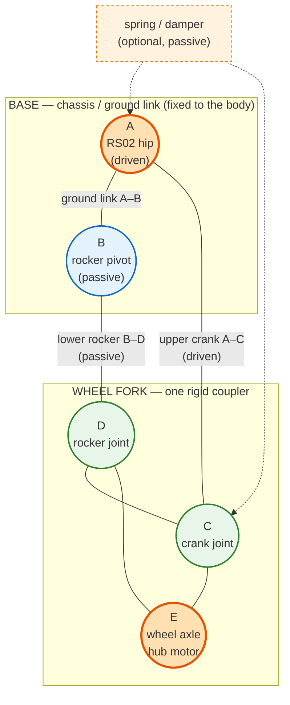

# System Architecture Design
## Wheeled-Bipedal Autonomous Robot (JBOT-WheeledBiped)

| Field | Value |
|---|---|
| Status | Living document (Phase 1 baseline) |
| Version | 0.2 |
| Last updated | 2026-10-21 |
| Related documents | `docs/system_requirements.md`, `docs/roadmap.md` |
| Scope | Compute tiers, power subsystem, communication interfaces, Rust software stack, safety concept |

---

## 1. Design Goals and Constraints

The architecture is driven by five constraints, in priority order:

1. **Safety first.** Loss of communication, control, or power must leave the robot in a predictable, low-energy state.
2. **Hard real-time separation.** The balance and motor-control loops must never depend on Linux scheduling.
3. **Deterministic communication.** Commands and feedback use bounded, versioned, checksummed frames with explicit timeouts.
4. **Modularity.** Perception, navigation, estimation, and control are independently testable Cargo crates with a single dependency direction.
5. **Upgradability.** Sensors, an optional manipulator, and AI accelerators can be added without redesigning the control path.

### 1.1. Non-functional targets

| Requirement | Target | Owner |
|---|---|---|
| Balance control loop | 1 kHz, jitter < 50 us | MCU |
| Hip QDD current loop | Actuator-internal (vendor firmware) | Actuator |
| Wheel FOC (if external driver) | 20-40 kHz | MCU / wheel driver |
| IMU sampling | 1-4 kHz | MCU |
| Command timeout / safe stop | 100 ms | MCU |
| MCU-to-RPi control latency | < 10 ms end-to-end | CAN + RPi |
| High-level control output | 100 Hz | RPi |
| State estimation (EKF) | 100-200 Hz | RPi |
| Localization / SLAM | 10-30 Hz | RPi |
| Navigation / behavior | 10-20 Hz | RPi |
| Boot to safe idle | < 10 s | RPi + MCU |
| Runtime | 20-45 min on M18 XC5.0 | Power subsystem |

> Numbers are design budgets, not measured guarantees. They must be validated in Phase 2/3 bench tests.

### 1.2. Mechanical concept: 1-DOF four-bar leg

The baseline is a two-wheeled balancing robot with four actuators: two RobStride RS02 hips in the body and two RS05 wheel actuators, one wheel per leg. Each leg is a planar **1-DOF four-bar linkage**. The base is the chassis link **A-B**; the wheel fork **C-D-E** is the moving coupler.



| Element | Type | Motor / function |
|---|---|---|
| A-B | Ground link | **Base / chassis** — fixed to the body |
| A | Revolute joint | **Hip QDD** — driven |
| B | Revolute joint | Passive rocker pivot on the base |
| A-C | Upper crank | Driven by the RS02 hip |
| B-D | Lower rocker | Passive |
| C-D-E | Wheel fork | One rigid coupler; E is the wheel axle |
| E | Wheel axle | **Hub motor** — driven |
| Spring / damper | Optional passive element | Parallel compliance between the base and the upper crank |

Consequences for the architecture:

- The mechanism has **one active DOF**; body height and wheel fore-aft offset are coupled along the coupler curve.
- The "knee" is a rigid bend of the wheel fork, not an articulated joint.
- Balance is **3D**: pitch via wheel torque, yaw via differential wheel torque, height via the common hip angle, roll via differential hip height. The 2D WIP model is a reduced-order model for initial LQR synthesis.
- Hip QDDs integrate FOC, encoder, and driver; the MCU commands them over CAN. Wheel hub drivers may be integrated or external.

---

## 2. System Context

```
                         ┌──────────────────────────────┐
                         │   Operator / Fleet / Cloud   │
                         │  SSH, VPN, Zenoh, ROS2 tools │
                         └──────────────┬───────────────┘
                                        │ Ethernet / Wi-Fi
┌───────────────────────────────────────▼───────────────────────────────────────┐
│                        Raspberry Pi 5 (Linux, aarch64)                        │
│  Perception  │  Localization / SLAM  │  Nav2 / planner  │  Behavior / mission  │
│  State estimation (EKF)  │  Supervisor  │  Zenoh router / ROS2 bridge  │  Logs  │
└───────────────┬───────────────────────────────┬───────────────────────────────┘
                │ CAN / UART                    │ USB3 / CSI-2 / PCIe
                │                               │
┌───────────────▼───────────────────┐   ┌───────▼───────────────────────────────┐
│  Real-time MCU (RP2350/ESP32/H7)  │   │  LiDAR, RGB-D camera, AI HAT (opt.)  │
│  Balance 1 kHz  │  Actuator CAN    │   └───────────────────────────────────────┘
│  BNO055 100 Hz  │  RC / CRSF       │
│  Watchdog       │                  │
└───────┬───────────────────┬───────┘
        │ CAN / ADC         │ CAN / UART
┌───────▼──────────┐  ┌─────▼──────────────────┐
│ 2x RS02 hip      │  │ RS02/RS05 feedback,    │
│ 2x RS05 wheel    │  │ encoders, IMU, current │
└───────┬──────────┘  └────────────────────────┘
        │ VMOT
┌───────▼──────────────────────────────────────────────────────────────────────┐
│  Power subsystem: Milwaukee M18 -> protection -> DC-DC 12 V / 5 V / 3.3 V    │
│  Hardware E-stop, main contactor, fuses, precharge, battery monitor          │
└──────────────────────────────────────────────────────────────────────────────┘
```

---

## 3. Compute Tiers

The robot uses a **two-tier compute architecture**. The split is intentional: Linux provides a rich ecosystem for AI, navigation, and networking, but cannot guarantee microsecond-level determinism. The MCU provides determinism but has limited compute and memory.

### 3.1. Tier 0: Power and Safety Plane (hardware)

Always-on, mostly analog/electromechanical layer:

- Battery input protection, fusing, reverse-polarity protection, TVS, precharge.
- Main contactor / motor-power switch controlled by the E-stop loop.
- DC-DC converters for 12 V, 5 V, and 3.3 V rails.
- Hardware E-stop with dual-channel redundancy.
- Current and voltage sensing for the supervisor.
- Actuator enable / sleep lines exposed by the vendor driver (if any) that default to "disabled" when unpowered.

Tier 0 has no software in the safety path. Software can request a stop; hardware must be able to enforce one independently.

### 3.2. Tier 1: Real-Time MCU (ESP32-S3 / RP2350 Pico 2 W / STM32H7)

**Responsibilities**

- Send torque, position, and velocity commands to the two RobStride RS02 hips over CAN; their FOC, encoder, and driver are integrated.
- Run the wheel FOC loop only if the RS05 wheel drivers are external; otherwise command the integrated wheel drivers.
- 1 kHz balance controller (PD / LQR / VMC), including tilt, roll, yaw, height, and velocity feedback.
- BNO055 attitude acquisition over I2C/UART, with gyro propagation between the 100 Hz fusion samples for the 1 kHz loop.
- Optional high-rate IMU (ICM-42688-P fallback) if BNO055 latency or fusion rate is insufficient.
- RS02/RS05 feedback, temperature, and bus-current monitoring.
- Command watchdog and fail-safe state machine.
- E-stop assertion and fault latching.
- Blackbox ring buffer for post-mortem diagnostics.
- Classic CAN through a TJA1051T/3 transceiver, optional CAN FD path, and UART transport to the Raspberry Pi.
- ExpressLRS 2.4G receiver over CRSF UART for teleoperation, with the hardware E-stop remaining independent.

**Proposed loop schedule**

| Loop | Rate | Trigger | Notes |
|---|---|---|---|
| Hip QDD current/torque | Actuator-internal | Vendor firmware | Not scheduled by the MCU |
| Wheel FOC (if external) | 20-40 kHz | Timer + injected ADC | Only for external wheel drivers |
| Wheel velocity (if external) | 1-2 kHz | Timer | Cascaded inside wheel FOC |
| Balance / posture | 1 kHz | Timer, fixed period | Hard deadline; no dynamic allocation |
| Attitude fusion | 100 Hz | I2C/UART | BNO055 output; timestamp at sample |
| Gyro propagation | 1 kHz | Timer | Bridge between fused samples |
| Telemetry aggregation | 200-500 Hz | Timer | Batched into transport frames |
| Command ingest | Event-driven | CAN RX interrupt / UART DMA | Validated and sequence-checked |
| Health / watchdog | 100 Hz | Timer | Feeds IWDG only when healthy |

**MCU selection trade-off**

| Candidate | Strengths | Weaknesses | Verdict |
|---|---|---|---|
| **STM32H723/H743** | Native FDCAN, advanced timers, high-speed ADC, FPU/DSP, CORDIC/FMAC, deterministic DMA, mature `embassy-stm32` support | More complex board design; 3.3 V only | **Recommended baseline** |
| **ESP32-S3** | Low cost, Wi-Fi/BLE, dual core, good `esp-rs` support | Only classic CAN (TWAI); CAN FD needs external SPI controller; less deterministic timers/ADC | Acceptable for early prototype, not preferred for final control board |
| **Pico 2 W (RP2350)** | Dual Cortex-M33, PIO, low cost, good `rp235x-hal`/`embassy-rp` support | No native CAN; only three ADC inputs on the W board; CYW43 RF/closed firmware; non-W Pico 2 preferred for production | Third candidate; requires external CAN controller and ADC |

**Decision:** STM32H723/H743 remains the recommended production baseline, but ADR-001 must benchmark it against the Pico 2 W (RP2350) and ESP32-S3 before the control board is ordered. Keep the protocol and HAL abstract enough that all three candidates can run the same control code. Provisional actuator, CAN, RC, and IMU selections are recorded in [`docs/hardware.md`](hardware.md).

**Real-time rules**

- `no_std` firmware; no heap allocation in the control path.
- Fixed-size buffers (`heapless`) for frames and telemetry.
- Interrupt priorities: FOC/ADC > CAN RX > control timer > UART > housekeeping.
- All shared state protected by critical sections or lock-free single-producer/single-consumer queues.
- No blocking waits in the 1 kHz loop; deadlines are enforced by hardware timers and watchdog.

### 3.3. Tier 2: High-Level Computer (Raspberry Pi 5, 16 GB)

**Responsibilities**

- Sensor drivers: LiDAR, RGB-D camera, optional AI accelerator.
- Perception: obstacle detection, free-space estimation, optional object/pose detection.
- Localization and mapping: LiDAR SLAM, map server, sensor fusion.
- Navigation: global planner, local planner/controller, costmaps, recovery behaviors.
- High-level state estimation: EKF fusing IMU, wheel odometry, and visual/LiDAR pose.
- Mission/behavior layer: behavior tree or state machine, teleoperation, docking, patrol.
- Supervisor: battery, thermal, latency, fault aggregation, logging, graceful shutdown.
- Connectivity: Zenoh router, ROS2 bridge, SSH/VPN, telemetry upload.
- Firmware update orchestration and blackbox retrieval.

**Why not run balance control here**

- Linux is not a hard real-time OS; scheduler jitter and USB/CAN stack latency can exceed the balance loop deadline.
- A kernel stall, page fault, thermal throttle, or userspace restart must not cause a fall.
- The MCU can keep the robot safe even if the RPi crashes or reboots.

The RPi may run a `PREEMPT_RT` kernel and isolated CPUs for communication threads, but this improves latency; it does not make the RPi the safety authority.

### 3.4. Control and data flow

```
Sensors (LiDAR, camera, IMU, encoders)
        │
        ▼
┌─────────────────────────────── Raspberry Pi 5 ───────────────────────────────┐
│ perception ──► world model ──► planner ──► trajectory/velocity command      │
│       ▲                              │                    │                  │
│       │                              ▼                    ▼                  │
│   localization ◄── SLAM/map      behavior tree      safety envelope          │
│       ▲                              │                    │                  │
│       └──────── EKF ◄────────────────┴────────────────────┘                  │
└───────────────────────────────────────┬──────────────────────────────────────┘
                                        │ 100 Hz command (CAN FD)
                                        ▼
┌─────────────────────────────── MCU ──────────────────────────────────────────┐
│ command validation ──► balance 1 kHz ──► velocity 1-2 kHz ──► actuator CAN   │
│        ▲                      │                                  │            │
│        │                      ▼                                  ▼            │
│   watchdog/faults ◄──── IMU, encoders, current, temperature ◄── actuators    │
└───────────────────────────────────────┬──────────────────────────────────────┘
                                        │ 200-500 Hz feedback
                                        ▼
                              Raspberry Pi 5 (EKF, telemetry, logs)
```

**Latency budget (design target)**

| Segment | Budget |
|---|---|
| IMU sample to filtered attitude on MCU | < 1 ms |
| MCU feedback to RPi receipt | < 2 ms |
| RPi estimation update | < 5 ms |
| RPi command to MCU receipt | < 2 ms |
| MCU command to motor torque | < 1 ms |
| End-to-end sensor-to-actuator (high-level loop) | < 50 ms |

---

## 4. Power Subsystem

### 4.1. Battery characteristics

- **Pack:** Milwaukee M18 XC5.0, 5S Li-ion, 5.0 Ah, ~90 Wh.
- **Voltage range:** 15.0 V (empty, 3.0 V/cell) to 21.0 V (full, 4.2 V/cell); 18.0 V nominal.
- **Design current:** 20–25 A continuous, 40 A fuse at 18 V, 55 A short peak (< 10 s).
- **Notes:** the pack contains its own BMS, but the robot must not rely on it as the only protection layer. Milwaukee packs may latch off under over-current or under-voltage; the robot should derate before that happens.

### 4.2. Protection and distribution chain

```
M18 pack
   │
   ▼
┌──────────────────┐
│ F1: 40 A fuse    │  slow-blow, main branch (18 V baseline)
└────────┬─────────┘
         ▼
┌──────────────────┐
│ Reverse polarity │  ideal diode / P-MOS + gate clamp
│ protection       │
└────────┬─────────┘
         ▼
┌──────────────────┐
│ TVS + bulk caps  │  SMBJ24A-class transient clamp, 470-1000 uF
└────────┬─────────┘
         ▼
┌──────────────────┐
│ Precharge /      │  10 ohm 5 W precharge, then main contactor
│ soft start       │  or inrush-limited hot-swap controller
└────────┬─────────┘
         ▼
┌──────────────────┐
│ Main contactor   │  controlled by E-stop loop and MCU enable
│ + current sense  │  INA226 / shunt, bidirectional
└────────┬─────────┘
         ▼
   VBAT bus (15-21 V M18 baseline; 24-36 V preferred)
   ├── 2x RS02 hip + 2x RS05 wheel ── branch fuse per actuator
   ├── 12 V DC-DC (5 A)           ── branch fuse
   ├── 5 V DC-DC (5-6 A)          ── branch fuse
   └── 3.3 V rail (MCU/sensors)   ── LDO or buck from 5 V
```

### 4.3. Rails

| Rail | Source | Load | Protection | Notes |
|---|---|---|---|---|
| VBAT 15-21 V (M18 baseline) / 24-36 V (preferred) | Pack | 4 actuators | 40 A main fuse at 18 V; 30 A at 24-36 V (validate), contactor, per-actuator fuse | Raw motor bus; keep short and twisted |
| 12 V / 5 A | Synchronous buck, 60 V input rated | Fans, sensors, optional arm, peripherals | 5 A fuse, TVS, LC filter | 60 W continuous |
| 5 V / 5-6 A | Synchronous buck, 60 V input rated | Raspberry Pi 5, LiDAR, camera, USB hub | 6 A fuse / eFuse, TVS | RPi 5 needs 5 V/5 A; use 5.1 V and short, thick wiring |
| 3.3 V / 1 A | Buck or LDO from 5 V | MCU, IMU, encoders, CAN transceiver | Polyfuse, ferrite | Keep analog and digital 3.3 V filtered separately if possible |
| 5 V isolated (optional) | Isolated DC-DC | Isolated CAN transceiver / external interface | — | Recommended for the external CAN/operator port |

**DC-DC requirements**

- Input range must cover 15-21 V (M18) and, if the preferred pack is adopted, up to 42 V (10S); use 60 V-rated parts for margin.
- Synchronous buck topology, > 90% efficiency at nominal load.
- Soft-start, current limiting, thermal shutdown, and output OVP.
- Switching frequency above the AM band where practical; avoid the IMU/LiDAR region; use shielded inductors.
- Place converters away from the IMU and analog front end; keep hot loops and input capacitors tight.

### 4.4. Power budget (initial estimate)

| Load | Typical | Peak | Rail |
|---|---|---|---|
| Raspberry Pi 5 | 8-12 W | 25 W | 5 V |
| LiDAR | 2 W | 3 W | 5 V |
| RGB-D camera | 2-3 W | 4 W | 5 V / USB |
| MCU + IMU + encoders | 1 W | 2 W | 3.3 V |
| Fans / misc. | 3 W | 8 W | 12 V |
| RS02 hip (2x) + RS05 wheel (2x) | 100-180 W | 360-550 W | VBAT |
| **Total** | **~115-200 W** | **~400-590 W** | |

At 18 V, 590 W is 33 A; a 30 A fuse is marginal for four actuators. At 24-36 V the same power is 16-25 A. Size the fuse, contactor, and harness for the measured peak; 40 A at 18 V is an initial estimate. Runtime on a 90 Wh pack is roughly 30-50 min at low load and 10-20 min under aggressive motion. Validate with a real load profile and battery sag test.

### 4.5. Sequencing, grounding, and EMI

**Power-up sequence**

1. Insert pack; precharge VBAT bus; close main contactor only after precharge completes.
2. 12 V and 5 V rails come up; 3.3 V comes up; MCU boots and runs self-test.
3. MCU asserts `MOTORS_ENABLE` only after passing self-test and receiving a valid RPi heartbeat.
4. RPi boots; Zenoh router, sensor drivers, and `jbot_node` start.
5. Supervisor performs handshake with MCU; robot enters `IDLE`.
6. Motion is enabled by an explicit operator or mission command.

**Power-down sequence**

1. Command zero velocity and enter `DAMPING`.
2. Disable actuators; open main contactor.
3. Flush logs and stop Zenoh/ROS2 processes.
4. Issue Linux shutdown; wait for RPi to power off (supervisor-controlled load switch or operator action).
5. Remove pack.

**Grounding**

- Single-point star ground at the battery negative terminal.
- Separate motor power return and logic return; join only at the star point.
- Shielded twisted pair for CAN; terminate the shield at one end (usually the RPi/control board) to avoid ground loops.
- Kelvin connection for the current shunt.
- Keep IMU on a vibration-damped, temperature-stable mount, away from DC-DC inductors and motor phase wires.

**EMI mitigations**

- TVS and common-mode chokes on external interfaces.
- Ferrites on motor phase cables and USB cables.
- Snubbers / RC networks across motor phases if driver ringing is observed.
- Twisted motor phase pairs; minimize loop area.
- Metal enclosure or grounded shielding for the control board; ensure the antenna area of any Wi-Fi module is not enclosed.

### 4.6. Battery monitoring and low-voltage behavior

- Measure pack voltage at the contactor output and cell-equivalent voltage via the pack BMS interface if available.
- Measure total current with a bidirectional shunt (INA226-class) at 100-500 Hz.
- Track coulomb count and energy; expose state of charge (SoC) and state of health (SoH) estimates.
- Thresholds (calibratable):
  - **Warning:** 16.0 V (about 3.2 V/cell) — reduce acceleration limits, notify operator.
  - **Derate:** 15.5 V — limit torque and speed.
  - **Hard stop:** 15.0 V with 500 ms debounce — disable motors, enter `FAULT`, allow controlled shutdown.
- Never rely on a single voltage sample under load; use a filtered value plus current compensation.
- Log all threshold events with timestamps and current.

### 4.7. E-stop topology

The E-stop is a **hardware** function, independent of Linux and MCU software:

- Dual-channel normally-closed switch (or two redundant switches) feeds a safety relay / contactor coil.
- One channel opens the main contactor (removes VBAT from all actuators).
- The second channel asserts actuator `EN`/`nSLEEP` low and signals the MCU and RPi.
- MCU latches the fault and reports it over CAN; RPi logs it and enters safe shutdown.
- Logic rails (5 V/12 V) remain powered so the event is logged and the RPi can shut down cleanly.
- A second, software-commanded stop exists for normal operation, but it is not a substitute for the hardware E-stop.

---

## 5. Communication Architecture

### 5.1. Topology

```
                 ┌─────────────────────────────┐
                 │ Raspberry Pi 5               │
                 │  CAN FD controller + xceiver │
                 │  UART (fallback)             │
                 │  USB3 / CSI-2 / PCIe         │
                 └───────┬──────────┬──────────┘
                         │          │
            120 ohm ─────┤          │ USB / CSI-2
                         │          ├── LiDAR
                 ┌───────▼───────┐  ├── RGB-D camera
                 │ CAN FD bus    │  └── AI HAT (optional)
                 │ 1 Mbit / 5 Mbit│
                 └───┬───────┬───┘
                     │       │
         ┌───────────▼─┐   ┌─▼─────────────┐
         │ MCU         │   │ Actuators     │
         │ (control)   │   │ (CAN nodes)   │
         └──────┬──────┘   └───────────────┘
                │ UART fallback (COBS + CRC16)
                └──────────────► Raspberry Pi 5
```

### 5.2. CAN FD (primary control bus)

- **Standard:** CAN FD, ISO 11898-2.
- **Bit rates:** 1 Mbit/s arbitration, 5 Mbit/s data phase (fallback to 2 Mbit/s if signal integrity is marginal).
- **Frame format:** 11-bit standard IDs for control; 29-bit extended IDs reserved for expansion (manipulator, future nodes).
- **Payload:** up to 64 bytes. Application header is 8 bytes; up to 56 bytes of payload per frame.
- **Termination:** 120 ohm at both physical ends; stub length < 0.3 m.
- **Transceiver:** 3.3 V CAN FD transceiver (e.g., TCAN334/MCP2542FD class), common-mode choke, TVS, split termination (2x 60 ohm + 4.7 nF to ground).
- **Isolation:** isolate the external/operator CAN port; internal motor bus may be non-isolated if it shares a clean ground.
- **Topology:** linear bus, no star; keep the RPi and MCU on the same bus segment; 2 RS02 hips + 2 RS05 wheels as additional nodes on the actuator bus; the MCU bridges the classic CAN actuator bus to the CAN FD backbone where used.
- **Actuator bus:** RobStride RS02/RS05 use classic CAN 1 Mbit/s through a TJA1051T/3 transceiver, not CAN FD. The MCU owns the actuator bus and exposes a normalized joint interface; wheel drivers follow their vendor protocol.

**CAN ID allocation (initial)**

| ID (hex) | Direction | Message | Rate | Payload |
|---|---|---|---|---|
| `0x010` | RPi -> MCU | `EmergencyStop` | event + 20 Hz repeat | cause, sequence, timestamp |
| `0x020` | RPi -> MCU | `ControlCommand` | 100 Hz | velocity, yaw rate, height/pitch, flags |
| `0x021` | RPi -> MCU | `ModeCommand` | event | idle/balance/damping/calibrate |
| `0x022` | RPi -> MCU | `ConfigCommand` | event | gains, limits, calibration |
| `0x100` | MCU -> RPi | `RobotState` | 200-500 Hz | state, faults, battery, temperatures |
| `0x101` | MCU -> RPi | `ImuSample` | 200-500 Hz | quaternion, accel, gyro, timestamp |
| `0x102` | MCU -> RPi | `JointFeedback` | 200-500 Hz | position, velocity, torque/current |
| `0x103` | MCU -> RPi | `PowerFeedback` | 50 Hz | voltage, current, SoC |
| `0x200` | MCU -> RPi | `DebugLog` | event / 10 Hz | fault codes, counters |
| `0x7FE` | both | `Heartbeat` | 20 Hz | node ID, uptime, health |
| `0x7FF` | MCU -> RPi | `FaultReport` | event + repeat | fault code, severity, context |

Rules:

- Lower IDs have higher priority; E-stop and heartbeat must never be delayed by telemetry.
- Control commands are **latest-value** semantics. Telemetry is loss-tolerant and may be dropped under overload.
- Actuators may use their own vendor ID range; the MCU maps the 2 RS02 hips and 2 RS05 wheels to four normalized joint IDs.
- All multi-byte fields are little-endian.

### 5.3. Application protocol and framing

Both CAN FD and UART use the same logical message schema:

```rust
#[derive(serde::Serialize, serde::Deserialize)]
struct FrameHeader {
    version: u8,       // protocol version, starts at 1
    msg_type: u8,      // message kind
    flags: u8,         // ack, fault, fragment, etc.
    seq: u16,          // wraps; used for loss/reorder detection
    timestamp_us: u32, // MCU monotonic microseconds (wraps ~71 min)
}

struct Frame {
    header: FrameHeader,
    payload: heapless::Vec<u8, 56>, // CAN FD: 8 + 56 = 64 bytes
    crc16: u16,                     // application CRC; optional on CAN FD, mandatory on UART
}
```

- **Serialization:** `postcard` for compact `serde` encoding; fixed layout for the header. Keep the schema versioned and reject unknown major versions.
- **CRC:** CRC-16/CCITT-FALSE (poly `0x1021`, init `0xFFFF`) over header + payload. CAN FD has its own link-layer CRC, but the application CRC catches software/fragmentation errors and keeps the UART path consistent.
- **Sequence:** 16-bit sequence per message type; receiver tracks gaps and reports loss counters.
- **Fragmentation:** if a payload exceeds 56 bytes, split into fragments with `flags & FRAGMENT` and a fragment index; reassemble with a timeout. Prefer designing messages to fit one frame.
- **Endianness:** little-endian for all numeric fields.
- **Validation:** reject frames with bad CRC, wrong version, wrong length, stale sequence, or out-of-range values. Invalid commands do not update the actuator setpoint.

### 5.4. UART fallback

- **Physical:** 3.3 V TTL, full-duplex, optional RTS/CTS flow control, shielded twisted pair if the cable is long.
- **Baud rate:** 921600 or 1 Mbaud, 8N1.
- **Framing:** COBS encoding with `0x00` as the frame delimiter; max frame 256 bytes; CRC-16 as above.
- **Resynchronization:** on CRC failure or oversized frame, discard until the next `0x00` delimiter.
- **Use cases:** bring-up, CAN failure fallback, debug console, firmware update recovery.
- **Limitations:** lower bandwidth and no multi-drop; not intended for motor-driver traffic.

### 5.5. USB and high-speed sensor interfaces

- **USB 3.0:** LiDAR, RGB-D camera, high-rate debug/telemetry, firmware DFU.
- **USB 2.0:** MCU CDC debug console, lower-rate sensors.
- **CSI-2:** camera direct connection when supported; preferred over USB for deterministic frame capture.
- **PCIe 2.0 x1:** NVMe storage and optional AI HAT (e.g., Hailo-8L). Check power and thermal budget.
- **Rules:**
  - USB is not used for the primary control loop; it is not deterministic enough.
  - Use a powered hub for high-draw peripherals; account for RPi 5 port current limits.
  - Use ferrites and short cables; avoid ground loops through the LiDAR/camera chassis.
  - Provide a dedicated USB port for MCU debug/DFU so recovery does not require disassembly.

### 5.6. MCU-internal buses

| Bus | Devices | Rate | Notes |
|---|---|---|---|
| SPI | Optional high-rate IMU (ICM-42688-P), CAN controller (Pico 2 W), flash | 10-24 MHz | DMA, interrupt, timestamp at sample |
| I2C | BNO055, temperature, power monitor, EEPROM | 400 kHz-1 MHz | Keep away from noisy motor lines; use pull-ups |
| ADC | Current sense, voltage, temperature | 10-100 kHz | Synchronized to PWM; Pico 2 W needs an external ADC for the full set |
| Timers | Encoders, PWM, FOC | hardware | Use hardware quadrature where available |
| GPIO | E-stop feedback, driver enable, fan | event | Default safe state on reset |

### 5.7. Time synchronization

- MCU maintains a free-running 1 MHz monotonic timer; every feedback frame carries the sample timestamp.
- RPi maintains `CLOCK_MONOTONIC`; it estimates the MCU-to-RPi offset and drift with an EWMA filter.
- Optional 1 PPS or a GPIO sync pulse from the MCU to the RPi improves alignment for sensor fusion.
- If Ethernet/PTP is available, use PTP for sensor timestamps; otherwise use arrival-time plus offset estimation.
- Always timestamp at the sensor/sample point, not at the application layer.

### 5.8. Bandwidth and QoS

| Traffic | Rate | Frame size | Bandwidth (approx.) | Policy |
|---|---|---|---|---|
| Control command | 100 Hz | 64 B | 51 kbit/s | Latest value, reliable |
| E-stop | event + 20 Hz | 16 B | 2.5 kbit/s | Highest priority, redundant |
| IMU feedback | 500 Hz | 64 B | 256 kbit/s | Best effort, loss-tolerant |
| Joint feedback | 500 Hz | 64 B | 256 kbit/s | Best effort |
| Robot state | 200 Hz | 64 B | 102 kbit/s | Best effort |
| Heartbeat | 20 Hz | 8 B | 1.3 kbit/s | Reliable |
| **Total (CAN FD)** | | | **< 700 kbit/s** | Fits 1 Mbit/s arbitration with margin |

At 1 Mbit/s arbitration, the bus is comfortably loaded. If telemetry is increased, raise the data-phase rate or reduce rates; do not compromise E-stop/command latency.

### 5.9. Fault handling

- **CAN bus-off:** MCU attempts automatic recovery; if it persists, enter `DAMPING` and report `FAULT_CAN_BUS`.
- **UART framing errors:** increment counters; after N consecutive errors, fall back to the other transport if available.
- **Sequence gaps:** log and expose a packet-loss metric; do not silently accept stale commands.
- **Heartbeat loss:** MCU stops motion after 100 ms; RPi supervisor marks the MCU as unhealthy and attempts recovery.
- **Duplicate commands:** idempotent; a repeated command with an older sequence is ignored.

---

## 6. Software Architecture (Rust)

### 6.1. Workspace and dependency direction

```
jbot_common  ◄── jbot_hardware
     ▲        ◄── jbot_estimation
     │        ◄── jbot_control
     │        ◄── jbot_navigation
     │                 ▲
     └─────────────────┴── jbot_node ──► binaries / services
```

Rules:

- `jbot_common` contains shared types, math, configuration, and message schemas. It must not depend on hardware or async runtimes.
- `jbot_hardware` owns transport (CAN/UART/USB) and sensor drivers; it may depend on Tokio.
- `jbot_estimation` owns filters and state estimation; pure computation, no I/O.
- `jbot_control` owns balance/velocity/posture controllers; pure computation, no I/O.
- `jbot_navigation` owns costmaps, planners, and path following; may depend on external map types.
- `jbot_node` is the composition root: it wires tasks, transports, middleware, supervision, and configuration.
- No dependency cycles. A crate that needs I/O receives it via a trait defined in `jbot_common` or a dedicated port module.

**Proposed crate split (future):**

- `jbot_protocol`: `no_std`-compatible message definitions, `postcard` schema, COBS/CRC framing, shared with firmware.
- `jbot_safety`: state machine, fault codes, watchdog policy, limit checks.
- `jbot_teleop`: joystick/gamepad and web teleoperation.
- `firmware/`: MCU binary using the same `jbot_protocol` crate.

### 6.2. Current crate responsibilities

| Crate | Responsibility | Status |
|---|---|---|
| `jbot_common` | Shared types, math, config, message definitions | Kinematics and config baseline |
| `jbot_hardware` | CAN/UART/USB transports, sensor and actuator drivers | Skeleton; provisional BNO055, TJA1051T/3, ExpressLRS, RobStride RS02/RS05 |
| `jbot_estimation` | EKF, attitude filters, odometry fusion | Complementary and Madgwick attitude filters; EKF pending |
| `jbot_control` | Balance, velocity, posture, safety envelope | 2D WIP, LQR, and speed-loop baseline |
| `jbot_sim` | Plant model, sensor simulation, replay harness | Fixed-step 2D WIP, sensor, delay, and replay baseline |
| `jbot_navigation` | Costmaps, global/local planning, path tracking | Skeleton |
| `jbot_node` | Runtime composition, middleware, supervision, CLI | Skeleton |

### 6.3. Runtime and task model (Tokio)

The RPi process uses a multi-thread Tokio runtime. Task isolation matters more than raw async throughput.

| Task | Rate / trigger | Tokio primitive | Notes |
|---|---|---|---|
| CAN/UART ingress | event-driven | dedicated blocking thread + `mpsc` | Do not block the runtime; use `spawn_blocking` or a dedicated thread for `socketcan` |
| Command egress | 100 Hz | `interval` + `watch` | Latest-value command; skip missed ticks |
| Estimation | 100-200 Hz | `interval` | Consumes IMU/odometry, publishes state |
| Control | 100 Hz | `interval` | Consumes state + trajectory, produces command |
| Navigation | 10-20 Hz | `interval` | May run in a separate process for isolation |
| Perception | sensor rate | `mpsc` / `broadcast` | CPU/GPU bound; consider a separate process |
| Supervisor | 10 Hz | `interval` | Battery, thermal, latency, faults |
| Telemetry/logging | 10-50 Hz | `broadcast` + bounded `mpsc` | Drop-oldest policy for telemetry |
| Middleware | event-driven | Zenoh/ROS2 callbacks | Bridge to external world |
| Shutdown | signal | `CancellationToken` | Coordinated graceful stop |

**Channel policy**

- `watch` for the latest command, latest state, and latest setpoint (no queue buildup).
- Bounded `mpsc` for frames and logs; on overflow, increment a counter and drop the oldest telemetry, never the E-stop.
- `broadcast` for faults and mode changes; slow subscribers must not block the producer.
- `oneshot` for request/response (configuration, calibration).

**Real-time caveats on Linux**

- Linux is not hard real-time. Use `PREEMPT_RT` if available, isolate CPUs (`isolcpus`), and pin the CAN/comms thread.
- Raise thread priority for comms/safety tasks (`SCHED_FIFO` via `libc`/`thread-priority`), but keep the 1 kHz loop on the MCU.
- Lock memory (`mlockall`) to avoid page faults in latency-sensitive threads.
- Avoid blocking calls, synchronous file I/O, and `std::sync::Mutex` across `.await` in async tasks.
- Use `MissedTickBehavior::Skip` or `Delay` deliberately; do not let a slow tick burst.
- Bound every queue; unbounded channels are a latent failure mode.
- No `panic!`/`unwrap()` in the control path; propagate typed errors and enter a safe state.

### 6.4. Middleware: Zenoh and ROS2

The robot uses a **Zenoh-first** data plane and bridges to ROS2 where the ecosystem requires it.

| Option | Role | Strengths | Trade-offs |
|---|---|---|---|
| **Zenoh** (`zenoh` crate) | Primary intra-robot and remote pub/sub, queryables, shared memory | Low overhead, Rust-native, works over LAN/WAN, good for telemetry and fleet | Not a ROS2 replacement; tooling ecosystem is smaller |
| **zenoh-bridge-ros2dds** | Bridge to Nav2, RViz, rosbag, existing ROS2 nodes | Keeps ROS2 ecosystem available without rewriting | Extra process; QoS mapping must be understood |
| **r2r** | Native Rust ROS2 client | Ergonomic pub/sub/service/action, async | Requires a sourced ROS2 installation; API/version coupling |
| **ros2-client** | Native Rust ROS2 client | Async, supports ROS2 concepts | Smaller community; verify feature coverage |
| **rclrs** | Official ROS2 Rust bindings | Closest to ROS2 semantics | API churn, more ceremony, C++ toolchain dependency |

**Recommendation**

- Use Zenoh for internal state, commands, telemetry, and remote monitoring.
- Use `zenoh-bridge-ros2dds` for Nav2, RViz, rosbag2, and third-party ROS2 packages.
- If native ROS2 is required inside Rust, standardize on **one** client library (prefer `r2r` for ergonomics or `ros2-client` for a lighter async footprint) and isolate it behind a trait so it can be swapped.
- Do not put DDS or Zenoh on the 1 kHz balance path. The control path stays on CAN FD.
- Map QoS explicitly:
  - Commands: reliable, keep-last, deadline.
  - High-rate telemetry: best-effort, keep-last.
  - Maps/TF: transient-local.
  - Faults/E-stop: reliable, highest priority, never dropped.

### 6.5. Key Rust libraries (candidate/adopted)

| Area | Crate | Purpose | Status |
|---|---|---|---|
| Async runtime | `tokio` | Tasks, timers, channels, signal handling | Adopted |
| Serialization | `serde`, `postcard` | Message schema and compact encoding | Adopted / proposed |
| Framing | `cobs`, `crc` | UART framing and checksums | Proposed |
| Linear algebra | `nalgebra` | Kinematics, EKF, control math | Adopted |
| Errors | `thiserror`, `anyhow` | Typed library errors, application context | Adopted / proposed |
| Logging | `tracing`, `tracing-subscriber` | Structured logs and spans | Proposed |
| Config | `serde`, `toml`, `config` | Robot configuration and calibration | Proposed |
| CLI | `clap` | Node and tooling commands | Proposed |
| CAN | `socketcan`, `tokio-socketcan` | Linux CAN FD access | Proposed |
| Serial | `tokio-serial`, `serialport` | UART fallback and debug | Proposed |
| Middleware | `zenoh` | Pub/sub, queryables, remote access | Proposed |
| ROS2 bridge | `zenoh-bridge-ros2dds` (external) | Nav2/RViz/rosbag integration | Proposed |
| ROS2 client | `r2r` or `ros2-client` | Native ROS2 if needed | Under evaluation |
| Visualization | `rerun` | Live plots, point clouds, replay | Proposed |
| Inference | `ort`, `tract`, `candle` | ONNX/model inference on CPU/accelerator | Under evaluation |
| State machines | `statig` | Explicit safety/behavior state machines | Proposed |
| Graph/search | `petgraph`, `pathfinding` | Planning and graph utilities | Proposed |
| Testing | `proptest`, `insta`, `mockall` | Property, snapshot, and mock testing | Proposed |

**Firmware stack (MCU)**

| Area | Crate | Purpose |
|---|---|---|
| HAL | `embassy-stm32` or `stm32-hal` | STM32 peripherals, async |
| Executor | `embassy-executor` | Async tasks on `no_std` |
| Time | `embassy-time` | Timers and delays |
| RTOS-style scheduling | `rtic` (alternative) | Priority-based, deterministic scheduling |
| HAL traits | `embedded-hal`, `embedded-can` | Portable drivers |
| CAN | `fdcan` / `bxcan` | FDCAN / classic CAN |
| Logging | `defmt`, `defmt-rtt` | Low-overhead binary logging |
| Flashing/debug | `probe-rs`, `panic-probe` | Flashing, RTT, panic dumps |
| Collections | `heapless` | Fixed-capacity buffers and queues |
| Math | `micromath`, `nalgebra` (libm) | `no_std` filters and kinematics |
| Watchdog | `embassy-stm32` IWDG | Independent hardware watchdog |

> Firmware dependencies are not yet in the workspace; they will be introduced with the `firmware/` crate in Phase 2.

### 6.6. Task/data architecture

```
┌─────────────┐   frames    ┌──────────────┐   state    ┌─────────────┐
│ CAN/UART RX │────────────►│ Estimation   │───────────►│ Control     │
│ (thread)    │  mpsc       │ (100-200 Hz) │  watch     │ (100 Hz)    │
└──────┬──────┘             └──────┬───────┘            └──────┬──────┘
       │                           │                           │
       │ telemetry                 │ state                     │ command
       ▼                           ▼                           ▼
┌─────────────┐             ┌──────────────┐            ┌─────────────┐
│ Telemetry   │             │ Supervisor   │            │ CAN/UART TX │
│ (10-50 Hz)  │             │ (10 Hz)      │            │ (100 Hz)    │
└──────┬──────┘             └──────┬───────┘            └──────┬──────┘
       │                           │ faults                    │
       ▼                           ▼                           ▼
┌─────────────────────────────────────────────────────────────────────┐
│ Zenoh / ROS2 bridge / logs / metrics / blackbox retrieval            │
└─────────────────────────────────────────────────────────────────────┘
```

### 6.7. AI and perception pipeline

```
Camera ──► V4L2/GStreamer ──► preprocess ──► model (ONNX/ORT/tract)
                                                    │
LiDAR ──► driver ──► point cloud ──► scan matching / SLAM ──► map + pose
                                                    │
                            ┌───────────────────────┴───────────────┐
                            ▼                                       ▼
                    obstacle/free-space map                 localization
                            │                                       │
                            └──────────────► costmap ◄──────────────┘
                                                │
                                          Nav2 / planner
                                                │
                                        velocity command
```

- Prefer hardware-accelerated inference via an AI HAT (Hailo-8L) or the RPi 5 CPU/GPU for small models.
- Keep inference off the control thread; publish detections as timestamped messages.
- Degrade gracefully: if perception or localization is stale, reduce speed or stop; never drive on stale data.
- Record sensor data with timestamps for replay and regression testing.

### 6.8. Configuration, logging, and observability

- **Configuration:** TOML files validated into typed structs (`serde` + `config`). Separate robot-specific calibration from code defaults. Version the config and log its hash at startup.
- **Logging:** `tracing` with JSON output; include node, task, robot ID, and correlation IDs. Avoid logging at high rates in the control path.
- **Metrics:** counters for frame loss, CRC errors, bus-off events, command age, loop jitter, battery voltage, temperatures, and fault counts. Export via Zenoh or a Prometheus endpoint.
- **Blackbox:** MCU ring buffer of the last N seconds of setpoints, states, faults, and raw sensor snapshots; dump over CAN/UART on request.
- **Replay:** record synchronized sensor/command logs; replay through `jbot_sim` for regression tests.

### 6.9. Build, deployment, and update

- **RPi target:** `aarch64-unknown-linux-gnu`; cross-compile with `cross` or `cargo-zigbuild`; ship as a static-ish binary with a known glibc baseline or use musl where compatible.
- **MCU target:** `thumbv7em-none-eabihf` (STM32H7) or the appropriate target for the chosen MCU; build with `cargo build --release --target ...`.
- **Process management:** systemd units for `jbot-node`, `zenohd`, sensor drivers, and the ROS2 bridge. Restart policy with backoff; watchdog integration.
- **Filesystem:** read-only root where practical; separate writable partition for logs and maps. A/B updates or atomic image updates.
- **Firmware update:** USB DFU / `probe-rs` in development; a CAN/UART bootloader with image signature and rollback for production.
- **CI:** `cargo fmt --check`, `cargo clippy -- -D warnings`, `cargo test`, cross-build for aarch64, firmware build, `cargo deny`, `cargo audit`.
- **Versioning:** protocol version in every frame; reject incompatible major versions. Keep firmware and host protocol versions in a compatibility matrix.

### 6.10. Testing strategy

| Level | What | Tools |
|---|---|---|
| Unit | Math, framing, CRC, state machine, limits | `cargo test` |
| Property | Framing round-trips, sequence wraparound, malformed frames | `proptest` |
| Integration | CAN/UART loopback, transport failover, timeout behavior | `tokio::test`, virtual CAN (`vcan`) |
| Simulation | Plant model, sensor noise, balance and navigation scenarios | `jbot_sim`, Gazebo/ROS2 |
| HIL | Real MCU + actuators + RPi, fault injection | Bench rig, `defmt`, logic analyzer |
| System | E-stop, battery cutoff, thermal, communication loss, 24 h soak | Full robot |
| Regression | Replay recorded logs and compare metrics | `rerun`, golden traces |

**Definition of done for control changes:** unit tests pass, HIL balance test passes, no new clippy warnings, latency and jitter within budget, and a rollback path exists.

---

## 7. Safety and Fault Management

### 7.1. State machine

```
BOOT
  │ self-test OK
  ▼
SELF_TEST ──fail──► FAULT
  │ pass
  ▼
IDLE ◄──────────────┐
  │ enable motion    │ disable / stop
  ▼                  │
BALANCE / ACTIVE ────┘
  │ fault / timeout / E-stop / low battery
  ▼
DAMPING ──► FAULT ──► SHUTDOWN
  ▲
  └── E_STOP (latched, requires physical reset)
```

| State | Motors | Behavior |
|---|---|---|
| `BOOT` | Disabled | Clock/peripheral init, load calibration |
| `SELF_TEST` | Disabled | IMU, encoder, CAN, voltage, driver checks |
| `IDLE` | Disabled or zero torque | Accept commands, hold safe posture if possible |
| `BALANCE` | Enabled | 1 kHz balance and velocity control |
| `DAMPING` | Enabled, zero/low torque | Controlled stop; no balancing |
| `FAULT` | Disabled | Latch fault, report, wait for reset |
| `E_STOP` | Hardware disabled | Latched until physical reset and self-test |
| `SHUTDOWN` | Disabled | Flush logs, park, power down |

### 7.2. Watchdog chain

1. **Hardware E-stop:** opens motor power independently of software.
2. **MCU independent watchdog (IWDG):** reset if the control loop stops feeding it.
3. **Command watchdog:** if no valid `ControlCommand` for 100 ms, enter `DAMPING`.
4. **RPi heartbeat:** MCU requires a valid heartbeat; loss triggers `DAMPING`.
5. **RPi systemd watchdog:** restart `jbot_node` if it hangs; log the event.
6. **Supervisor:** monitors battery, temperature, latency, and fault flags; commands a safe stop when limits are exceeded.

### 7.3. Limits and protections

| Quantity | Limit | Action |
|---|---|---|
| Actuator current | Per-actuator and total (RS02 hip + RS05 wheel) | Current limit, then fault |
| Actuator temperature | Vendor limit minus margin | Derate, then disable |
| Battery voltage | 16.0 / 15.5 / 15.0 V | Warn / derate / stop |
| Body tilt | Configurable (e.g., 25-35 deg) | Reduce torque, then damping |
| Command age | 100 ms | Damping |
| CAN bus-off | Persistent | Damping + fault |
| CPU/GPU temperature | RPi throttle point minus margin | Reduce perception/nav rate, notify |
| Wheel/hip velocity | Configurable | Limit, then fault |

### 7.4. Fault codes and reporting

- Faults are enumerated (`FAULT_IMU`, `FAULT_CAN_BUS`, `FAULT_OVERCURRENT_LEFT`, `FAULT_UNDERVOLTAGE`, `FAULT_ESTOP`, ...).
- Each fault has severity (`Info`, `Warning`, `Critical`, `Latched`) and a timestamp.
- Critical faults disable motion and are latched until an explicit reset with the robot stationary.
- Faults are published on `0x7FF` and via Zenoh/ROS2; the supervisor logs them with context (voltage, current, temperature, last command).

---

## 8. Deployment and Operations

### 8.1. Process layout on the RPi

| Process | Role | Restart policy |
|---|---|---|
| `zenohd` | Local Zenoh router | Always |
| `jbot-node` | Estimation, control, supervision, hardware I/O | Always, with backoff |
| `zenoh-bridge-ros2dds` | ROS2/Nav2/RViz bridge | Always |
| LiDAR driver | Point cloud/scan publisher | Always |
| Camera driver | Image/Depth publisher | Always |
| `nav2` (if used) | Planning and navigation | On demand |
| Logging/telemetry agent | Upload and retention | Always |

- Run perception/navigation in separate processes where practical so a crash does not take down the control/supervision process.
- Use a supervisor (systemd) with `Restart=on-failure`, `WatchdogSec`, and resource limits.
- Keep the control/supervision process minimal; avoid loading large models into it.

### 8.2. Network and remote access

- Local Wi-Fi/Ethernet for Zenoh and ROS2; disable unnecessary services.
- SSH/VPN for remote support; no direct exposure of robot control ports to the public internet.
- Optional 4G/5G router for fleet telemetry; queue and compress logs when offline.
- Authenticate Zenoh/ROS2 endpoints where supported; isolate the robot network from the corporate LAN.

### 8.3. Boot and shutdown

- **Boot:** power → MCU self-test → safe idle → RPi boot → Zenoh router → drivers → `jbot-node` → handshake → `IDLE`.
- **Shutdown:** stop motion → damping → disable drivers → flush logs → stop processes → Linux shutdown → open contactor.
- **Brownout:** MCU resets into safe state; drivers disabled by default; RPi monitors undervoltage and logs the event.

---

## 9. Risks and Mitigations

| Risk | Impact | Mitigation |
|---|---|---|
| Linux scheduling jitter | Poor high-level loop timing | Keep 1 kHz loop on MCU; use `PREEMPT_RT`, CPU isolation, RT priorities |
| CAN FD signal integrity | Bus errors, dropped frames | Proper termination, short stubs, common-mode choke, scope validation |
| Selected MCU lacks native CAN FD | Extra latency/complexity | Benchmark STM32H7, Pico 2 W, and ESP32-S3; use an external CAN FD controller only for prototypes |
| Milwaukee pack BMS latch-off | Unexpected power loss | Derate before cutoff; monitor voltage/current; test pack behavior under load |
| EMI from motors | IMU/CAN/USB corruption | Shielding, twisted pairs, ferrites, grounding, physical separation |
| Thermal throttling on RPi | Perception/nav slowdown | Heatsink/fan, thermal monitoring, graceful degradation |
| AI accelerator power/thermal | Brownout or throttling | Budget power, separate rail, thermal design, validate under load |
| Firmware/host protocol drift | Incompatible frames | Protocol version, schema tests, compatibility matrix, CI |
| Single point of failure in E-stop | Safety hazard | Dual-channel E-stop, hardware contactor, periodic proof test |

---

## 10. Architecture Decision Records (summary)

| ADR | Decision | Rationale | Status |
|---|---|---|---|
| ADR-001 | STM32H723/H743 as production MCU; Teensy/ESP32-S3 for prototypes | Native FDCAN, deterministic timers, strong `no_std` ecosystem | Proposed |
| ADR-002 | CAN FD primary, UART fallback | Deterministic, multi-drop, robust in EMI; UART for bring-up/recovery | Accepted |
| ADR-003 | Two-tier compute: RPi 5 + MCU | Separates AI/nav from hard real-time control | Accepted |
| ADR-004 | Zenoh-first middleware, ROS2 bridge | Rust-native, low overhead, keeps ROS2 ecosystem available | Proposed |
| ADR-005 | E-stop removes motor power but keeps logic powered | Preserves logging and graceful shutdown | Accepted |
| ADR-006 | M18 5S input with 12 V / 5 V / 3.3 V rails | Matches available battery; 18 V limits top speed at 1.5 m/s; 24-36 V preferred for margin (open question 9) | Accepted (baseline) |
| ADR-007 | Application CRC + sequence on all frames | Uniform error detection across CAN FD and UART | Proposed |
| ADR-008 | SLAM: Rust-native stack vs `slam_toolbox`/Cartographer via the ROS2 bridge | Pending Phase 4 evaluation | Proposed |
| ADR-009 | 1-DOF four-bar leg, one wheel per leg, 2 RS02 hips + 2 RS05 wheels (provisional) | Compact 4-actuator layout; motors in the body; known coupler curve; height and fore-aft are coupled | Accepted |
| ADR-010 | RobStride-class QDD on hips with integrated FOC; MCU is the balance/CAN/safety controller | Removes the custom hip power stage; vendor current loop; classic CAN 1 Mbit/s | Proposed |

---

## 11. Open Questions

1. Final MCU choice and board design: STM32H723/H743 vs Pico 2 W (RP2350) vs ESP32-S3. Decide after an actuator/CAN/ADC/jitter benchmark.
2. Actuator interface: provisional RobStride RS02 hips and RS05 wheels with integrated FOC; substitute only with an equivalent CAN/torque/thermal envelope. Affects CAN traffic and safety signals.
3. Leg topology: **decided** — 1-DOF four-bar (base A-B, upper crank A-C, lower rocker B-D, wheel fork C-D-E, optional spring). Remaining: link lengths, spring rate/travel, height range, and the E-position.
4. LiDAR/camera selection and mounting; impact on SLAM and AI compute budget.
5. Whether Nav2 is used as-is (C++ via bridge) or replaced by a Rust planner. Affects `jbot_navigation`.
6. AI accelerator choice (Hailo-8L vs CPU-only) and model runtime (`ort` vs `tract` vs `candle`).
7. Production firmware update path: CAN bootloader vs USB DFU vs debug probe.
8. Enclosure, connector, and serviceability requirements.
9. Power pack voltage: M18 18 V baseline vs 24-36 V preferred. At 18 V the 1.5 m/s target is marginal and the fuse margin is tight.
10. Wheel drive: one hub motor per wheel; validate traction and slip on the target surface. Dual wheels per leg are deferred.

---

## 12. Glossary

| Term | Meaning |
|---|---|
| CAN FD | CAN with Flexible Data-rate; higher payload and data-phase bit rate |
| COBS | Consistent Overhead Byte Stuffing; framing for serial streams |
| DC-DC | Direct-current voltage converter |
| EKF | Extended Kalman Filter |
| FOC | Field-Oriented Control for BLDC/PMSM motors |
| HIL | Hardware-in-the-loop testing |
| IMU | Inertial Measurement Unit |
| IWDG | Independent Watchdog |
| MCU | Microcontroller Unit |
| M18 | Milwaukee 18 V battery platform |
| QDD | Quasi-Direct Drive actuator |
| SLAM | Simultaneous Localization and Mapping |
| SoC / SoH | State of Charge / State of Health |
| VMC | Virtual Model Control |
| Zenoh | Pub/sub/query middleware for distributed systems |

---

## 13. References

- `docs/system_requirements.md` — system requirements specification.
- `docs/roadmap.md` — phased implementation plan.
- `Cargo.toml` and `crates/*/Cargo.toml` — current workspace layout and dependencies.
