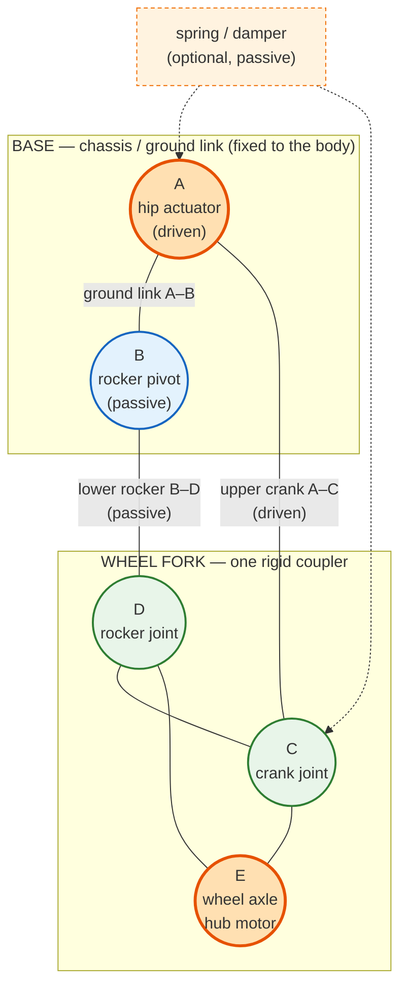

# System Architecture Design
## Wheeled Balancing Robot on a Donor Hoverboard (JBOT-Wheeled Biped)

| Field | Value |
|---|---|
| Status | Living document (stage 1 donor hardware baseline, Pico 2 W real-time controller) |
| Version | 0.4 |

| Related documents | `docs/system_requirements.md`, `docs/hardware.md`, `docs/roadmap.md`, `docs/pico-bridge.md` |
| Scope | Compute tiers, power subsystem, communication interfaces, Rust software stack, safety concept |

> **Change in 0.4 (ADR-011).** The real-time balance controller moved from the
> donor mainboard to a Raspberry Pi Pico 2 W (RP2350). The mainboard keeps the
> 16 kHz FOC current loop and the power stage and is driven as a torque actuator
> node over USART2. The BNO055 and the XR1 receiver are wired to the Pico, not to
> the mainboard. See `docs/hardware.md` §2.4 and `docs/pico-bridge.md`.

---

## 1. Design Goals and Constraints

The architecture is driven by five constraints, in priority order:

1. **Safety first.** Loss of communication, control, or power must leave the robot in a predictable, low-energy state.
2. **Hard real-time separation.** The balance and motor-control loops must never depend on Linux scheduling.
3. **Deterministic communication.** Commands and feedback use bounded, versioned, checksummed frames with explicit timeouts.
4. **Modularity.** Perception, navigation, estimation, and control are independently testable Cargo crates with a single dependency direction.
5. **Upgradability.** Sensors, an optional manipulator, and AI accelerators can be added without redesigning the control path.

### 1.0. Hardware baseline and staging

The architecture is built on a donor hoverboard, a Raspberry Pi Pico 2 W, and —
from stage 3 — a mission computer. The same motor controller, radio link, and
balancing core are used in all stages.

| Stage | Hardware | Actuation | Control scope |
|---|---|---|---|
| **1** | Donor STM32F103RCT6 mainboard, Pico 2 W, 2 hub motors, 10s2p pack, BNO055, XR1 receiver | 2 wheel motors | Balance, drive, turn, spin in place |
| **2** | Stage 1 plus 2 hip actuators and drivers, four-bar legs | 2 wheels + 2 hips | Adds height and roll through the hips |
| **3** | Stage 2 plus a mission computer | Unchanged | Telemetry, estimation, navigation |

What the design takes as fixed:

- **Two MCU tiers.** The Pico 2 W is the real-time controller: attitude
  estimation, the 200 Hz balance loop, speed and yaw loops, arming, limits, and
  telemetry. The STM32F103RCT6 mainboard is the actuator node: 16 kHz FOC
  current loop, phase and DC-link current limits, hall capture, pack voltage,
  board temperature, power latch, and an independent 100 ms command timeout.
- The mainboard is the only board that drives the wheel motors. It has two
  three-phase bridges, so it cannot host the hip actuators.
- The radio is a BetaFPV LiteRadio 3 Pro (ExpressLRS 2.4 GHz) and a RadioMaster
  XR1 receiver (CRSF, 420 kbaud) on the Pico's UART1, not on the mainboard.
- The IMU is a BNO055 on the Pico's I2C1 at 400 kHz, 100 Hz fusion output.
- The Pico and the mainboard are linked over the mainboard's USART2 (left 4-pin
  cable) with the stock EFeru `VARIANT_USART` frame format, running `TRQ_MODE`.
- The donor board has no routed CAN. Stages 1 and 2 therefore use UART links;
  CAN remains a reserved interface for a future controller or an external hip
  bus and is not part of the current wiring.
- Because the IMU and the radio left the mainboard, the right cable (PB10/PB11)
  is free for USART3 and is available for the stage 2 hip link without soldering.

### 1.1. Non-functional targets

| Requirement | Target | Owner |
|---|---|---|
| Balance control loop | 200 Hz, 5 ms period, jitter ≤ 50 µs | Pico 2 W |
| FOC current loop | 16 kHz | STM32F103 timer ISR |
| IMU sampling and fusion | 100 Hz, gyro propagated to the balance rate | BNO055 + Pico 2 W |
| Radio setpoints | up to 250 Hz over CRSF | XR1 + Pico 2 W |
| Pico-to-mainboard command | 200-400 Hz, 8-byte frames | Pico 2 W UART0 |
| Mainboard feedback | 100 Hz, 18-byte frames | STM32F103 USART2 |
| Command timeout | 100 ms, zeroes torque without cutting the power stage | Pico 2 W and STM32F103 |
| Mission-computer setpoints | 100 Hz, optional | Mission computer |
| State estimation (EKF) | 100-200 Hz | Mission computer |
| Localization / SLAM | 10-30 Hz | Mission computer |
| Navigation / behavior | 10-20 Hz | Mission computer |
| Boot to safe idle | < 10 s | Pico 2 W + mission computer |
| Runtime | 20-45 min on the donor 10s2p pack | Power subsystem |

> Numbers are design budgets, not measured guarantees. They must be validated in
> stage 1 and stage 2 bench tests. The 200 Hz balance rate is generated by a
> hardware timer on the Pico 2 W; the mainboard applies the received torque
> command in its 5 ms main loop, so the actuator path is quantized to 5 ms and
> that quantization must be included in the loop-delay budget.

### 1.2. Mechanical concept: stage 2, 1-DOF four-bar leg

Stage 1 has no legs: two hub motors, one wheel per side, with the pack and
electronics low and centred. Stage 2 adds one hip actuator per leg and turns the
platform into a wheeled biped with four actuators: two hip actuators in the body
and two hub motors, one per wheel. Each leg is a planar **1-DOF four-bar
linkage**. The base is the chassis link **A-B**; the wheel fork **C-D-E** is the
moving coupler.



| Element | Type | Motor / function |
|---|---|---|
| A-B | Ground link | **Base / chassis** — fixed to the body |
| A | Revolute joint | **Hip actuator** — driven, model TBD |
| B | Revolute joint | Passive rocker pivot on the base |
| A-C | Upper crank | Driven by the hip actuator |
| B-D | Lower rocker | Passive |
| C-D-E | Wheel fork | One rigid coupler; E is the wheel axle |
| E | Wheel axle | **Hub motor** — driven |
| Spring / damper | Optional passive element | Parallel compliance between the base and the upper crank |

Consequences for the architecture:

- The mechanism has **one active DOF**; body height and wheel fore-aft offset are coupled along the coupler curve.
- The "knee" is a rigid bend of the wheel fork, not an articulated joint.
- Balance is **3D** at stage 2: pitch via wheel torque, yaw via differential wheel torque, height via the common hip angle, roll via differential hip height. Stage 1 balances pitch and yaw only.
- The Pico 2 W runs the balance loop and commands wheel torque to the mainboard. The hips need their own drivers, commanded as setpoints over the mainboard's USART3; they must never be driven directly from the wheel bridges.

---

## 2. System Context

```
                         ┌──────────────────────────────┐
                         │   Operator / Fleet / Cloud   │
                         │  SSH, VPN, Zenoh, ROS2 tools │
                         └──────────────┬───────────────┘
                                        │ Ethernet / Wi-Fi
┌───────────────────────────────────────▼───────────────────────────────────────┐
│          Mission computer, stage 3 (Raspberry Pi 5 class, Linux)              │
│  Perception │ Localization / SLAM │ Nav2-equivalent │ Behavior │ Supervisor   │
│  State estimation (EKF) │ Zenoh router / ROS2 bridge │ Logs                   │
└───────────────────────────────┬───────────────────────────────────────────────┘
                                │ UART (setpoints, telemetry, tuning)
┌───────────────────────────────▼───────────────────────────────────────────────┐
│                     Pico 2 W, RP2350 — real-time controller                   │
│  CRSF ingest │ BNO055 100 Hz │ balance 200 Hz │ limits │ state machine        │
│  arming │ telemetry │ blackbox │ watchdog                                     │
└───────┬───────────────────────┬──────────────────────┬────────────────────────┘
        │ UART0 115200          │ I2C1 400 kHz         │ UART1 420 kbaud
        │ EFeru torque frames   │                      │
┌───────▼───────────────────────┴────────────┐   ┌─────▼──────────────────────┐
│  Donor mainboard STM32F103RCT6             │   │  BNO055, XR1 receiver      │
│  FOC 16 kHz │ current limits │ halls       │   └────────────────────────────┘
│  pack voltage │ temperature │ power latch  │
│  USART3 free for the stage 2 hip link      │
└───────┬───────────────────────┬────────────┘
        │ 3-phase + halls       │ 42 V
┌───────▼──────────┐   ┌────────▼───────────────────────────────────────────────┐
│ 2x hub motors    │   │ Donor power: pack → fuse → kill switch → bridges       │
│ stage 2: 2 hips  │   │ BMS, charge port, 5 V DC-DC for Pico, receiver, IMU    │
│ via USART3       │   └────────────────────────────────────────────────────────┘
└──────────────────┘
```

---

## 3. Compute Tiers

The robot uses a **two-tier compute architecture**. The split is intentional: Linux provides a rich ecosystem for AI, navigation, and networking, but cannot guarantee microsecond-level determinism. The MCU provides determinism but has limited compute and memory.

### 3.1. Tier 0: Power and Safety Plane (hardware)

Always-on, mostly analog/electromechanical layer:

- Donor 10s2p pack with its integrated BMS, original charge port, and original charger.
- Main fuse, keyed battery connector, and a latching kill switch in the battery line.
- The mainboard's own power latch (PA5), which holds the board on after the button is pressed.
- 42 V to 5 V DC-DC for the receiver and the IMU, input rated for at least 60 V.
- Current and voltage sensing on the mainboard: phase shunts, DC-link shunt, pack divider, board NTC.
- Charge-detect input (PA12), used as a charging interlock.

Tier 0 has no software in the safety path. The kill switch does not depend on
firmware, which matters because the power button is only a firmware-held soft
latch and a hung board ignores it.

### 3.2. Tier 1: Real-Time Control Plane (Pico 2 W + STM32F103RCT6)

Tier 1 is split into two MCUs with different jobs and different code bases. The
Pico owns the robot's behaviour; the mainboard owns the power stage.

#### 3.2.1. Pico 2 W (RP2350) — balance controller

**Responsibilities**

- Receive CRSF setpoints from the XR1 over UART1, validate the frames, and apply
  the arming, authority, and failsafe rules.
- Read the BNO055 over I2C1 at 100 Hz and estimate pitch and pitch rate at the
  balance rate.
- Run the balance controller at 200 Hz: pitch PD, speed loop, and yaw loop.
- Enforce tilt cutoff, torque and rate limits, battery thresholds, and the
  charge interlock.
- Send torque commands to the mainboard at 200-400 Hz and consume its 100 Hz
  feedback (wheel speeds, pack voltage, board temperature, echoed command).
- Run the safety state machine, the watchdog, and the blackbox ring buffer.
- Serve the mission-computer link: setpoints in, telemetry and parameters out.
- Stage 2: forward height and roll setpoints to the hip driver over UART.

**Loop schedule**

| Loop | Rate | Trigger | Notes |
|---|---|---|---|
| Balance / posture | 200 Hz | Hardware timer | Hard deadline, jitter ≤ 50 µs |
| Attitude propagation | 200 Hz | Balance step | Gyro integration between fused samples |
| Torque egress to mainboard | 200-400 Hz | Timer | Latest-value, zero on stale |
| Attitude fusion | 100 Hz | I2C poll | BNO055 output; timestamp at the sample |
| Mainboard feedback | 100 Hz | UART RX | Frame with XOR checksum |
| CRSF ingest | up to 250 Hz | UART RX | Validated, failsafe checked |
| Mission-computer ingest | 50-100 Hz | UART RX | Frame with CRC and sequence |
| Telemetry / CRSF reply | 10-50 Hz | Main loop | Pack voltage, link quality, state |
| Health / watchdog | 100 Hz | Main loop | Feeds the RP2350 watchdog only when healthy |

Platform facts that shape the code: Cortex-M33 at 150 MHz with a single-precision
FPU, 520 KB SRAM, 4 MB flash, two hardware PL011 UARTs, three PIO blocks. The
wireless subsystem is **not initialised** in stage 1: it adds power draw, EMI,
and a second firmware to maintain, and the mission computer already provides
connectivity.

#### 3.2.2. STM32F103RCT6 mainboard — torque actuator node

**Responsibilities**

- Run the FOC and SVPWM loop at 16 kHz for both hub motors, with phase current
  and DC-link current limiting.
- Apply the torque command received over USART2 in `TRQ_MODE` (`|command| ≤
  1000` maps to `|I_q| ≤ I_MOT_MAX`).
- Read hall sensors, phase currents, pack voltage, and board temperature.
- Enforce the current, speed, and temperature limits locally.
- Drop to `OPEN_MODE` (zero torque) after 100 ms without a valid command frame.
- Hold the power latch and drive the buzzer and status LED.
- Report every 10 ms: echoed command, both wheel speeds, pack voltage, board
  temperature, LED state.

**Loop schedule**

| Loop | Rate | Trigger | Notes |
|---|---|---|---|
| FOC current and SVPWM | 16 kHz | Timer + injected ADC | Both motors, same ISR budget |
| Hall capture | 16 kHz equivalent | Timer / EXTI | Speed derived from hall period |
| Command application | 200 Hz | 5 ms main loop | Latest value; quantized to 5 ms |
| Serial feedback | 100 Hz | 5 ms main loop, every 2nd pass | 18 bytes, XOR checksum |
| Health / timeout | 200 Hz | Main loop | 100 ms serial timeout |

**Why the mainboard stays, and its limits**

| Property | Consequence |
|---|---|
| Two 3-phase bridges, 12 FETs, shunts, halls | Exactly two motors, with current and speed feedback; the hips need external drivers |
| 16 kHz PWM | Audible band; the current loop sets the torque bandwidth |
| Cortex-M3 at 72 MHz, no FPU, 48 KB RAM | Unsuitable for the balance loop and the estimator; stays a pure actuator node |
| No routed CAN, two UARTs | USART2 to the Pico, USART3 free for the stage 2 hip link |
| Firmware is upstream EFeru C | Least custom code on the board that touches the motors; no FOC rewrite |

#### 3.2.3. Why the split, and what it costs

The BNO055 and the XR1 are already on the Pico in the current wiring, so the
alternative — tunnelling raw attitude and CRSF data to the mainboard — would add
10-20 ms and unpredictable jitter inside the balance loop. Moving the loop to the
Pico removes that hop and gives the estimator an FPU and 10× the RAM.

The cost is explicit and must be managed:

- The Pico is now in the safety path: a Pico reset or hang mid-balance ends in a
  fall. Mitigated by the RP2350 watchdog, a health-gated feed, and the
  mainboard's independent 100 ms timeout.
- The actuator path is quantized to the mainboard's 5 ms loop. This delay is part
  of the controller design and must be measured, not assumed.
- Two firmware images and two wire protocols must stay version-compatible. The
  compatibility matrix is a release artifact.

**Real-time rules**

- `no_std` firmware on both MCUs; no heap allocation in the control path.
- Fixed-size buffers for frames and telemetry.
- Pico interrupt/task priorities: balance timer > UART RX > I2C > housekeeping.
- All shared state protected by critical sections or lock-free single-producer/single-consumer queues.
- No blocking waits in the 200 Hz loop; deadlines are enforced by hardware timers and the watchdog.
- The mainboard never trusts the link: a missing or invalid frame zeroes torque
  regardless of what the Pico believes.

### 3.3. Tier 2: High-Level Computer (stage 3, Raspberry Pi 5 class)

**Responsibilities**

- Sensor drivers: LiDAR, RGB-D camera, optional AI accelerator.
- Perception: obstacle detection, free-space estimation, optional object/pose detection.
- Localization and mapping: LiDAR SLAM, map server, sensor fusion.
- Navigation: global planner, local planner/controller, costmaps, recovery behaviors.
- High-level state estimation: EKF fusing IMU, wheel odometry, and visual/LiDAR pose.
- Mission/behavior layer: behavior tree or state machine, teleoperation, docking, patrol.
- Supervisor: battery, thermal, latency, fault aggregation, logging, graceful shutdown.
- Connectivity: Zenoh router, ROS2 bridge, SSH/VPN, telemetry upload.
- Firmware update orchestration and blackbox retrieval.

**Why not run balance control here**

- Linux is not a hard real-time OS; scheduler jitter and USB/serial stack latency can exceed the balance loop deadline.
- A kernel stall, page fault, thermal throttle, or userspace restart must not cause a fall.
- The mainboard keeps the robot safe even if the mission computer crashes or reboots.

The mission computer may run a `PREEMPT_RT` kernel and isolated CPUs for communication threads, but this improves latency; it does not make it the safety authority.

### 3.4. Control and data flow

```
Sensors (LiDAR, camera, BNO055, halls, pack voltage)
        │
        ▼
┌─────────────────────── Mission computer (stage 3) ───────────────────────────┐
│ perception ──► world model ──► planner ──► velocity / yaw-rate setpoint      │
│       ▲                              │                    │                  │
│       │                              ▼                    ▼                  │
│   localization ◄── SLAM/map      behavior tree      safety envelope          │
│       ▲                              │                    │                  │
│       └──────── EKF ◄────────────────┴────────────────────┘                  │
└───────────────────────────────────────┬──────────────────────────────────────┘
                                        │ 50-100 Hz setpoints (UART)
                                        ▼
┌──────────────────────── Pico 2 W RP2350 ─────────────────────────────────────┐
│ CRSF + arbitration ──► balance 200 Hz ──► torque command ──► UART0           │
│        ▲                      │                                   │          │
│        │                      ▼                                   │          │
│  limits / arming ◄── BNO055 100 Hz, wheel speeds ◄────────────────┘          │
└───────────────────────────────────────┬──────────────────────────────────────┘
                                        │ 200-400 Hz command / 100 Hz feedback
                                        ▼
┌────────────────── Donor mainboard STM32F103RCT6 ─────────────────────────────┐
│ torque command ──► FOC 16 kHz + current limits ──► 2x hub motors             │
│        ▲                        │                                │           │
│        │                        ▼                                ▼           │
│  timeout 100 ms ◄── halls, currents, pack voltage, temperature ◄── MOSFETs   │
└───────────────────────────────────────┬──────────────────────────────────────┘
                                        │ 50 Hz telemetry (CRSF + mission link)
                                        ▼
                              Mission computer (EKF, logs)
```

**Latency budget (design target)**

| Segment | Budget |
|---|---|
| BNO055 sample to filtered attitude on the Pico | < 2 ms |
| Pico balance step to mainboard command byte | < 1 ms |
| Mainboard command to applied torque | <= 5 ms (5 ms main loop, measured) |
| Pico feedback to mission computer | < 2 ms |
| Mission-computer estimation update | < 5 ms |
| Mission-computer setpoint to Pico | < 2 ms |
| End-to-end sensor-to-actuator (balance loop) | < 10 ms |
| End-to-end sensor-to-actuator (high-level loop) | < 50 ms |

---

## 4. Power Subsystem

### 4.1. Battery characteristics

- **Pack:** donor 10s2p Li-ion 18650, 4.4 Ah, about 158 Wh, integrated BMS.
- **Voltage range:** about 30 V (empty, 3.0 V/cell) to 42.0 V (full, 4.2 V/cell); 36 V nominal.
- **Design current:** about 20 A continuous, 30-40 A short peak depending on the BMS; main fuse 30-40 A.
- **Notes:** the BMS protects the cells but is not a control layer. It can latch off under over-current, over-voltage, or under-voltage. On a 2p pack the sag under load is significant, so the firmware must derate early and never rely on the BMS to limit torque.

### 4.2. Protection and distribution chain

```
Donor 10s2p pack (integrated BMS)
   │ keyed battery connector
   ▼
┌──────────────────────┐
│ F1: 30-40 A fuse     │  main branch, >= 60 V DC rating
└──────────┬───────────┘
           ▼
┌──────────────────────┐
│ Kill switch          │  latching, >= 40 A, reachable in a fall
└──────────┬───────────┘
           ▼
   VBAT bus, 30-42 V
   ├── mainboard MOSFET bridges ── 2 hub motors (no branch fuse on the donor board)
   ├── 5 V DC-DC (XR1 + BNO055) ── 2 A branch fuse
   └── 15 V rail on the sideboard cables ── unused, insulated
```

Precharge is optional: the donor mainboard has its own input capacitance and is
switched on by its latch, not by a contactor. Add a precharge resistor only if
inrush proves to be a problem with the chosen fuse.

### 4.3. Rails

| Rail | Source | Load | Protection | Notes |
|---|---|---|---|---|
| VBAT 30-42 V | Donor pack | Mainboard bridges, 2 hub motors | 30-40 A main fuse, kill switch | Keep short and twisted; the BMS is the last line of defence |
| 15 V (cable) | Donor mainboard | None in stage 1-2 | Insulate the unused pins | Live when the board is on; never feed logic from it |
| 5 V / 1.5 A | External buck, >= 60 V input | Pico 2 W, XR1 receiver, BNO055 | 2 A fuse, TVS | Do not power the receiver or the Pico from the 15 V rail |
| 3.3 V | Mainboard internal regulator | MCU, halls, logic | On-board | Logic is 3.3 V; the left cable is not 5 V tolerant |

**DC-DC requirements**

- Input range must cover 30-42 V; use 60 V-rated parts for margin and transients.
- Synchronous buck, > 85% efficiency at 0.5-1 W is not critical at this load; low quiescent current and clean output are.
- Soft-start, current limiting, and output OVP.
- Keep the converter away from the BNO055: its magnetometer is affected by DC current loops, which is one reason to run the IMU in accelerometer-gyro fusion mode.

### 4.4. Power budget (initial estimate)

| Load | Typical | Peak | Rail |
|---|---|---|---|
| Hub motors (2x) | 40-80 W | 600 W for < 10 s | VBAT |
| Mainboard logic, halls, sensors | 2 W | 3 W | Internal |
| XR1 receiver + BNO055 | 0.2 W | 0.3 W | 5 V |
| Pico 2 W (wireless disabled) | 0.35 W | 0.6 W | 5 V |
| **Total, stage 1** | **~45-85 W** | **~600 W** | |

At 36 V, 600 W is about 17 A, which the pack can supply briefly; the 10 A per
motor limit caps the steady demand. The 158 Wh pack gives roughly 1.5-3 h at
typical draw, but aggressive balancing and repeated acceleration bring the
realistic runtime to 20-40 min. Runtime must be measured on the real pack,
because sag and BMS behaviour dominate at low charge. The mission computer
(stage 3) adds 8-25 W.

### 4.5. Sequencing, grounding, and EMI

**Power-up sequence**

1. Press the power button; the mainboard latches itself on (PA5) and starts its internal rails.
2. The external 5 V DC-DC comes up; the Pico 2 W, the XR1, and the BNO055 boot.
3. The Pico runs its self-test: IMU presence and calibration, CRSF frames, the mainboard link, and the charge-detect input.
4. The Pico sends zero torque to the mainboard and keeps the state `IDLE`; the mainboard only applies commands it receives.
5. The robot is armed only by the arm switch on the radio, never by the mission computer.
6. Each stage requires a still robot and a fresh self-test; a Pico reboot always returns to `IDLE` with zero torque.

**Power-down sequence**

1. Disarm from the radio; setpoints go to zero.
2. The balance loop keeps running, so the robot stays upright until it is supported.
3. Short press of the power button; the firmware releases the latch and the board powers off.
4. If the firmware does not respond, the kill switch removes battery power.

**Grounding**

- Single-point star ground at the battery negative terminal.
- Separate motor power return and logic return; join only at the star point.
- Twisted pair for UART and I2C, with a ground return in the same cable.
- Kelvin connection for the current shunt on the mainboard.
- Keep the BNO055 away from motor phase wires and DC-DC inductors: its magnetometer sees motor currents as field changes. Prefer the accelerometer-gyro fusion mode for this reason.

**EMI mitigations**

- Ferrites on motor phase cables and on the receiver cable.
- Twisted motor phase pairs; minimize loop area.
- Keep the receiver antenna clear of the mainboard and the battery.
- Shield the sideboard cables if the radio link shows dropouts at high motor current.
- Snubbers / RC networks across motor phases if driver ringing is observed.

### 4.6. Battery monitoring and low-voltage behavior

- Measure pack voltage with the mainboard divider (PA0-class input) and calibrate it against a multimeter.
- Measure DC-link current with the mainboard shunt; it is accurate enough for derating, not for coulomb counting.
- Estimate state of charge from voltage and, later, coulomb counting on the mission computer.
- Thresholds (calibratable):
  - **Warning:** 36.0 V (about 3.6 V/cell) — reduce acceleration limits, notify the operator.
  - **Derate:** 33.0 V — limit torque and speed.
  - **Hard stop:** 30.0 V with 500 ms debounce — disable motors, enter `FAULT`, allow controlled shutdown.
- Never rely on a single voltage sample under load; use a filtered value plus current compensation.
- Log all threshold events with timestamps and current. The donor board has no RTC, so the Pico stamps and uplinks the events over the mission link or CRSF telemetry.

### 4.7. E-stop topology

The real E-stop is **hardware** and independent of Linux and MCU software:

- A latching kill switch in the battery positive line removes power from everything, including the mainboard.
- It is the only stop that works when the firmware hangs. The power button is read by the firmware, and the firmware holds the power latch; a hung board ignores the button.
- The switch must be reachable during a fall and clearly marked. It is not a substitute for a controlled stop during normal operation.
- A software stop exists for normal use: disarm, zero setpoints, then release the power latch. It is not a safety authority.

The donor board has no contactor and no separate driver-enable line. A later
stage can add a contactor or a motor-power relay controlled by the kill loop;
until then, the battery-line switch is the accepted safety path.

---

## 5. Communication Architecture

### 5.1. Topology

```
                 ┌─────────────────────────────┐
                 │ LiteRadio 3 Pro             │
                 │ ExpressLRS 2.4 GHz, 8 ch    │
                 └──────────┬──────────────────┘
                            │ 2.4 GHz
                 ┌──────────▼──────────────────┐
                 │ XR1 receiver, CRSF 420k     │
                 └──────────┬──────────────────┘
                            │ UART1 (GP5 RX)
┌───────────────────────────▼──────────────────────────┐
│ Pico 2 W (RP2350)                                    │
│  UART1 CRSF │ I2C1 BNO055 │ PIO UART │ UART0        │
└──────┬──────────────────┬──────────────────┬─────────┘
       │ I2C1             │ PIO UART         │ UART0
┌──────▼──────┐   ┌───────▼────────┐   ┌─────▼──────────────────────┐
│ BNO055      │   │ Mission        │   │ STM32F103RCT6 mainboard    │
│             │   │ computer       │   │ USART2 ← Pico, USART3 →    │
│             │   │ (stage 3)      │   │ hip driver (stage 2)       │
└─────────────┘   └────────────────┘   └─────┬──────────────────────┘
                                             │ 3-phase + halls
                                       ┌─────▼──────┐
                                       │ 2 hub      │
                                       │ motors     │
                                       └────────────┘
```

### 5.2. Serial links

The donor board has no routed CAN. Stages 1 and 2 use point-to-point serial
links; CAN remains a reserved interface for a later controller or an external
hip bus and is not wired today.

| Link | Interface | Pins | Peer | Rate | Purpose |
|---|---|---|---|---|---|
| Radio | Pico UART1 | GP5 RX ← XR1 TX, GP4 TX → XR1 RX | XR1 receiver | 420 kbaud, CRSF | Setpoints, arm state, telemetry reply |
| IMU | Pico I2C1 | GP2 SDA, GP3 SCL | BNO055 | 400 kHz | Attitude at 100 Hz |
| Mainboard | Pico UART0 ↔ STM32 USART2 | GP16 TX → PA3 RX, GP17 RX ← PA2 TX, left cable | STM32F103RCT6 | 115200, 8N1 | Torque commands in, feedback out |
| Mission computer | Pico PIO UART ↔ RPi UART | GP6 TX → GPIO15 RX, GP7 RX ← GPIO14 TX | Raspberry Pi 5 | 460800, 8N1, COBS + CRC-16 | Setpoints, telemetry, parameters |
| Hip driver (stage 2) | STM32 USART3 | PB10 TX, PB11 RX, right cable | Hip driver | 115200, 8N1 | Height and position setpoints |
| Pico debug | USB CDC + SWD | USB, SWDIO/SWCLK | Host or probe | — | Text console, flashing, `defmt` RTT |
| Mainboard debug | SWD | PA13, PA14 | ST-Link | — | Flashing |
| CAN (reserved) | not routed | PB8/PB9 package pins | Future node | — | Requires soldering or a new board |

Rules:

- Each link is a single point-to-point connection; there is no multi-drop bus.
- All signal wires are 3.3 V. The 15 V pin on each cable is power only and is
  insulated when unused.
- The Pico, the mainboard, and the mission computer share one ground at the
  battery star point. Do not create a second return through USB while the robot
  is powered.
- The right cable's PB10/PB11 pins now carry USART3 only. I2C2 stays unused, so
  the stage 2 hip link needs no soldering and the IMU never has to move.
- CRSF frames are parsed and validated by the Pico; a CRC failure or a timeout
  does not update the setpoint.
- The mission-computer frame carries a CRC and a sequence counter, so a stale
  frame is rejected exactly like a corrupt one.
- The Pico-to-mainboard frame is the stock EFeru format (XOR checksum, no
  sequence); the mainboard's independent 100 ms timeout bounds its age.

### 5.3. Application protocol and framing

All serial links above the CRSF link use the same logical message schema:

```rust
#[derive(serde::Serialize, serde::Deserialize)]
struct FrameHeader {
    version: u8,       // protocol version, starts at 1
    msg_type: u8,      // message kind
    flags: u8,         // ack, fault, fragment, etc.
    seq: u16,          // wraps; used for loss/reorder detection
    timestamp_us: u32, // Pico monotonic microseconds (wraps ~71 min)
}

struct Frame {
    header: FrameHeader,
    payload: heapless::Vec<u8, 53>,
    crc16: u16,         // mandatory on the mission-computer link
}
```

- **Header size:** the encoded header is **9 bytes** (1 + 1 + 1 + 2 + 4). Earlier
  revisions of this document called it 8 bytes while listing 9 bytes of fields;
  that ambiguity is closed here. The layout is fixed, `postcard` encodes the
  fields without padding, and golden byte vectors are part of the test suite.
- **Frame size:** 9-byte header + payload ≤ 53 bytes + CRC-16 = at most 64 bytes
  before COBS. The COBS wire buffer is 72 bytes.
- **Scope:** this schema applies to the mission-computer link only. The
  Pico-to-mainboard link keeps the stock EFeru 8-byte command and 18-byte
  feedback frames; the CRSF link keeps the CRSF frame format.
- **Serialization:** `postcard` for compact `serde` encoding; fixed layout for the header. Keep the schema versioned and reject unknown major versions.
- **CRC:** CRC-16/CCITT-FALSE (poly `0x1021`, init `0xFFFF`) over header + payload.
- **Sequence:** 16-bit sequence per message type; the receiver tracks gaps and reports loss counters.
- **Fragmentation:** if a payload exceeds 53 bytes, split into fragments with `flags & FRAGMENT` and a fragment index; reassemble with a timeout. Prefer designing messages to fit one frame.
- **Endianness:** little-endian for all numeric fields.
- **Validation:** reject frames with bad CRC, wrong version, wrong length, stale sequence, or out-of-range values. Invalid commands do not update the actuator setpoint.

### 5.4. Mission-computer link

- **Physical:** 3.3 V TTL UART from the Pico's PIO UART (GP6 TX, GP7 RX) to the Raspberry Pi 5 header UART (GPIO14 TX, GPIO15 RX), 460800 8N1, with a ground return in the same cable. Raise to 921600 only after measuring the error rate.
- **Role:** setpoints, telemetry, parameters, and blackbox retrieval. The mission computer never arms and never commands motor torque directly.
- **Frame:** the 9-byte header + payload + CRC-16 of section 5.3, with a 16-bit sequence.
- **Timeout:** a frame older than 300 ms is not authority; the radio takes over or the setpoints go to zero.
- **Bandwidth:** 460800 baud carries 100 Hz setpoints, 100 Hz telemetry, parameter traffic, and blackbox dumps with margin.
- **Fallback:** if the link is absent, the robot runs on the radio alone. This is the normal stage 1 and stage 2 configuration.
- **Tuning:** the same link carries parameter get/set and blackbox requests, so tuning does not need a laptop on the robot.

### 5.5. USB and high-speed sensor interfaces

- **USB 3.0:** LiDAR, RGB-D camera, high-rate debug/telemetry, firmware DFU.
- **USB 2.0:** MCU CDC debug console, lower-rate sensors.
- **CSI-2:** camera direct connection when supported; preferred over USB for deterministic frame capture.
- **PCIe 2.0 x1:** NVMe storage and optional AI HAT (e.g., Hailo-8L). Check power and thermal budget.
- **Rules:**
  - USB is not used for the primary control loop; it is not deterministic enough.
  - Use a powered hub for high-draw peripherals; account for the mission computer's port current limits.
  - Use ferrites and short cables; avoid ground loops through the LiDAR/camera chassis.
  - Provide a dedicated USB port for MCU debug/DFU so recovery does not require disassembly.

### 5.6. MCU-internal buses

| Board | Bus | Devices | Rate | Notes |
|---|---|---|---|---|
| Pico 2 W | I2C1 | BNO055 | 400 kHz | GP2/GP3, short wires, pull-ups on the module |
| Pico 2 W | UART1 | XR1 receiver | 420 kbaud | GP4/GP5, hardware PL011 |
| Pico 2 W | PIO UART | Mission computer | 460800 | GP6/GP7, one PIO state machine per direction |
| Pico 2 W | USB | Debug console | Full speed | CDC ACM; not used in the control path |
| Mainboard | ADC | Phase currents, DC-link current, pack voltage, NTC | Synchronized to PWM | Injected conversion inside the FOC interrupt |
| Mainboard | Timers | PWM, hall capture, 5 ms main loop | hardware | 16 kHz PWM, dead time 48 counts |
| Mainboard | GPIO | Power latch, charge detect, buzzer, LED | event | Safe state on reset |
| Mainboard | I2C2 | unused | — | PB10/PB11 now carry USART3 |

### 5.7. Time synchronization

- The Pico maintains the reference monotonic microsecond clock for the robot. Every mission-computer frame carries the Pico timestamp of the sample that produced it.
- The mainboard keeps its own free-running timer; its frames carry no timestamp, so the Pico stamps them at reception and exposes the link age.
- The mission computer maintains `CLOCK_MONOTONIC` and estimates the Pico-to-computer offset and drift with an EWMA filter.
- Optional 1 PPS or a GPIO sync pulse improves alignment for sensor fusion, but is not needed in stage 1. A Pico GPIO is reserved for it.
- If Ethernet/PTP is available, use PTP for sensor timestamps; otherwise use arrival time plus offset estimation.
- Always timestamp at the sensor/sample point, not at the application layer.

### 5.8. Bandwidth and QoS

| Traffic | Rate | Frame size | Bandwidth (approx.) | Policy |
|---|---|---|---|---|
| CRSF setpoints | 50-250 Hz | 26 B | up to 42 kbit/s at 420 kbaud | Latest value, validated |
| CRSF telemetry reply | 10-50 Hz | 10 B | 4 kbit/s | Best effort |
| Pico → mainboard torque | 200-400 Hz | 8 B | 16-32 kbit/s at 115200 | Latest value, zero on stale |
| Mainboard → Pico feedback | 100 Hz | 18 B | 18 kbit/s | Loss-tolerant, counted |
| Mission-computer setpoints | 100 Hz | 16 B | 15 kbit/s at 460800 | Latest value, reliable |
| Mission-computer telemetry | 50-100 Hz | 32 B | 26 kbit/s | Best effort |
| IMU samples (internal) | 100 Hz | 20 B | internal bus only | Best effort, timestamped |
| **Total on the Pico-mainboard link** | | | **~50 kbit/s** | 43 % of 115200 with margin |
| **Total on the mission link** | | | **~45 kbit/s** | Fits 460800 with margin |

Command traffic has priority over telemetry. If a link saturates, reduce the
telemetry rate; never delay the setpoint or the arming state.

### 5.9. Fault handling

- **CRSF timeout:** zero the setpoints and keep balancing; latch a warning. Do not cut motor torque.
- **CRSF CRC errors:** increment a counter; after N consecutive errors, treat the link as lost.
- **Mission-link framing errors:** increment counters; after N consecutive errors, drop the mission authority and fall back to the radio.
- **Sequence gaps:** log and expose a packet-loss metric; do not silently accept stale commands.
- **Pico-to-mainboard link loss:** the mainboard zeroes torque after 100 ms and reports it in the next feedback frame; the Pico records the outage.
- **Pico reset or hang:** the mainboard zeroes torque after 100 ms; the robot falls and the kill switch is the operator's stop. This is an accepted consequence of ADR-011 and is covered by the RP2350 watchdog and a health-gated feed.
- **Mainboard fault:** the FOC core disables the bridges and reports through the feedback frame and the buzzer; the Pico latches `FAULT` and refuses to arm until the mainboard is power-cycled.
- **Duplicate commands:** the EFeru frame has no sequence, so the mainboard simply applies the latest valid frame; the mission link is idempotent by sequence.

---

## 6. Software Architecture (Rust)

### 6.1. Workspace and dependency direction

```
jbot_common  ◄── jbot_hardware
     ▲        ◄── jbot_navigation
     │
     └────────────── jbot_node ──► binaries / services
```

Rules:

- `jbot_common` contains shared types, configuration, and message schemas. It must not depend on hardware or async runtimes.
- `jbot_hardware` owns transport (UART/USB) and sensor drivers; it may depend on Tokio.
- `jbot_navigation` owns costmaps, planners, and path following; may depend on external map types.
- `jbot_node` is the composition root: it wires tasks, transports, middleware, supervision, and configuration.
- No dependency cycles. A crate that needs I/O receives it via a trait defined in `jbot_common` or a dedicated port module.

**Proposed crate split (future):**

- `jbot_protocol`: `no_std`-compatible message definitions, `postcard` schema, CRC framing, shared with firmware.
- `jbot_safety`: state machine, fault codes, watchdog policy, limit checks.
- `jbot_teleop`: joystick/gamepad and web teleoperation.
- `firmware/pico-bridge/`: separate embedded Cargo workspace for the Pico 2 W
  balance controller; not a member of the host workspace. See
  [`docs/pico-bridge.md`](pico-bridge.md).
- `firmware/eferu/`: upstream C firmware on the F103 mainboard, pinned and
  patched; the mainboard is not rewritten in Rust for stages 1-2.
- `firmware/hoverboard-rs/`: deferred. Only created if the STM32 torque path or
  the 5 ms command quantization proves inadequate for the hips.

### 6.2. Current crate responsibilities

| Crate | Responsibility | Status |
|---|---|---|
| `jbot_common` | Shared types, config, message definitions | Configuration baseline |
| `jbot_hardware` | UART/USB transports, sensor and actuator drivers | Skeleton; provisional BNO055 and CRSF link |
| `jbot_navigation` | Costmaps, global/local planning, path tracking | Skeleton |
| `jbot_node` | Runtime composition, middleware, supervision, CLI | Skeleton |
| `firmware/pico-bridge` | Pico 2 W balance controller: CRSF, BNO055, control, safety | Planned; see `docs/pico-bridge.md` |
| `firmware/eferu` | F103 torque actuator node: FOC, limits, timeout | Pinned upstream C, patched |
| `firmware/hoverboard-rs` | Optional F103 Rust replacement | Deferred |

### 6.3. Runtime and task model (Tokio)

The mission-computer process uses a multi-thread Tokio runtime. Task isolation matters more than raw async throughput.

| Task | Rate / trigger | Tokio primitive | Notes |
|---|---|---|---|
| UART ingress | event-driven | dedicated blocking thread + `mpsc` | Do not block the runtime with serial I/O |
| Command egress | 100 Hz | `interval` + `watch` | Latest-value command; skip missed ticks |
| Estimation | 100-200 Hz | `interval` | Consumes IMU/odometry, publishes state |
| Control | 100 Hz | `interval` | Consumes state + trajectory, produces command |
| Navigation | 10-20 Hz | `interval` | May run in a separate process for isolation |
| Perception | sensor rate | `mpsc` / `broadcast` | CPU/GPU bound; consider a separate process |
| Supervisor | 10 Hz | `interval` | Battery, thermal, latency, faults |
| Telemetry/logging | 10-50 Hz | `broadcast` + bounded `mpsc` | Drop-oldest policy for telemetry |
| Middleware | event-driven | Zenoh/ROS2 callbacks | Bridge to external world |
| Shutdown | signal | `CancellationToken` | Coordinated graceful stop |

**Channel policy**

- `watch` for the latest command, latest state, and latest setpoint (no queue buildup).
- Bounded `mpsc` for frames and logs; on overflow, increment a counter and drop the oldest telemetry, never the arming state or a fault.
- `broadcast` for faults and mode changes; slow subscribers must not block the producer.
- `oneshot` for request/response (configuration, calibration).

**Real-time caveats on Linux**

- Linux is not hard real-time. Use `PREEMPT_RT` if available, isolate CPUs (`isolcpus`), and pin the UART/comms thread.
- Raise thread priority for comms/safety tasks (`SCHED_FIFO` via `libc`/`thread-priority`), but keep the balance loop on the Pico 2 W; nothing on Linux is in the torque path.
- Lock memory (`mlockall`) to avoid page faults in latency-sensitive threads.
- Avoid blocking calls, synchronous file I/O, and `std::sync::Mutex` across `.await` in async tasks.
- Use `MissedTickBehavior::Skip` or `Delay` deliberately; do not let a slow tick burst.
- Bound every queue; unbounded channels are a latent failure mode.
- No `panic!`/`unwrap()` in the control path; propagate typed errors and enter a safe state.

### 6.4. Middleware: Zenoh and ROS2

The robot uses a **Zenoh-first** data plane and bridges to ROS2 where the ecosystem requires it.

| Option | Role | Strengths | Trade-offs |
|---|---|---|---|
| **Zenoh** (`zenoh` crate) | Primary intra-robot and remote pub/sub, queryables, shared memory | Low overhead, Rust-native, works over LAN/WAN, good for telemetry and fleet | Not a ROS2 replacement; tooling ecosystem is smaller |
| **zenoh-bridge-ros2dds** | Bridge to Nav2, RViz, rosbag, existing ROS2 nodes | Keeps ROS2 ecosystem available without rewriting | Extra process; QoS mapping must be understood |
| **r2r** | Native Rust ROS2 client | Ergonomic pub/sub/service/action, async | Requires a sourced ROS2 installation; API/version coupling |
| **ros2-client** | Native Rust ROS2 client | Async, supports ROS2 concepts | Smaller community; verify feature coverage |
| **rclrs** | Official ROS2 Rust bindings | Closest to ROS2 semantics | API churn, more ceremony, C++ toolchain dependency |

**Recommendation**

- Use Zenoh for internal state, commands, telemetry, and remote monitoring.
- Use `zenoh-bridge-ros2dds` for Nav2, RViz, rosbag2, and third-party ROS2 packages.
- If native ROS2 is required inside Rust, standardize on **one** client library (prefer `r2r` for ergonomics or `ros2-client` for a lighter async footprint) and isolate it behind a trait so it can be swapped.
- Do not put DDS or Zenoh on the balance path. The control path is the Pico 2 W's own loop, fed by CRSF over the XR1 link; the mission link only supplies setpoints.
- Map QoS explicitly:
  - Commands: reliable, keep-last, deadline.
  - High-rate telemetry: best-effort, keep-last.
  - Maps/TF: transient-local.
  - Faults and arming state: reliable, highest priority, never dropped.

### 6.5. Key Rust libraries (candidate/adopted)

| Area | Crate | Purpose | Status |
|---|---|---|---|
| Async runtime | `tokio` | Tasks, timers, channels, signal handling | Adopted |
| Serialization | `serde`, `postcard` | Message schema and compact encoding | Adopted / proposed |
| Framing | `cobs`, `crc` | UART framing and checksums | Proposed |
| Linear algebra | `nalgebra` | Kinematics, EKF, control math | Adopted |
| Errors | `thiserror`, `anyhow` | Typed library errors, application context | Adopted / proposed |
| Logging | `tracing`, `tracing-subscriber` | Structured logs and spans | Proposed |
| Config | `serde`, `toml`, `config` | Robot configuration and calibration | Proposed |
| CLI | `clap` | Node and tooling commands | Proposed |
| CAN (deferred) | `socketcan`, `tokio-socketcan` | Future CAN access if a controller with routed CAN is added | Deferred |
| Serial | `tokio-serial`, `serialport` | CRSF and mission-computer link | Proposed |
| Middleware | `zenoh` | Pub/sub, queryables, remote access | Proposed |
| ROS2 bridge | `zenoh-bridge-ros2dds` (external) | Nav2/RViz/rosbag integration | Proposed |
| ROS2 client | `r2r` or `ros2-client` | Native ROS2 if needed | Under evaluation |
| Visualization | `rerun` | Live plots, point clouds, replay | Proposed |
| Inference | `ort`, `tract`, `candle` | ONNX/model inference on CPU/accelerator | Under evaluation |
| State machines | `statig` | Explicit safety/behavior state machines | Proposed |
| Graph/search | `petgraph`, `pathfinding` | Planning and graph utilities | Proposed |
| Testing | `proptest`, `insta`, `mockall` | Property, snapshot, and mock testing | Proposed |

**Firmware stack (Pico 2 W, `firmware/pico-bridge`)**

| Area | Crate | Purpose |
|---|---|---|
| HAL | `embassy-rp` (rp235x feature) | RP2350 peripherals, async, DMA |
| Executor | `embassy-executor` | Static async tasks on `no_std` |
| Time | `embassy-time` | Tickers and deadlines |
| Sync | `embassy-sync` | `watch`, `signal`, bounded channels |
| HAL traits | `embedded-hal` | Portable I2C/UART drivers |
| Logging | `defmt`, `defmt-rtt` | Low-overhead binary logging over SWD |
| Flashing/debug | `probe-rs`, `panic-probe` | Flashing, RTT, panic dumps |
| Collections | `heapless` | Fixed-capacity buffers and queues |
| Framing | `cobs`, `crc` | Mission-link COBS and CRC-16 |
| Math | `micromath` | `no_std` scalar math |
| Watchdog | `embassy-rp` watchdog | Hardware watchdog, health-gated feed |

**Firmware stack (STM32F103 mainboard)**

The mainboard keeps the pinned upstream EFeru C firmware, built with PlatformIO
and `arm-none-eabi-gcc`. Rust is not used there in stages 1-2: the FOC core is
generated fixed-point C, and a rewrite would have to be re-validated from
scratch. The optional `firmware/hoverboard-rs` replacement would use
`stm32f1xx-hal` 0.11 and RTIC 2 with the C core behind one FFI boundary.

> Firmware dependencies live in `firmware/pico-bridge/`, a separate embedded
> workspace. They are not members of the host workspace.

### 6.6. Task/data architecture

```
┌─────────────┐   frames    ┌──────────────┐   state    ┌─────────────┐
│ UART RX     │────────────►│ Estimation   │───────────►│ Control     │
│ (thread)    │  mpsc       │ (100-200 Hz) │  watch     │ (100 Hz)    │
└──────┬──────┘             └──────┬───────┘            └──────┬──────┘
       │                           │                           │
       │ telemetry                 │ state                     │ command
       ▼                           ▼                           ▼
┌─────────────┐             ┌──────────────┐            ┌─────────────┐
│ Telemetry   │             │ Supervisor   │            │ UART TX     │
│ (10-50 Hz)  │             │ (10 Hz)      │            │ (100 Hz)    │
└──────┬──────┘             └──────┬───────┘            └──────┬──────┘
       │                           │ faults                    │
       ▼                           ▼                           ▼
┌─────────────────────────────────────────────────────────────────────┐
│ Zenoh / ROS2 bridge / logs / metrics / blackbox retrieval            │
└─────────────────────────────────────────────────────────────────────┘
```

### 6.7. AI and perception pipeline

```
Camera ──► V4L2/GStreamer ──► preprocess ──► model (ONNX/ORT/tract)
                                                    │
LiDAR ──► driver ──► point cloud ──► scan matching / SLAM ──► map + pose
                                                    │
                            ┌───────────────────────┴───────────────┐
                            ▼                                       ▼
                    obstacle/free-space map                 localization
                            │                                       │
                            └──────────────► costmap ◄──────────────┘
                                                │
                                          Nav2 / planner
                                                │
                                        velocity command
```

- Prefer hardware-accelerated inference via an AI HAT (Hailo-8L) or the mission computer's CPU/GPU for small models.
- Keep inference off the control thread; publish detections as timestamped messages.
- Degrade gracefully: if perception or localization is stale, reduce speed or stop; never drive on stale data.
- Record sensor data with timestamps for replay and regression testing.

### 6.8. Configuration, logging, and observability

- **Configuration:** TOML files validated into typed structs (`serde` + `config`). Separate robot-specific calibration from code defaults. Version the config and log its hash at startup.
- **Logging:** `tracing` with JSON output; include node, task, robot ID, and correlation IDs. Avoid logging at high rates in the control path.
- **Metrics:** counters for frame loss, CRC errors, bus-off events, command age, loop jitter, battery voltage, temperatures, and fault counts. Export via Zenoh or a Prometheus endpoint.
- **Blackbox:** Pico ring buffer of the last N seconds of setpoints, states, faults, and raw sensor snapshots; dump over the mission link or USB on request.
- **Replay:** record synchronized sensor/command logs; replay through the HIL bench for regression tests.

### 6.9. Build, deployment, and update

- **Mission-computer target:** `aarch64-unknown-linux-gnu`; cross-compile with `cross` or `cargo-zigbuild`; ship as a static-ish binary with a known glibc baseline or use musl where compatible.
- **Pico 2 W target:** `thumbv8m.main-none-eabihf` (Cortex-M33 with FPU); build in `firmware/pico-bridge` with `cargo build --release`, flash with `probe-rs` or a UF2 over BOOTSEL.
- **Mainboard target:** upstream C, built with PlatformIO (`pio run -e VARIANT_USART`), flashed over SWD with `pio run -t upload`. A Rust replacement target would be `thumbv7m-none-eabi` and is deferred.
- **Process management:** systemd units for `jbot-node`, `zenohd`, sensor drivers, and the ROS2 bridge. Restart policy with backoff; watchdog integration.
- **Filesystem:** read-only root where practical; separate writable partition for logs and maps. A/B updates or atomic image updates.
- **Firmware update:** SWD with `probe-rs` or UF2 for the Pico, SWD for the mainboard; a signed-over-the-wire update path is deferred to the production stage.
- **CI:** `cargo fmt --check`, `cargo clippy -- -D warnings`, `cargo test`, cross-build for aarch64, Pico cross-build, `cargo deny`, `cargo audit`.
- **Versioning:** protocol version in every frame; reject incompatible major versions. Keep three versions in a compatibility matrix: Pico firmware, mission-link protocol, and mainboard EFeru profile.

### 6.10. Testing strategy

| Level | What | Tools |
|---|---|---|
| Unit | Math, framing, CRC, state machine, limits | `cargo test` |
| Property | Framing round-trips, sequence wraparound, malformed frames | `proptest` |
| Integration | UART loopback, link timeouts, arbitration between radio and mission computer | `tokio::test`, virtual serial ports |
| Golden vectors | EFeru 8/18/22-byte frames, CRSF frames, mission-link frames | Captured bench traces, checked into the repo |
| Simulation | Sensor noise and navigation scenarios | Gazebo/ROS2 |
| HIL | Pico + real mainboard + hub motors + mission computer, fault injection | Bench rig, `defmt`, logic analyzer, scope GPIO |
| System | Kill switch, battery cutoff, thermal, communication loss, 24 h soak | Full robot |
| Regression | Replay recorded logs and compare metrics | `rerun`, golden traces |

**Definition of done for control changes:** unit tests pass, HIL balance test passes, no new clippy warnings, latency and jitter within budget, and a rollback path exists.

---

## 7. Safety and Fault Management

### 7.1. State machine

```
BOOT
  │ self-test OK
  ▼
SELF_TEST ──fail──► FAULT
  │ pass
  ▼
IDLE ◄──────────────┐
  │ arm (radio only) │ disarm / stop
  ▼                  │
BALANCE ◄── link loss: zero setpoints, keep balancing
  │ fault / tilt / overcurrent / low battery / kill switch
  ▼
DAMPING ──► FAULT ──► SHUTDOWN
  ▲
  └── E_STOP (kill switch, latched until power is restored)
```

The state machine runs on the Pico 2 W. The mainboard has no state machine of its
own: it applies torque, enforces its limits, and zeroes torque on a 100 ms
command timeout.

| State | Motors | Behavior |
|---|---|---|
| `BOOT` | Disabled | Clock/peripheral init, load calibration, zero torque |
| `SELF_TEST` | Disabled | IMU presence and calibration, mainboard link, pack voltage, charger, radio |
| `IDLE` | Zero torque | Accept commands, keep the estimator running, refuse to arm if any check failed |
| `BALANCE` | Torque enabled | 200 Hz balance and velocity control |
| `DAMPING` | Low/zero torque with rate damping | Controlled stop; no balancing |
| `FAULT` | Zero torque | Latch fault, report, wait for power cycle and a successful self-test |
| `E_STOP` | Hardware disabled | Latched until the kill switch is restored and the robot is re-initialised |
| `SHUTDOWN` | Zero torque | Flush blackbox, disarm, release the power latch |

### 7.2. Watchdog chain

1. **Kill switch:** removes battery power independently of software.
2. **Pico 2 W hardware watchdog:** resets the RP2350 if the balance loop stops feeding it.
3. **Mainboard serial timeout:** 100 ms without a valid torque frame zeroes torque independently of the Pico.
4. **Mainboard independent watchdog (IWDG):** resets the STM32 if its own main loop stops feeding it.
5. **Radio watchdog:** loss of valid CRSF frames for 100 ms zeroes the setpoints and keeps balancing. It never cuts torque while the robot is upright.
6. **Mission-link watchdog:** a command older than 300 ms loses authority; the radio takes over.
7. **Charge interlock:** a plugged-in charger blocks arming and motor output.
8. **Tilt cutoff:** a body angle above the configured limit zeroes torque and latches a fault.
9. **Mission-computer systemd watchdog (stage 3):** restarts `jbot_node` if it hangs; its loss does not affect balance.

The Pico feed is health-gated: it happens only after the balance step completes,
the IMU sample is fresh, and the mainboard link is valid.

### 7.3. Limits and protections

| Quantity | Limit | Where enforced | Action |
|---|---|---|---|
| Motor phase current | 10 A per motor (bench profile) | Mainboard FOC | Current limit, then fault |
| DC-link current | 12 A | Mainboard FOC | Current chopping |
| Torque command | ±1000 units (= ±I_MOT_MAX) | Pico and mainboard | Clamp, then count |
| Battery voltage | 36.0 / 33.0 / 30.0 V | Pico, from mainboard feedback | Warn / derate / stop |
| Body tilt | Configurable, 25-35 deg | Pico | Zero torque, latch fault |
| Command age | 100 ms (radio and mainboard link), 300 ms (mission link) | Pico and mainboard | Zero setpoints, keep balancing |
| Wheel speed | 400 rpm (bench profile) | Mainboard FOC | Speed limit |
| Board temperature | Margin below the NTC trip | Mainboard and Pico | Derate, then disable |
| Charger present | Any time | Pico | Block arming and motor output |

### 7.4. Fault codes and reporting

- Faults are enumerated (`FAULT_IMU`, `FAULT_RADIO`, `FAULT_LINK`, `FAULT_MAINBOARD_LINK`, `FAULT_OVERCURRENT_LEFT`, `FAULT_UNDERVOLTAGE`, `FAULT_TILT`, `FAULT_CHARGER`, ...).
- Each fault has severity (`Info`, `Warning`, `Critical`, `Latched`) and a Pico timestamp.
- Critical faults zero torque and are latched until an explicit reset with the robot stationary.
- Faults are reported over CRSF telemetry and the mission link and logged by the mission computer with context (voltage, current, temperature, last command).

---

## 8. Deployment and Operations

### 8.1. Process layout on the mission computer

| Process | Role | Restart policy |
|---|---|---|
| `zenohd` | Local Zenoh router | Always |
| `jbot-node` | Estimation, supervision, hardware I/O | Always, with backoff |
| `zenoh-bridge-ros2dds` | ROS2/Nav2/RViz bridge | Always |
| LiDAR driver | Point cloud/scan publisher | Always |
| Camera driver | Image/Depth publisher | Always |
| `nav2` (if used) | Planning and navigation | On demand |
| Logging/telemetry agent | Upload and retention | Always |

- Run perception/navigation in separate processes where practical so a crash does not take down the supervision process.
- Use a supervisor (systemd) with `Restart=on-failure`, `WatchdogSec`, and resource limits.
- Keep the supervision process minimal; avoid loading large models into it.
- The mainboard keeps balancing if every process above disappears; that is the point of the split.

### 8.2. Network and remote access

- Local Wi-Fi/Ethernet for Zenoh and ROS2; disable unnecessary services.
- SSH/VPN for remote support; no direct exposure of robot control ports to the public internet.
- Optional 4G/5G router for fleet telemetry; queue and compress logs when offline.
- Authenticate Zenoh/ROS2 endpoints where supported; isolate the robot network from the corporate LAN.

### 8.3. Boot and shutdown

- **Boot:** power button → mainboard latch and self-test → 5 V rail → Pico, receiver, and IMU boot → Pico self-test → zero torque → radio link check → `IDLE`. The mission computer, if present, boots in parallel and never gates the MCUs.
- **Shutdown:** disarm → zero torque → release the power latch. The mission computer shuts down first, or is simply powered off with the robot.
- **Brownout:** the Pico resets into `IDLE` with zero torque; the mainboard zeroes torque within 100 ms and keeps its bridges off until a valid frame arrives. The pack BMS may latch off. The operator restores power with the button after checking the pack.

---

## 9. Risks and Mitigations

| Risk | Impact | Mitigation |
|---|---|---|
| Linux scheduling jitter | Poor high-level loop timing | Keep the 200 Hz balance loop on the Pico 2 W; use `PREEMPT_RT`, CPU isolation, RT priorities |
| Pico stays in the safety path after ADR-011 | A Pico reset or hang mid-balance ends in a fall | RP2350 watchdog with a health-gated feed, mainboard 100 ms timeout, kill switch, fault-injection tests |
| Balance loop is quantized to the mainboard's 5 ms loop | Phase loss, reduced stability margin | Measure the delay, include it in the controller design, send commands at 200-400 Hz; fall back to `hoverboard-rs` only if measurements demand it |
| Two firmware images and two protocols | Version skew, mismatched limits | Compatibility matrix, protocol versions, golden vectors in CI |
| UART link errors under motor EMI | Dropped commands | Keep the setpoint watchdog forgiving (zero, not cut); twisted pairs, ferrites, CRC, sequence checks |
| F103 cannot raise the balance rate if the hips need it | Controller upgrade | Balance already runs on the Pico; only the torque path would change, and `hoverboard-rs` is the prepared option |
| Donor pack BMS latch-off | Unexpected power loss | Derate before cutoff; monitor voltage and current; test pack behaviour under load |
| 2p pack sag under peak current | Early derating, weak balance | Keep the 10 A per motor limit; measure sag; never raise limits without a thermal and sag test |
| Regen on a full pack trips the BMS | DC-link spike | Start at about 90% charge; limit regen current; test before trusting the BMS |
| EMI from motors | IMU and radio corruption | Shielding, twisted pairs, ferrites, physical separation; prefer BNO055 fusion without the magnetometer |
| Thermal throttling on the mission computer | Perception/nav slowdown | Heatsink/fan, thermal monitoring, graceful degradation |
| AI accelerator power/thermal | Brownout or throttling | Budget power, separate rail, thermal design, validate under load |
| Firmware/host protocol drift | Incompatible frames | Protocol version, schema tests, compatibility matrix, CI |
| Power button mistaken for an E-stop | Injury risk | Label it; document that the kill switch is the safety path; proof-test the kill switch |

---

## 10. Architecture Decision Records (summary)

| ADR | Decision | Rationale | Status |
|---|---|---|---|
| ADR-001 | Donor STM32F103RCT6 mainboard as the stage 1-2 power stage and actuator node | The board already owns the MOSFET bridges, current shunts, halls, and power latch; replacing it would discard the cheapest and best-integrated part of the donor. Superseded in scope by ADR-011: the mainboard keeps the actuator role, not the balance loop | Accepted (scope amended by ADR-011) |
| ADR-002 | Serial links (CRSF + UART), not CAN, for stages 1-2 | CAN is not routed on the donor board; UART covers the radio, IMU, and mission link with enough bandwidth | Accepted |
| ADR-003 | Three-tier compute: Pico 2 W real-time tier, mainboard actuator tier, mission computer (stage 3) | Separates AI/nav from hard real-time control, and the hard real-time control from the power stage. Originally two tiers (mainboard + mission computer); ADR-011 inserted the Pico tier | Accepted (revised by ADR-011) |
| ADR-004 | Zenoh-first middleware, ROS2 bridge | Rust-native, low overhead, keeps ROS2 ecosystem available | Proposed |
| ADR-005 | Kill switch removes battery power; the power button is not an E-stop | The button is firmware-held; only a hardware switch survives a hung firmware | Accepted |
| ADR-006 | Donor 10s2p pack, 36 V nominal, 30-42 V range | Already matched to the mainboard and motors; conservative current limits compensate for the 2p capacity | Accepted (baseline) |
| ADR-007 | Application CRC + sequence on all serial frames | Uniform error detection across CRSF and UART | Proposed |
| ADR-008 | SLAM: Rust-native stack vs `slam_toolbox`/Cartographer via the ROS2 bridge | Pending stage 4 evaluation | Proposed |
| ADR-009 | Stage 2: 1-DOF four-bar leg, one hub wheel per leg, 2 hip actuators | Compact 4-actuator layout; motors in the body; known coupler curve; height and fore-aft are coupled | Accepted |
| ADR-010 | Hip actuator with integrated driver, commanded as setpoints over USART3; model TBD | Avoids a custom hip power stage; keeps the mainboard's two bridges for the wheels | Proposed |
| ADR-011 | Move the real-time balance controller to a Raspberry Pi Pico 2 W (RP2350); the STM32F103RCT6 mainboard becomes a torque actuator node driven over USART2 in `TRQ_MODE`; the BNO055 and the XR1 receiver are wired to the Pico | The BNO055 and the XR1 are already physically on the Pico in the current wiring, so keeping balance on the F103 would require tunnelling attitude and CRSF data over a UART inside the 200 Hz loop, adding 10-20 ms and jitter. The Pico brings an FPU, 520 KB SRAM, hardware timers, PIO, and a proper watchdog; the F103 keeps the 16 kHz FOC and the power stage it was designed for. Accepted cost: the Pico is now in the safety path and the actuator command is quantized to the F103's 5 ms loop | Accepted |

---

## 11. Open Questions

1. Stage 2 hip actuator: model, torque, gear ratio, driver interface, and whether it accepts setpoints over UART or needs an external driver board.
2. Whether the mission computer appears in stage 2 (as the hip driver) or stage 3 (as a separate navigation computer).
3. BNO055 fusion mode: accelerometer-gyro (IMUPLUS) to reject motor magnetic fields, or full 9-DOF if the mounting proves clean.
4. Regeneration limit and the highest safe start-of-charge for the donor BMS.
5. LiDAR/camera selection and mounting; impact on SLAM and AI compute budget.
6. Whether Nav2 is used as-is (C++ via bridge) or replaced by a Rust planner. Affects `jbot_navigation`.
7. AI accelerator choice (Hailo-8L vs CPU-only) and model runtime (`ort` vs `tract` vs `candle`).
8. Production firmware update path: UART bootloader vs SWD probe, for both the Pico and the mainboard.
9. Enclosure, connector, and serviceability requirements, including where the Pico is mounted.
10. Whether a contactor or motor-power relay is added to the donor power path for stage 2 and beyond.
11. Wheel traction and slip on the target surface; dual wheels remain deferred.
12. XR1 pad mapping: confirm which of the receiver's TX/RX pads is which before soldering the Pico harness.
13. 5 V source for the Pico on the robot: a dedicated DC-DC, or a tap from the mainboard's internal 5 V rail. Both need a measured current budget and an inrush check.
14. Charge-detect path after ADR-011: the F103 sees PA12, but the interlock now lives on the Pico. Either forward the flag in the feedback frame or wire PA12 to a spare Pico GPIO.
15. Whether to enable `ENABLE_ODOMETRY` in the EFeru build immediately (22-byte feedback, adds per-wheel odometry) or keep the 18-byte frame until odometry is actually consumed.
16. Measured end-to-end actuator delay and jitter on the Pico → mainboard path; this number decides whether the 5 ms quantization needs the deferred `hoverboard-rs` controller.

---

## 12. Glossary

| Term | Meaning |
|---|---|
| BNO055 | Bosch 9-DOF IMU with onboard sensor fusion |
| COBS | Consistent Overhead Byte Stuffing, the framing used on the mission-computer link |
| CRSF | Crossfire serial protocol used by ExpressLRS receivers |
| DC-DC | Direct-current voltage converter |
| EFeru | The upstream open-source hoverboard firmware (C) that runs the F103 mainboard |
| ELRS | ExpressLRS, the 2.4 GHz radio link used by the transmitter and receiver |
| EKF | Extended Kalman Filter |
| FOC | Field-Oriented Control for BLDC/PMSM motors |
| HIL | Hardware-in-the-loop testing |
| IMU | Inertial Measurement Unit |
| IWDG | Independent Watchdog |
| MCU | Microcontroller Unit |
| Pico 2 W | Raspberry Pi Pico 2 W, the RP2350-based board used as the real-time controller |
| PIO | Programmable I/O block on the RP2350, used here for an extra UART |
| QDD | Quasi-Direct Drive actuator |
| RP2350 | The Raspberry Pi microcontroller on the Pico 2 W: dual Cortex-M33 at 150 MHz with FPU |
| SLAM | Simultaneous Localization and Mapping |
| SoC / SoH | State of Charge / State of Health |
| Tier 1 | The real-time control tier: Pico 2 W plus the STM32F103 actuator node |
| Tier 2 | The mission computer tier (stage 3): Linux, estimation, navigation |
| TRQ_MODE | EFeru control mode in which the serial command is a torque (I_q) request |
| VMC | Virtual Model Control |
| Zenoh | Pub/sub/query middleware for distributed systems |

---

## 13. References

- `docs/system_requirements.md` — system requirements specification.
- `docs/specification.md` — product specification and requirement IDs.
- `docs/hardware.md` — pin maps, wiring, and the stage I/O budget.
- `docs/pico-bridge.md` — the Pico 2 W firmware: pins, links, tasks, state machine, tests.
- `docs/roadmap.md` — phased implementation plan.
- `docs/tasks.md` — work breakdown by milestone.
- `docs/bom.md` — bill of materials.
- `firmware/README.md` — firmware layout, EFeru patches, and build instructions.
- `firmware/eferu/` — pinned upstream EFeru C sources with jbot patches.
- `Cargo.toml` and `crates/*/Cargo.toml` — current workspace layout and dependencies.
