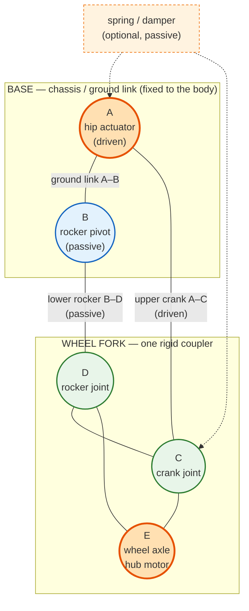

# System Architecture Design
## Wheeled Balancing Robot on a Donor Hoverboard (JBOT-Wheeled Biped)

| Field | Value |
|---|---|
| Status | Living document (stage 1 donor hardware baseline) |
| Version | 0.3 |
| Last updated | 2026-11-12 |
| Related documents | `docs/system_requirements.md`, `docs/hardware.md`, `docs/roadmap.md` |
| Scope | Compute tiers, power subsystem, communication interfaces, Rust software stack, safety concept |

---

## 1. Design Goals and Constraints

The architecture is driven by five constraints, in priority order:

1. **Safety first.** Loss of communication, control, or power must leave the robot in a predictable, low-energy state.
2. **Hard real-time separation.** The balance and motor-control loops must never depend on Linux scheduling.
3. **Deterministic communication.** Commands and feedback use bounded, versioned, checksummed frames with explicit timeouts.
4. **Modularity.** Perception, navigation, estimation, and control are independently testable Cargo crates with a single dependency direction.
5. **Upgradability.** Sensors, an optional manipulator, and AI accelerators can be added without redesigning the control path.

### 1.0. Hardware baseline and staging

The architecture is built on a donor hoverboard and delivered in two stages. The
same wheel controller, radio link, and balancing core are used in both.

| Stage | Hardware | Actuation | Control scope |
|---|---|---|---|
| **1** | Donor STM32F103RCT6 mainboard, 2 hub motors, 10s2p pack, BNO055, XR1 receiver | 2 wheel motors | Balance, drive, turn, spin in place |
| **2** | Stage 1 plus 2 hip actuators and drivers, four-bar legs | 2 wheels + 2 hips | Adds height and roll through the hips |
| **3** | Stage 2 plus a mission computer | Unchanged | Telemetry, estimation, navigation |

What the design takes as fixed:

- The mainboard is the only board that drives the wheel motors. It has two
  three-phase bridges, so it cannot host the hip actuators.
- The radio is a BetaFPV LiteRadio 3 Pro (ExpressLRS 2.4 GHz) and a RadioMaster
  XR1 receiver (CRSF, 420 kbaud) on USART2.
- The IMU is a BNO055 on I2C at 100 Hz. It sits on I2C2 in stage 1 and moves to
  I2C1 when the right cable is needed for the stage 2 link.
- The donor board has no routed CAN. Stages 1 and 2 therefore use UART links;
  CAN remains a reserved interface for a future controller or an external hip
  bus and is not part of the current wiring.

### 1.1. Non-functional targets

| Requirement | Target | Owner |
|---|---|---|
| Balance control loop | 200 Hz, 5 ms period | Mainboard |
| FOC current loop | 16 kHz | Mainboard timer ISR |
| IMU fusion | 100 Hz, gyro propagated to the balance rate | BNO055 + mainboard |
| Radio setpoints | up to 250 Hz over CRSF | XR1 + mainboard |
| Command timeout | 100 ms, zeroes setpoints without cutting torque | Mainboard |
| Mission-computer setpoints | 100 Hz, optional | Mission computer |
| State estimation (EKF) | 100-200 Hz | Mission computer |
| Localization / SLAM | 10-30 Hz | Mission computer |
| Navigation / behavior | 10-20 Hz | Mission computer |
| Boot to safe idle | < 10 s | Mainboard + mission computer |
| Runtime | 20-45 min on the donor 10s2p pack | Power subsystem |

> Numbers are design budgets, not measured guarantees. They must be validated in
> stage 1 and stage 2 bench tests. The 200 Hz balance rate is set by the donor
> mainboard's 5 ms loop; do not assume a 1 kHz loop on this controller.

### 1.2. Mechanical concept: stage 2, 1-DOF four-bar leg

Stage 1 has no legs: two hub motors, one wheel per side, with the pack and
electronics low and centred. Stage 2 adds one hip actuator per leg and turns the
platform into a wheeled biped with four actuators: two hip actuators in the body
and two hub motors, one per wheel. Each leg is a planar **1-DOF four-bar
linkage**. The base is the chassis link **A-B**; the wheel fork **C-D-E** is the
moving coupler.



| Element | Type | Motor / function |
|---|---|---|
| A-B | Ground link | **Base / chassis** — fixed to the body |
| A | Revolute joint | **Hip actuator** — driven, model TBD |
| B | Revolute joint | Passive rocker pivot on the base |
| A-C | Upper crank | Driven by the hip actuator |
| B-D | Lower rocker | Passive |
| C-D-E | Wheel fork | One rigid coupler; E is the wheel axle |
| E | Wheel axle | **Hub motor** — driven |
| Spring / damper | Optional passive element | Parallel compliance between the base and the upper crank |

Consequences for the architecture:

- The mechanism has **one active DOF**; body height and wheel fore-aft offset are coupled along the coupler curve.
- The "knee" is a rigid bend of the wheel fork, not an articulated joint.
- Balance is **3D** at stage 2: pitch via wheel torque, yaw via differential wheel torque, height via the common hip angle, roll via differential hip height. Stage 1 balances pitch and yaw only.
- The mainboard drives the wheels and runs the balance loop. The hips need their own drivers, commanded as setpoints over USART3; they must never be driven directly from the wheel bridges.

---

## 2. System Context

```
                         ┌──────────────────────────────┐
                         │   Operator / Fleet / Cloud   │
                         │  SSH, VPN, Zenoh, ROS2 tools │
                         └──────────────┬───────────────┘
                                        │ Ethernet / Wi-Fi
┌───────────────────────────────────────▼───────────────────────────────────────┐
│          Mission computer, stage 3 (Raspberry Pi 5 class, Linux)              │
│  Perception │ Localization / SLAM │ Nav2-equivalent │ Behavior │ Supervisor   │
│  State estimation (EKF) │ Zenoh router / ROS2 bridge │ Logs                   │
└───────────────┬───────────────────────────────┬───────────────────────────────┘
                │ UART USART3 (setpoints)       │ USB3 / CSI-2 / PCIe
                │                               │
┌───────────────▼───────────────────┐   ┌───────▼───────────────────────────────┐
│  Donor mainboard STM32F103RCT6    │   │  LiDAR, RGB-D camera, AI HAT (opt.)   │
│  Balance 200 Hz  │  FOC 16 kHz     │   └───────────────────────────────────────┘
│  BNO055 100 Hz   │  CRSF / USART2  │
│  Safety limits   │  Power latch    │
└───────┬───────────────────┬───────┘
        │ 3-phase + halls   │ I2C / CRSF
┌───────▼──────────┐  ┌─────▼──────────────────┐
│ 2x hub motors    │  │ BNO055, XR1 receiver,  │
│ stage 2: 2 hips  │  │ battery, temperature   │
│ via USART3       │  └────────────────────────┘
└───────┬──────────┘
        │ 42 V
┌───────▼──────────────────────────────────────────────────────────────────────┐
│  Donor power: 10s2p pack -> fuse -> kill switch -> mainboard MOSFET bridges   │
│  BMS, charge port, DC-DC 5 V for the receiver and the IMU                     │
└──────────────────────────────────────────────────────────────────────────────┘
```

---

## 3. Compute Tiers

The robot uses a **two-tier compute architecture**. The split is intentional: Linux provides a rich ecosystem for AI, navigation, and networking, but cannot guarantee microsecond-level determinism. The MCU provides determinism but has limited compute and memory.

### 3.1. Tier 0: Power and Safety Plane (hardware)

Always-on, mostly analog/electromechanical layer:

- Donor 10s2p pack with its integrated BMS, original charge port, and original charger.
- Main fuse, keyed battery connector, and a latching kill switch in the battery line.
- The mainboard's own power latch (PA5), which holds the board on after the button is pressed.
- 42 V to 5 V DC-DC for the receiver and the IMU, input rated for at least 60 V.
- Current and voltage sensing on the mainboard: phase shunts, DC-link shunt, pack divider, board NTC.
- Charge-detect input (PA12), used as a charging interlock.

Tier 0 has no software in the safety path. The kill switch does not depend on
firmware, which matters because the power button is only a firmware-held soft
latch and a hung board ignores it.

### 3.2. Tier 1: Real-Time Controller (donor STM32F103RCT6)

**Responsibilities**

- Run the FOC and SVPWM loop at 16 kHz for both hub motors, with phase current
  and DC-link current limiting.
- Run the balance controller at 200 Hz: pitch PD, speed loop, and yaw loop.
- Read the BNO055 over I2C at 100 Hz and propagate the gyro between samples.
- Receive CRSF setpoints from the XR1 over USART2, validate the link, and apply
  the arming and authority rules.
- Accept optional setpoints from the mission computer or hip driver over USART3.
- Read hall sensors, phase currents, pack voltage, and board temperature.
- Enforce tilt cutoff, current limits, charge interlock, and the command timeout.
- Drive the buzzer and status LED.
- Stage 2: forward height and roll setpoints to the hip drivers over USART3.
- Keep a blackbox ring buffer for post-mortem diagnostics.

**Loop schedule**

| Loop | Rate | Trigger | Notes |
|---|---|---|---|
| FOC current and SVPWM | 16 kHz | Timer + injected ADC | Both motors, same ISR budget |
| Hall capture | 16 kHz equivalent | Timer / EXTI | Speed derived from hall period |
| Balance / posture | 200 Hz | 5 ms main loop | Hard deadline; no dynamic allocation |
| Attitude fusion | 100 Hz | I2C | BNO055 output; timestamp at sample |
| Gyro propagation | 200 Hz | Main loop | Bridge between fused samples |
| CRSF ingest | up to 250 Hz | UART DMA | Validated, failsafe checked |
| Mission-computer ingest | 50-100 Hz | UART DMA | Frame with CRC and sequence |
| Telemetry / CRSF reply | 50 Hz | Main loop | Pack voltage, link quality, state |
| Health / watchdog | 100 Hz | Main loop | Feeds IWDG only when healthy |

**Why this board, and its limits**

| Property | Consequence |
|---|---|
| Cortex-M3 at 72 MHz, no FPU, 48 KB RAM | Balance math uses fixed point or soft float; keep the loop budget small |
| Two 3-phase bridges, 12 FETs | Exactly two motors; the hips need external drivers |
| Three hall inputs per motor, phase shunts | Speed and torque feedback without extra sensors |
| No routed CAN, two UARTs, one shared I2C/USART pair | UART and CRSF only; IMU placement drives the stage 2 wiring |
| 16 kHz PWM | Audible band; the current loop sets the torque bandwidth |

A later controller is an option only if the platform outgrows the F103, for
example if the hips demand a faster outer loop. The protocol and HAL stay
abstract enough to move the control code without changing the behaviour.

**Real-time rules**

- `no_std` firmware; no heap allocation in the control path.
- Fixed-size buffers for frames and telemetry.
- Interrupt priorities: FOC/ADC > UART RX > control timer > housekeeping.
- All shared state protected by critical sections or lock-free single-producer/single-consumer queues.
- No blocking waits in the 200 Hz loop; deadlines are enforced by hardware timers and the watchdog.

### 3.3. Tier 2: High-Level Computer (stage 3, Raspberry Pi 5 class)

**Responsibilities**

- Sensor drivers: LiDAR, RGB-D camera, optional AI accelerator.
- Perception: obstacle detection, free-space estimation, optional object/pose detection.
- Localization and mapping: LiDAR SLAM, map server, sensor fusion.
- Navigation: global planner, local planner/controller, costmaps, recovery behaviors.
- High-level state estimation: EKF fusing IMU, wheel odometry, and visual/LiDAR pose.
- Mission/behavior layer: behavior tree or state machine, teleoperation, docking, patrol.
- Supervisor: battery, thermal, latency, fault aggregation, logging, graceful shutdown.
- Connectivity: Zenoh router, ROS2 bridge, SSH/VPN, telemetry upload.
- Firmware update orchestration and blackbox retrieval.

**Why not run balance control here**

- Linux is not a hard real-time OS; scheduler jitter and USB/serial stack latency can exceed the balance loop deadline.
- A kernel stall, page fault, thermal throttle, or userspace restart must not cause a fall.
- The mainboard keeps the robot safe even if the mission computer crashes or reboots.

The mission computer may run a `PREEMPT_RT` kernel and isolated CPUs for communication threads, but this improves latency; it does not make it the safety authority.

### 3.4. Control and data flow

```
Sensors (LiDAR, camera, IMU, hall sensors, pack voltage)
        │
        ▼
┌─────────────────────── Mission computer (stage 3) ───────────────────────────┐
│ perception ──► world model ──► planner ──► velocity / yaw-rate setpoint      │
│       ▲                              │                    │                  │
│       │                              ▼                    ▼                  │
│   localization ◄── SLAM/map      behavior tree      safety envelope          │
│       ▲                              │                    │                  │
│       └──────── EKF ◄────────────────┴────────────────────┘                  │
└───────────────────────────────────────┬──────────────────────────────────────┘
                                        │ 50-100 Hz setpoints (USART3)
                                        ▼
┌────────────────── Donor mainboard STM32F103RCT6 ─────────────────────────────┐
│ CRSF + link validation ──► balance 200 Hz ──► FOC 16 kHz ──► 2x hub motors   │
│        ▲                        │                                │            │
│        │                        ▼                                ▼            │
│  limits / charge interlock ◄── IMU, halls, currents, voltage ◄── MOSFETs     │
└───────────────────────────────────────┬──────────────────────────────────────┘
                                        │ 50 Hz telemetry (CRSF + USART3)
                                        ▼
                              Mission computer (EKF, logs)
```

**Latency budget (design target)**

| Segment | Budget |
|---|---|
| IMU sample to filtered attitude on the mainboard | < 2 ms |
| Mainboard feedback to mission computer | < 2 ms |
| Mission-computer estimation update | < 5 ms |
| Mission-computer setpoint to mainboard | < 2 ms |
| Mainboard setpoint to motor torque | <= 5 ms (one balance period) |
| End-to-end sensor-to-actuator (high-level loop) | < 50 ms |

---

## 4. Power Subsystem

### 4.1. Battery characteristics

- **Pack:** donor 10s2p Li-ion 18650, 4.4 Ah, about 158 Wh, integrated BMS.
- **Voltage range:** about 30 V (empty, 3.0 V/cell) to 42.0 V (full, 4.2 V/cell); 36 V nominal.
- **Design current:** about 20 A continuous, 30-40 A short peak depending on the BMS; main fuse 30-40 A.
- **Notes:** the BMS protects the cells but is not a control layer. It can latch off under over-current, over-voltage, or under-voltage. On a 2p pack the sag under load is significant, so the firmware must derate early and never rely on the BMS to limit torque.

### 4.2. Protection and distribution chain

```
Donor 10s2p pack (integrated BMS)
   │ keyed battery connector
   ▼
┌──────────────────────┐
│ F1: 30-40 A fuse     │  main branch, >= 60 V DC rating
└──────────┬───────────┘
           ▼
┌──────────────────────┐
│ Kill switch          │  latching, >= 40 A, reachable in a fall
└──────────┬───────────┘
           ▼
   VBAT bus, 30-42 V
   ├── mainboard MOSFET bridges ── 2 hub motors (no branch fuse on the donor board)
   ├── 5 V DC-DC (XR1 + BNO055) ── 2 A branch fuse
   └── 15 V rail on the sideboard cables ── unused, insulated
```

Precharge is optional: the donor mainboard has its own input capacitance and is
switched on by its latch, not by a contactor. Add a precharge resistor only if
inrush proves to be a problem with the chosen fuse.

### 4.3. Rails

| Rail | Source | Load | Protection | Notes |
|---|---|---|---|---|
| VBAT 30-42 V | Donor pack | Mainboard bridges, 2 hub motors | 30-40 A main fuse, kill switch | Keep short and twisted; the BMS is the last line of defence |
| 15 V (cable) | Donor mainboard | None in stage 1-2 | Insulate the unused pins | Live when the board is on; never feed logic from it |
| 5 V / 1 A | External buck, >= 60 V input | XR1 receiver, BNO055 | 2 A fuse, TVS | Do not power the receiver from the 15 V rail |
| 3.3 V | Mainboard internal regulator | MCU, halls, logic | On-board | Logic is 3.3 V; the left cable is not 5 V tolerant |

**DC-DC requirements**

- Input range must cover 30-42 V; use 60 V-rated parts for margin and transients.
- Synchronous buck, > 85% efficiency at 0.5-1 W is not critical at this load; low quiescent current and clean output are.
- Soft-start, current limiting, and output OVP.
- Keep the converter away from the BNO055: its magnetometer is affected by DC current loops, which is one reason to run the IMU in accelerometer-gyro fusion mode.

### 4.4. Power budget (initial estimate)

| Load | Typical | Peak | Rail |
|---|---|---|---|
| Hub motors (2x) | 40-80 W | 600 W for < 10 s | VBAT |
| Mainboard logic, halls, sensors | 2 W | 3 W | Internal |
| XR1 receiver + BNO055 | 0.2 W | 0.3 W | 5 V |
| **Total, stage 1** | **~45-85 W** | **~600 W** | |

At 36 V, 600 W is about 17 A, which the pack can supply briefly; the 10 A per
motor limit caps the steady demand. The 158 Wh pack gives roughly 1.5-3 h at
typical draw, but aggressive balancing and repeated acceleration bring the
realistic runtime to 20-40 min. Runtime must be measured on the real pack,
because sag and BMS behaviour dominate at low charge. The mission computer
(stage 3) adds 8-25 W.

### 4.5. Sequencing, grounding, and EMI

**Power-up sequence**

1. Press the power button; the mainboard latches itself on (PA5) and starts its internal rails.
2. The external 5 V DC-DC comes up; the XR1 and the BNO055 boot.
3. The mainboard runs self-test, reads the IMU, and checks the radio link.
4. The robot stays in `IDLE` until the operator arms it from the radio.
5. Motion is enabled only by the arm switch, never by the mission computer.

**Power-down sequence**

1. Disarm from the radio; setpoints go to zero.
2. The balance loop keeps running, so the robot stays upright until it is supported.
3. Short press of the power button; the firmware releases the latch and the board powers off.
4. If the firmware does not respond, the kill switch removes battery power.

**Grounding**

- Single-point star ground at the battery negative terminal.
- Separate motor power return and logic return; join only at the star point.
- Twisted pair for UART and I2C, with a ground return in the same cable.
- Kelvin connection for the current shunt on the mainboard.
- Keep the BNO055 away from motor phase wires and DC-DC inductors: its magnetometer sees motor currents as field changes. Prefer the accelerometer-gyro fusion mode for this reason.

**EMI mitigations**

- Ferrites on motor phase cables and on the receiver cable.
- Twisted motor phase pairs; minimize loop area.
- Keep the receiver antenna clear of the mainboard and the battery.
- Shield the sideboard cables if the radio link shows dropouts at high motor current.
- Snubbers / RC networks across motor phases if driver ringing is observed.

### 4.6. Battery monitoring and low-voltage behavior

- Measure pack voltage with the mainboard divider (PA0-class input) and calibrate it against a multimeter.
- Measure DC-link current with the mainboard shunt; it is accurate enough for derating, not for coulomb counting.
- Estimate state of charge from voltage and, later, coulomb counting on the mission computer.
- Thresholds (calibratable):
  - **Warning:** 36.0 V (about 3.6 V/cell) — reduce acceleration limits, notify the operator.
  - **Derate:** 33.0 V — limit torque and speed.
  - **Hard stop:** 30.0 V with 500 ms debounce — disable motors, enter `FAULT`, allow controlled shutdown.
- Never rely on a single voltage sample under load; use a filtered value plus current compensation.
- Log all threshold events with timestamps and current. The donor board has no RTC, so uplink the events over CRSF or USART3 when a mission computer is present.

### 4.7. E-stop topology

The real E-stop is **hardware** and independent of Linux and MCU software:

- A latching kill switch in the battery positive line removes power from everything, including the mainboard.
- It is the only stop that works when the firmware hangs. The power button is read by the firmware, and the firmware holds the power latch; a hung board ignores the button.
- The switch must be reachable during a fall and clearly marked. It is not a substitute for a controlled stop during normal operation.
- A software stop exists for normal use: disarm, zero setpoints, then release the power latch. It is not a safety authority.

The donor board has no contactor and no separate driver-enable line. A later
stage can add a contactor or a motor-power relay controlled by the kill loop;
until then, the battery-line switch is the accepted safety path.

---

## 5. Communication Architecture

### 5.1. Topology

```
                 ┌─────────────────────────────┐
                 │ LiteRadio 3 Pro             │
                 │ ExpressLRS 2.4 GHz, 8 ch    │
                 └──────────┬──────────────────┘
                            │ 2.4 GHz
                 ┌──────────▼──────────────────┐
                 │ XR1 receiver, CRSF 420k     │
                 └──────────┬──────────────────┘
                            │ USART2 (left cable)
┌───────────────────────────▼─────────────────────────┐
│ Donor mainboard STM32F103RCT6                       │
│  USART2 CRSF  │  I2C2 BNO055  │  USART3 link       │
└──────┬──────────────────┬──────────────────┬────────┘
       │ 3-phase + halls  │ I2C              │ UART
┌──────▼──────┐   ┌───────▼──────┐   ┌───────▼────────────────┐
│ 2 hub motors│   │ BNO055       │   │ Hip driver / mission   │
│             │   │              │   │ computer (stage 2/3)   │
└─────────────┘   └──────────────┘   └────────────────────────┘
```

### 5.2. Serial links

The donor board has no routed CAN. Stages 1 and 2 use point-to-point serial
links; CAN remains a reserved interface for a later controller or an external
hip bus and is not wired today.

| Link | Interface | Pins | Peer | Rate | Purpose |
|---|---|---|---|---|---|
| Radio | USART2 | PA2 TX, PA3 RX | XR1 receiver | 420 kbaud, CRSF | Setpoints, arm state, telemetry reply |
| IMU | I2C2 | PB10 SCL, PB11 SDA | BNO055 | 100 kHz | Attitude at 100 Hz |
| Mission / hips | USART3 | PB10 TX, PB11 RX | Mission computer or hip driver | 115200, 8N1 | Setpoints in, feedback out |
| Debug | SWD | PA13, PA14 | ST-Link | — | Flashing, RTT logs |
| CAN (reserved) | not routed | PB8/PB9 package pins | Future node | — | Requires soldering or a new board |

Rules:

- Each link is a single point-to-point connection; there is no multi-drop bus.
- All signal wires are 3.3 V. The 15 V pin on each cable is power only and is
  insulated when unused.
- The right cable's two signal pins carry either USART3 or I2C2, never both.
  This is why the IMU moves to I2C1 when the mission-computer link is added.
- CRSF frames are parsed and validated by the firmware; a CRC failure or a
  timeout does not update the setpoint.
- The mission-computer frame carries a CRC and a sequence counter, so a stale
  frame is rejected exactly like a corrupt one.

### 5.3. Application protocol and framing

All serial links above the CRSF link use the same logical message schema:

```rust
#[derive(serde::Serialize, serde::Deserialize)]
struct FrameHeader {
    version: u8,       // protocol version, starts at 1
    msg_type: u8,      // message kind
    flags: u8,         // ack, fault, fragment, etc.
    seq: u16,          // wraps; used for loss/reorder detection
    timestamp_us: u32, // MCU monotonic microseconds (wraps ~71 min)
}

struct Frame {
    header: FrameHeader,
    payload: heapless::Vec<u8, 56>,
    crc16: u16,         // mandatory on every serial link
}
```

- **Serialization:** `postcard` for compact `serde` encoding; fixed layout for the header. Keep the schema versioned and reject unknown major versions.
- **CRC:** CRC-16/CCITT-FALSE (poly `0x1021`, init `0xFFFF`) over header + payload.
- **Sequence:** 16-bit sequence per message type; the receiver tracks gaps and reports loss counters.
- **Fragmentation:** if a payload exceeds 56 bytes, split into fragments with `flags & FRAGMENT` and a fragment index; reassemble with a timeout. Prefer designing messages to fit one frame.
- **Endianness:** little-endian for all numeric fields.
- **Validation:** reject frames with bad CRC, wrong version, wrong length, stale sequence, or out-of-range values. Invalid commands do not update the actuator setpoint.

### 5.4. Mission-computer link

- **Physical:** 3.3 V TTL UART on the right cable, 115200 8N1, with a ground return in the same cable.
- **Role:** setpoints and telemetry only; the mission computer never arms and never commands motor torque directly.
- **Frame:** header + payload + CRC-16, with a 16-bit sequence.
- **Timeout:** a frame older than 300 ms is not authority; the radio takes over or the setpoints go to zero.
- **Bandwidth:** 115200 baud carries 100 Hz setpoints plus 50 Hz telemetry with room to spare. If the link needs more, raise the baud rate rather than shrinking the frame below 10 bytes.
- **Fallback:** if the link is absent, the robot runs on the radio alone. This is the normal stage 1 configuration.

### 5.5. USB and high-speed sensor interfaces

- **USB 3.0:** LiDAR, RGB-D camera, high-rate debug/telemetry, firmware DFU.
- **USB 2.0:** MCU CDC debug console, lower-rate sensors.
- **CSI-2:** camera direct connection when supported; preferred over USB for deterministic frame capture.
- **PCIe 2.0 x1:** NVMe storage and optional AI HAT (e.g., Hailo-8L). Check power and thermal budget.
- **Rules:**
  - USB is not used for the primary control loop; it is not deterministic enough.
  - Use a powered hub for high-draw peripherals; account for the mission computer's port current limits.
  - Use ferrites and short cables; avoid ground loops through the LiDAR/camera chassis.
  - Provide a dedicated USB port for MCU debug/DFU so recovery does not require disassembly.

### 5.6. Mainboard-internal buses

| Bus | Devices | Rate | Notes |
|---|---|---|---|
| I2C2 | BNO055 | 100 kHz | Right cable PB10/PB11 in stage 1; keep away from motor lines |
| I2C1 (remap) | BNO055 after stage 2 rewiring | 100 kHz | PB8/PB9 package pins, two soldered 30 AWG wires |
| ADC | Phase currents, DC-link current, pack voltage, NTC | Synchronized to PWM | Injected conversion inside the FOC interrupt |
| Timers | PWM, hall capture, 5 ms main loop | hardware | 16 kHz PWM, dead time 48 counts |
| GPIO | Power latch, charge detect, buzzer, LED | event | Safe state on reset |

### 5.7. Time synchronization

- The mainboard maintains a free-running microsecond timer; every telemetry frame carries the sample timestamp.
- The mission computer maintains `CLOCK_MONOTONIC`; it estimates the mainboard-to-computer offset and drift with an EWMA filter.
- Optional 1 PPS or a GPIO sync pulse improves alignment for sensor fusion, but is not needed in stage 1.
- If Ethernet/PTP is available, use PTP for sensor timestamps; otherwise use arrival time plus offset estimation.
- Always timestamp at the sensor/sample point, not at the application layer.

### 5.8. Bandwidth and QoS

| Traffic | Rate | Frame size | Bandwidth (approx.) | Policy |
|---|---|---|---|---|
| CRSF setpoints | 50-250 Hz | 26 B | up to 42 kbit/s at 420 kbaud | Latest value, validated |
| CRSF telemetry reply | 10-50 Hz | 10 B | 4 kbit/s | Best effort |
| Mission-computer setpoints | 100 Hz | 16 B | 13 kbit/s at 115200 | Latest value, reliable |
| Mission-computer telemetry | 50 Hz | 32 B | 13 kbit/s | Best effort |
| IMU samples (internal) | 100 Hz | 20 B | internal bus only | Best effort, timestamped |
| **Total on the mission link** | | | **~26 kbit/s** | Fits 115200 with margin |

Command traffic has priority over telemetry. If a link saturates, reduce the
telemetry rate; never delay the setpoint or the arming state.

### 5.9. Fault handling

- **CRSF timeout:** zero the setpoints and keep balancing; latch a warning. Do not cut motor torque.
- **CRSF CRC errors:** increment a counter; after N consecutive errors, treat the link as lost.
- **Mission-link framing errors:** increment counters; after N consecutive errors, drop the mission authority and fall back to the radio.
- **Sequence gaps:** log and expose a packet-loss metric; do not silently accept stale commands.
- **Mainboard fault:** disable the bridges, latch `FAULT`, and rely on the operator or the kill switch.
- **Duplicate commands:** idempotent; a repeated command with an older sequence is ignored.

---

## 6. Software Architecture (Rust)

### 6.1. Workspace and dependency direction

```
jbot_common  ◄── jbot_hardware
     ▲        ◄── jbot_navigation
     │
     └────────────── jbot_node ──► binaries / services
```

Rules:

- `jbot_common` contains shared types, configuration, and message schemas. It must not depend on hardware or async runtimes.
- `jbot_hardware` owns transport (UART/USB) and sensor drivers; it may depend on Tokio.
- `jbot_navigation` owns costmaps, planners, and path following; may depend on external map types.
- `jbot_node` is the composition root: it wires tasks, transports, middleware, supervision, and configuration.
- No dependency cycles. A crate that needs I/O receives it via a trait defined in `jbot_common` or a dedicated port module.

**Proposed crate split (future):**

- `jbot_protocol`: `no_std`-compatible message definitions, `postcard` schema, CRC framing, shared with firmware.
- `jbot_safety`: state machine, fault codes, watchdog policy, limit checks.
- `jbot_teleop`: joystick/gamepad and web teleoperation.
- `firmware/hoverboard-rs/`: separate embedded Cargo workspace on the F103 mainboard; not a member of the host workspace.

### 6.2. Current crate responsibilities

| Crate | Responsibility | Status |
|---|---|---|
| `jbot_common` | Shared types, config, message definitions | Configuration baseline |
| `jbot_hardware` | UART/USB transports, sensor and actuator drivers | Skeleton; provisional BNO055 and CRSF link |
| `jbot_navigation` | Costmaps, global/local planning, path tracking | Skeleton |
| `jbot_node` | Runtime composition, middleware, supervision, CLI | Skeleton |
| `firmware/hoverboard-rs` | F103 balance firmware: FOC shim, IMU, CRSF, safety | Planned; see `firmware/README.md` |

### 6.3. Runtime and task model (Tokio)

The mission-computer process uses a multi-thread Tokio runtime. Task isolation matters more than raw async throughput.

| Task | Rate / trigger | Tokio primitive | Notes |
|---|---|---|---|
| UART ingress | event-driven | dedicated blocking thread + `mpsc` | Do not block the runtime with serial I/O |
| Command egress | 100 Hz | `interval` + `watch` | Latest-value command; skip missed ticks |
| Estimation | 100-200 Hz | `interval` | Consumes IMU/odometry, publishes state |
| Control | 100 Hz | `interval` | Consumes state + trajectory, produces command |
| Navigation | 10-20 Hz | `interval` | May run in a separate process for isolation |
| Perception | sensor rate | `mpsc` / `broadcast` | CPU/GPU bound; consider a separate process |
| Supervisor | 10 Hz | `interval` | Battery, thermal, latency, faults |
| Telemetry/logging | 10-50 Hz | `broadcast` + bounded `mpsc` | Drop-oldest policy for telemetry |
| Middleware | event-driven | Zenoh/ROS2 callbacks | Bridge to external world |
| Shutdown | signal | `CancellationToken` | Coordinated graceful stop |

**Channel policy**

- `watch` for the latest command, latest state, and latest setpoint (no queue buildup).
- Bounded `mpsc` for frames and logs; on overflow, increment a counter and drop the oldest telemetry, never the arming state or a fault.
- `broadcast` for faults and mode changes; slow subscribers must not block the producer.
- `oneshot` for request/response (configuration, calibration).

**Real-time caveats on Linux**

- Linux is not hard real-time. Use `PREEMPT_RT` if available, isolate CPUs (`isolcpus`), and pin the UART/comms thread.
- Raise thread priority for comms/safety tasks (`SCHED_FIFO` via `libc`/`thread-priority`), but keep the balance loop on the mainboard.
- Lock memory (`mlockall`) to avoid page faults in latency-sensitive threads.
- Avoid blocking calls, synchronous file I/O, and `std::sync::Mutex` across `.await` in async tasks.
- Use `MissedTickBehavior::Skip` or `Delay` deliberately; do not let a slow tick burst.
- Bound every queue; unbounded channels are a latent failure mode.
- No `panic!`/`unwrap()` in the control path; propagate typed errors and enter a safe state.

### 6.4. Middleware: Zenoh and ROS2

The robot uses a **Zenoh-first** data plane and bridges to ROS2 where the ecosystem requires it.

| Option | Role | Strengths | Trade-offs |
|---|---|---|---|
| **Zenoh** (`zenoh` crate) | Primary intra-robot and remote pub/sub, queryables, shared memory | Low overhead, Rust-native, works over LAN/WAN, good for telemetry and fleet | Not a ROS2 replacement; tooling ecosystem is smaller |
| **zenoh-bridge-ros2dds** | Bridge to Nav2, RViz, rosbag, existing ROS2 nodes | Keeps ROS2 ecosystem available without rewriting | Extra process; QoS mapping must be understood |
| **r2r** | Native Rust ROS2 client | Ergonomic pub/sub/service/action, async | Requires a sourced ROS2 installation; API/version coupling |
| **ros2-client** | Native Rust ROS2 client | Async, supports ROS2 concepts | Smaller community; verify feature coverage |
| **rclrs** | Official ROS2 Rust bindings | Closest to ROS2 semantics | API churn, more ceremony, C++ toolchain dependency |

**Recommendation**

- Use Zenoh for internal state, commands, telemetry, and remote monitoring.
- Use `zenoh-bridge-ros2dds` for Nav2, RViz, rosbag2, and third-party ROS2 packages.
- If native ROS2 is required inside Rust, standardize on **one** client library (prefer `r2r` for ergonomics or `ros2-client` for a lighter async footprint) and isolate it behind a trait so it can be swapped.
- Do not put DDS or Zenoh on the balance path. The control path is the mainboard's own loop, fed by CRSF or USART3.
- Map QoS explicitly:
  - Commands: reliable, keep-last, deadline.
  - High-rate telemetry: best-effort, keep-last.
  - Maps/TF: transient-local.
  - Faults and arming state: reliable, highest priority, never dropped.

### 6.5. Key Rust libraries (candidate/adopted)

| Area | Crate | Purpose | Status |
|---|---|---|---|
| Async runtime | `tokio` | Tasks, timers, channels, signal handling | Adopted |
| Serialization | `serde`, `postcard` | Message schema and compact encoding | Adopted / proposed |
| Framing | `cobs`, `crc` | UART framing and checksums | Proposed |
| Linear algebra | `nalgebra` | Kinematics, EKF, control math | Adopted |
| Errors | `thiserror`, `anyhow` | Typed library errors, application context | Adopted / proposed |
| Logging | `tracing`, `tracing-subscriber` | Structured logs and spans | Proposed |
| Config | `serde`, `toml`, `config` | Robot configuration and calibration | Proposed |
| CLI | `clap` | Node and tooling commands | Proposed |
| CAN (deferred) | `socketcan`, `tokio-socketcan` | Future CAN access if a controller with routed CAN is added | Deferred |
| Serial | `tokio-serial`, `serialport` | CRSF and mission-computer link | Proposed |
| Middleware | `zenoh` | Pub/sub, queryables, remote access | Proposed |
| ROS2 bridge | `zenoh-bridge-ros2dds` (external) | Nav2/RViz/rosbag integration | Proposed |
| ROS2 client | `r2r` or `ros2-client` | Native ROS2 if needed | Under evaluation |
| Visualization | `rerun` | Live plots, point clouds, replay | Proposed |
| Inference | `ort`, `tract`, `candle` | ONNX/model inference on CPU/accelerator | Under evaluation |
| State machines | `statig` | Explicit safety/behavior state machines | Proposed |
| Graph/search | `petgraph`, `pathfinding` | Planning and graph utilities | Proposed |
| Testing | `proptest`, `insta`, `mockall` | Property, snapshot, and mock testing | Proposed |

**Firmware stack (MCU)**

| Area | Crate | Purpose |
|---|---|---|
| HAL | `embassy-stm32` or `stm32-hal` | STM32 peripherals, async |
| Executor | `embassy-executor` | Async tasks on `no_std` |
| Time | `embassy-time` | Timers and delays |
| RTOS-style scheduling | `rtic` | Priority-based, deterministic scheduling |
| HAL traits | `embedded-hal` | Portable drivers |
| Logging | `defmt`, `defmt-rtt` | Low-overhead binary logging |
| Flashing/debug | `probe-rs`, `panic-probe` | Flashing, RTT, panic dumps |
| Collections | `heapless` | Fixed-capacity buffers and queues |
| Math | `micromath` | `no_std` scalar math |
| Watchdog | `stm32f1xx-hal` IWDG | Independent hardware watchdog |

> Firmware dependencies live in `firmware/hoverboard-rs/`, a separate embedded
> workspace. They are not members of the host workspace.

### 6.6. Task/data architecture

```
┌─────────────┐   frames    ┌──────────────┐   state    ┌─────────────┐
│ UART RX     │────────────►│ Estimation   │───────────►│ Control     │
│ (thread)    │  mpsc       │ (100-200 Hz) │  watch     │ (100 Hz)    │
└──────┬──────┘             └──────┬───────┘            └──────┬──────┘
       │                           │                           │
       │ telemetry                 │ state                     │ command
       ▼                           ▼                           ▼
┌─────────────┐             ┌──────────────┐            ┌─────────────┐
│ Telemetry   │             │ Supervisor   │            │ UART TX     │
│ (10-50 Hz)  │             │ (10 Hz)      │            │ (100 Hz)    │
└──────┬──────┘             └──────┬───────┘            └──────┬──────┘
       │                           │ faults                    │
       ▼                           ▼                           ▼
┌─────────────────────────────────────────────────────────────────────┐
│ Zenoh / ROS2 bridge / logs / metrics / blackbox retrieval            │
└─────────────────────────────────────────────────────────────────────┘
```

### 6.7. AI and perception pipeline

```
Camera ──► V4L2/GStreamer ──► preprocess ──► model (ONNX/ORT/tract)
                                                    │
LiDAR ──► driver ──► point cloud ──► scan matching / SLAM ──► map + pose
                                                    │
                            ┌───────────────────────┴───────────────┐
                            ▼                                       ▼
                    obstacle/free-space map                 localization
                            │                                       │
                            └──────────────► costmap ◄──────────────┘
                                                │
                                          Nav2 / planner
                                                │
                                        velocity command
```

- Prefer hardware-accelerated inference via an AI HAT (Hailo-8L) or the mission computer's CPU/GPU for small models.
- Keep inference off the control thread; publish detections as timestamped messages.
- Degrade gracefully: if perception or localization is stale, reduce speed or stop; never drive on stale data.
- Record sensor data with timestamps for replay and regression testing.

### 6.8. Configuration, logging, and observability

- **Configuration:** TOML files validated into typed structs (`serde` + `config`). Separate robot-specific calibration from code defaults. Version the config and log its hash at startup.
- **Logging:** `tracing` with JSON output; include node, task, robot ID, and correlation IDs. Avoid logging at high rates in the control path.
- **Metrics:** counters for frame loss, CRC errors, bus-off events, command age, loop jitter, battery voltage, temperatures, and fault counts. Export via Zenoh or a Prometheus endpoint.
- **Blackbox:** mainboard ring buffer of the last N seconds of setpoints, states, faults, and raw sensor snapshots; dump over USART3 or SWD on request.
- **Replay:** record synchronized sensor/command logs; replay through the HIL bench for regression tests.

### 6.9. Build, deployment, and update

- **Mission-computer target:** `aarch64-unknown-linux-gnu`; cross-compile with `cross` or `cargo-zigbuild`; ship as a static-ish binary with a known glibc baseline or use musl where compatible.
- **Mainboard target:** `thumbv7m-none-eabi`; the F103 has no FPU, so the balance code is fixed point or soft float. Build with `cargo build --release --target thumbv7m-none-eabi`.
- **Process management:** systemd units for `jbot-node`, `zenohd`, sensor drivers, and the ROS2 bridge. Restart policy with backoff; watchdog integration.
- **Filesystem:** read-only root where practical; separate writable partition for logs and maps. A/B updates or atomic image updates.
- **Firmware update:** SWD with `probe-rs` in development; a UART bootloader with image signature and rollback for production.
- **CI:** `cargo fmt --check`, `cargo clippy -- -D warnings`, `cargo test`, cross-build for aarch64, firmware build, `cargo deny`, `cargo audit`.
- **Versioning:** protocol version in every frame; reject incompatible major versions. Keep firmware and host protocol versions in a compatibility matrix.

### 6.10. Testing strategy

| Level | What | Tools |
|---|---|---|
| Unit | Math, framing, CRC, state machine, limits | `cargo test` |
| Property | Framing round-trips, sequence wraparound, malformed frames | `proptest` |
| Integration | UART loopback, link timeouts, arbitration between radio and mission computer | `tokio::test`, virtual serial ports |
| Simulation | Sensor noise and navigation scenarios | Gazebo/ROS2 |
| HIL | Real mainboard + hub motors + mission computer, fault injection | Bench rig, `defmt`, logic analyzer |
| System | Kill switch, battery cutoff, thermal, communication loss, 24 h soak | Full robot |
| Regression | Replay recorded logs and compare metrics | `rerun`, golden traces |

**Definition of done for control changes:** unit tests pass, HIL balance test passes, no new clippy warnings, latency and jitter within budget, and a rollback path exists.

---

## 7. Safety and Fault Management

### 7.1. State machine

```
BOOT
  │ self-test OK
  ▼
SELF_TEST ──fail──► FAULT
  │ pass
  ▼
IDLE ◄──────────────┐
  │ arm (radio only) │ disarm / stop
  ▼                  │
BALANCE ◄── link loss: zero setpoints, keep balancing
  │ fault / tilt / overcurrent / low battery / kill switch
  ▼
DAMPING ──► FAULT ──► SHUTDOWN
  ▲
  └── E_STOP (kill switch, latched until power is restored)
```

| State | Motors | Behavior |
|---|---|---|
| `BOOT` | Disabled | Clock/peripheral init, load calibration |
| `SELF_TEST` | Disabled | IMU, hall, voltage, charger, link checks |
| `IDLE` | Disabled or zero torque | Accept commands, hold safe posture if possible |
| `BALANCE` | Enabled | 200 Hz balance and velocity control |
| `DAMPING` | Enabled, zero/low torque | Controlled stop; no balancing |
| `FAULT` | Disabled | Latch fault, report, wait for reset |
| `E_STOP` | Hardware disabled | Latched until physical reset and self-test |
| `SHUTDOWN` | Disabled | Flush logs, park, power down |

### 7.2. Watchdog chain

1. **Kill switch:** removes battery power independently of software.
2. **Mainboard independent watchdog (IWDG):** resets the MCU if the control loop stops feeding it.
3. **Radio watchdog:** loss of valid CRSF frames for 100 ms zeroes the setpoints and keeps balancing. It never cuts torque while the robot is upright.
4. **Mission-link watchdog:** a command older than 300 ms loses authority; the radio takes over.
5. **Charge interlock:** a plugged-in charger blocks arming and motor output.
6. **Tilt cutoff:** a body angle above the configured limit disables the bridges and latches a fault.
7. **Mission-computer systemd watchdog (stage 3):** restarts `jbot_node` if it hangs; its loss does not affect balance.

### 7.3. Limits and protections

| Quantity | Limit | Action |
|---|---|---|
| Motor phase current | 10 A per motor (bench profile) | Current limit, then fault |
| DC-link current | 12 A | Current chopping in the FOC core |
| Battery voltage | 36.0 / 33.0 / 30.0 V | Warn / derate / stop |
| Body tilt | Configurable, 25-35 deg | Cut torque, latch fault |
| Command age | 100 ms (radio), 300 ms (mission link) | Zero setpoints, keep balancing |
| Wheel speed | 400 rpm (bench profile) | Speed limit |
| Board temperature | Margin below the NTC trip | Derate, then disable |
| Charger present | Any time | Block arming and motor output |

### 7.4. Fault codes and reporting

- Faults are enumerated (`FAULT_IMU`, `FAULT_RADIO`, `FAULT_LINK`, `FAULT_OVERCURRENT_LEFT`, `FAULT_UNDERVOLTAGE`, `FAULT_TILT`, `FAULT_CHARGER`, ...).
- Each fault has severity (`Info`, `Warning`, `Critical`, `Latched`) and a timestamp.
- Critical faults disable motion and are latched until an explicit reset with the robot stationary.
- Faults are reported over CRSF telemetry and USART3 and logged by the mission computer with context (voltage, current, temperature, last command).

---

## 8. Deployment and Operations

### 8.1. Process layout on the mission computer

| Process | Role | Restart policy |
|---|---|---|
| `zenohd` | Local Zenoh router | Always |
| `jbot-node` | Estimation, supervision, hardware I/O | Always, with backoff |
| `zenoh-bridge-ros2dds` | ROS2/Nav2/RViz bridge | Always |
| LiDAR driver | Point cloud/scan publisher | Always |
| Camera driver | Image/Depth publisher | Always |
| `nav2` (if used) | Planning and navigation | On demand |
| Logging/telemetry agent | Upload and retention | Always |

- Run perception/navigation in separate processes where practical so a crash does not take down the supervision process.
- Use a supervisor (systemd) with `Restart=on-failure`, `WatchdogSec`, and resource limits.
- Keep the supervision process minimal; avoid loading large models into it.
- The mainboard keeps balancing if every process above disappears; that is the point of the split.

### 8.2. Network and remote access

- Local Wi-Fi/Ethernet for Zenoh and ROS2; disable unnecessary services.
- SSH/VPN for remote support; no direct exposure of robot control ports to the public internet.
- Optional 4G/5G router for fleet telemetry; queue and compress logs when offline.
- Authenticate Zenoh/ROS2 endpoints where supported; isolate the robot network from the corporate LAN.

### 8.3. Boot and shutdown

- **Boot:** power button → mainboard latch and self-test → safe idle → 5 V rail → receiver and IMU → radio link check → `IDLE`. The mission computer, if present, boots in parallel and never gates the mainboard.
- **Shutdown:** disarm → zero setpoints → release the power latch. The mission computer shuts down first, or is simply powered off with the robot.
- **Brownout:** the mainboard resets into a safe state with the bridges off; the pack BMS may latch off. The operator restores power with the button after checking the pack.

---

## 9. Risks and Mitigations

| Risk | Impact | Mitigation |
|---|---|---|
| Linux scheduling jitter | Poor high-level loop timing | Keep the 200 Hz balance loop on the mainboard; use `PREEMPT_RT`, CPU isolation, RT priorities |
| UART link errors under motor EMI | Dropped commands | Keep the setpoint watchdog forgiving (zero, not cut); twisted pairs, ferrites, CRC, sequence checks |
| F103 cannot raise the balance rate if the hips need it | Controller upgrade | Keep the protocol and HAL abstract; plan a faster board only if stage 2 measurements demand it |
| Donor pack BMS latch-off | Unexpected power loss | Derate before cutoff; monitor voltage and current; test pack behaviour under load |
| 2p pack sag under peak current | Early derating, weak balance | Keep the 10 A per motor limit; measure sag; never raise limits without a thermal and sag test |
| Regen on a full pack trips the BMS | DC-link spike | Start at about 90% charge; limit regen current; test before trusting the BMS |
| EMI from motors | IMU and radio corruption | Shielding, twisted pairs, ferrites, physical separation; prefer BNO055 fusion without the magnetometer |
| Thermal throttling on the mission computer | Perception/nav slowdown | Heatsink/fan, thermal monitoring, graceful degradation |
| AI accelerator power/thermal | Brownout or throttling | Budget power, separate rail, thermal design, validate under load |
| Firmware/host protocol drift | Incompatible frames | Protocol version, schema tests, compatibility matrix, CI |
| Power button mistaken for an E-stop | Injury risk | Label it; document that the kill switch is the safety path; proof-test the kill switch |

---

## 10. Architecture Decision Records (summary)

| ADR | Decision | Rationale | Status |
|---|---|---|---|
| ADR-001 | Donor STM32F103RCT6 mainboard as the stage 1-2 controller | The board already owns the MOSFET bridges, current shunts, halls, and power latch; replacing it would discard the cheapest and best-integrated part of the donor | Accepted |
| ADR-002 | Serial links (CRSF + UART), not CAN, for stages 1-2 | CAN is not routed on the donor board; UART covers the radio, IMU, and mission link with enough bandwidth | Accepted |
| ADR-003 | Two-tier compute: mainboard + mission computer (stage 3) | Separates AI/nav from hard real-time control | Accepted |
| ADR-004 | Zenoh-first middleware, ROS2 bridge | Rust-native, low overhead, keeps ROS2 ecosystem available | Proposed |
| ADR-005 | Kill switch removes battery power; the power button is not an E-stop | The button is firmware-held; only a hardware switch survives a hung firmware | Accepted |
| ADR-006 | Donor 10s2p pack, 36 V nominal, 30-42 V range | Already matched to the mainboard and motors; conservative current limits compensate for the 2p capacity | Accepted (baseline) |
| ADR-007 | Application CRC + sequence on all serial frames | Uniform error detection across CRSF and UART | Proposed |
| ADR-008 | SLAM: Rust-native stack vs `slam_toolbox`/Cartographer via the ROS2 bridge | Pending stage 4 evaluation | Proposed |
| ADR-009 | Stage 2: 1-DOF four-bar leg, one hub wheel per leg, 2 hip actuators | Compact 4-actuator layout; motors in the body; known coupler curve; height and fore-aft are coupled | Accepted |
| ADR-010 | Hip actuator with integrated driver, commanded as setpoints over USART3; model TBD | Avoids a custom hip power stage; keeps the mainboard's two bridges for the wheels | Proposed |

---

## 11. Open Questions

1. Stage 2 hip actuator: model, torque, gear ratio, driver interface, and whether it accepts setpoints over UART or needs an external driver board.
2. Whether the mission computer appears in stage 2 (as the hip driver) or stage 3 (as a separate navigation computer).
3. BNO055 fusion mode: accelerometer-gyro (IMUPLUS) to reject motor magnetic fields, or full 9-DOF if the mounting proves clean.
4. Regeneration limit and the highest safe start-of-charge for the donor BMS.
5. LiDAR/camera selection and mounting; impact on SLAM and AI compute budget.
6. Whether Nav2 is used as-is (C++ via bridge) or replaced by a Rust planner. Affects `jbot_navigation`.
7. AI accelerator choice (Hailo-8L vs CPU-only) and model runtime (`ort` vs `tract` vs `candle`).
8. Production firmware update path: UART bootloader vs SWD probe.
9. Enclosure, connector, and serviceability requirements.
10. Whether a contactor or motor-power relay is added to the donor power path for stage 2 and beyond.
11. Wheel traction and slip on the target surface; dual wheels remain deferred.

---

## 12. Glossary

| Term | Meaning |
|---|---|
| BNO055 | Bosch 9-DOF IMU with onboard sensor fusion |
| CRSF | Crossfire serial protocol used by ExpressLRS receivers |
| DC-DC | Direct-current voltage converter |
| ELRS | ExpressLRS, the 2.4 GHz radio link used by the transmitter and receiver |
| EKF | Extended Kalman Filter |
| FOC | Field-Oriented Control for BLDC/PMSM motors |
| HIL | Hardware-in-the-loop testing |
| IMU | Inertial Measurement Unit |
| IWDG | Independent Watchdog |
| MCU | Microcontroller Unit |
| QDD | Quasi-Direct Drive actuator |
| SLAM | Simultaneous Localization and Mapping |
| SoC / SoH | State of Charge / State of Health |
| VMC | Virtual Model Control |
| Zenoh | Pub/sub/query middleware for distributed systems |

---

## 13. References

- `docs/system_requirements.md` — system requirements specification.
- `docs/roadmap.md` — phased implementation plan.
- `Cargo.toml` and `crates/*/Cargo.toml` — current workspace layout and dependencies.
