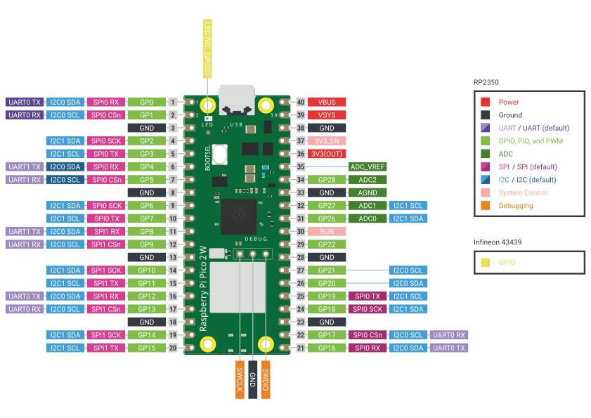

# Pico 2 W firmware

Everything for the RP2350 balance controller lives in this directory.

| Path | Content |
|---|---|
| `fw/` | The `pico-bridge` package: Embassy tasks, peripheral drivers, USB console, debug bridge and the flashed image. Owns the `.cargo/config.toml` target selection and `memory.x`. |
| `core/` | The `jbot_pico_core` crate: hardware-independent, `no_std`, allocation-free control law, filters, BNO055 decoding, EFeru/hardened wire formats and NVM schema. Host-tested. |

`fw/Cargo.toml` depends on `core/` through `path = "../core"`. The two crates
stay separate so control and protocol changes can be verified without hardware.

## Board pinout



The consolidated cross-board connection table is in `../../docs/wiring.md`; the
hardware pin tables are in `../../docs/hardware.md`.

## Checks

```sh
cd core
cargo test
cargo clippy --all-targets -- -D warnings

cd ../fw
cargo check
```

## Mainboard link mode

Both boards boot in `LEGACY8`. The Pico console has `protocol` for querying
and `protocol legacy`; `protocol hardened` is rejected. The STM32 console has
`$SET PROTOCOL LEGACY|HARDENED`, reachable from the Pico with `dbg <text>`.
Linking the hardened path in `main.rs` reproducibly broke USB CDC enumeration
on the bench, so the flashed image keeps the legacy path and the native
`jbot-console` exposes only the `LEGACY8` switch. See `../../docs/pico-bridge.md`
section 4.1.1.

## Build and flash

Put the board into BOOTSEL mode, then from `fw/`:

```sh
cargo build --release
cargo run --release          # picotool load -u -v -x -t elf
```

The release ELF is `target/thumbv8m.main-none-eabihf/release/pico-bridge`. See
[`../README.md`](../README.md) section 5 and `docs/pico-bridge.md` for the task
model and the safety contract.
