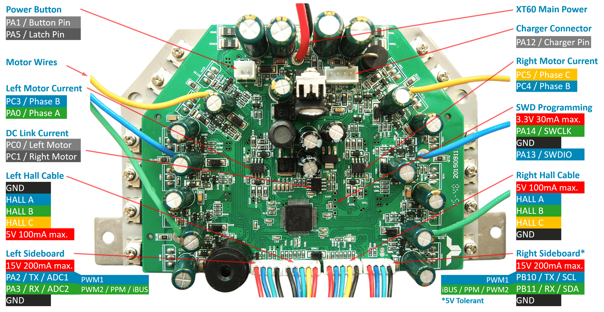

# STM32F103 mainboard firmware

The active firmware for the STM32F103RCT6 torque node is the Rust workspace in
`rust/`. The C tree in `eferu-foc/` is a pinned upstream reference with the JBOT
patches. It stays in the repository because it documents the hardware and is a
known-good hoverboard build, **not** because it is the firmware for this
self-balancing robot.

## Layout

| Path | Role |
|---|---|
| `rust/f103_core/` | Hardware-independent logic: FOC port, protocol, alerts, safety, battery, thermal, console, trace. Host-tested. |
| `rust/f103_fw/` | PAC/HAL firmware for the F103: clocks, TIM1/TIM8, ADC/DMA, both UARTs, IWDG, ISRs. |
| `rust/tools/calibration/` | Console bridge, binary trace decoder, build/flash script. |
| `rust/tools/foc_golden/` | Host recorder and golden vectors from the unmodified generated C controller. |
| `eferu-foc/` | Pinned EFeru C firmware, JBOT patches and upstream documentation. Reference and rollback only. |

## Board pinout



The same image and the pin tables are in `../docs/hardware.md`. The upstream
reference also contains schematics and photos under
`eferu-foc/eferu/docs/`.

## Active firmware (Rust)

- The 16 kHz FOC controller is a bit-exact fixed-point port of the generated C
  controller, replayed against golden vectors in `rust/tools/foc_golden/`.
- USART2 (PA2/PA3, 115200 8N1) carries the stock 8-byte command and 18-byte
  feedback frames used by the Pico link. USART3 (PB10/PB11, 115200 8N1) is a
  separate text/binary debug console (`$GET`, `$GETP`, `$WATCH`, `$TRACE`,
  `$DUMP`, `$ADC`, `$SAVE`, ...).
- The link-loss timeout is monitored from boot and drives the three low-pitch
  buzzer beeps, matching the old firmware's warning. Missing or stale commands
  always force the safe output.
- The default build keeps **MOE low**: the torque loop can be observed on the
  bench, but no gate can be driven until HIL validation and explicit sign-off.
  The `moe` Cargo feature is the only path that writes `BDTR.MOE`.

### Checks and build

From `firmware/stm32f103/rust`:

```sh
cargo fmt --all -- --check
cargo test -p f103_core
cargo clippy -p f103_core --all-targets -- -D warnings
cd f103_fw && cargo build --release
```

The release image is built and packaged by `rust/tools/calibration/flash.sh`.
Run it without arguments to build, check the size limit and print the flash
command; `--flash` performs the write and needs explicit approval.

### Flashing the mainboard

Hardware: ST-Link V2, **SWDIO, SWCLK and GND only**. There is no NRST wire.

1. Power the mainboard and hold its power button during the whole write. The
   firmware-owned latch on PA5 is released on reset; without the button held,
   `st-flash` reports `NRST is not connected` and `Failed to connect to target`.
2. Run `./flash.sh --flash` from `rust/tools/calibration/`.
3. Confirm the Pico bridge reports a fresh feedback frame after boot.

Do not use `st-flash --connect-under-reset` with this wiring.

## Reference C firmware (`eferu-foc/`)

The pinned upstream checkout `eferu-foc/eferu/` (commit `4f141cb`) is kept as a
hardware reference and rollback artifact, **not** as the active firmware. Do not
push to its upstream remote. It documents measured facts the Rust port relies
on: timer and ADC/DMA topology, dead time, hall/phase mapping, current scales,
board variants, schematics and photos in `eferu-foc/eferu/docs/`.

It is a working `VARIANT_USART` / `FOC_CTRL` / `TRQ_MODE` build for a normal
hoverboard (10 A / 12 A / 400 rpm, `SERIAL_TIMEOUT = 160`, legacy 8/18-byte
frames on USART2, debug text on USART3). It is not suitable for a self-balancing
robot: link loss ends in `OPEN_MODE` freewheel only after about 800 ms,
inactivity or low battery latches power off, the protocol has only an XOR
checksum, and balancing is marked `TODO` in the upstream source.

The JBOT configuration files live next to the checkout:
`eferu-config.patch`, `eferu-jbot-config.h`, `eferu-jbot.patch` (history) and
`eferu-bench.patch` (not applied). Build, restore and flashing details are in
`eferu-foc/README.md`; keep `I_MOT_MAX` at 10 A unless MOSFET and pack
temperatures have been measured.
